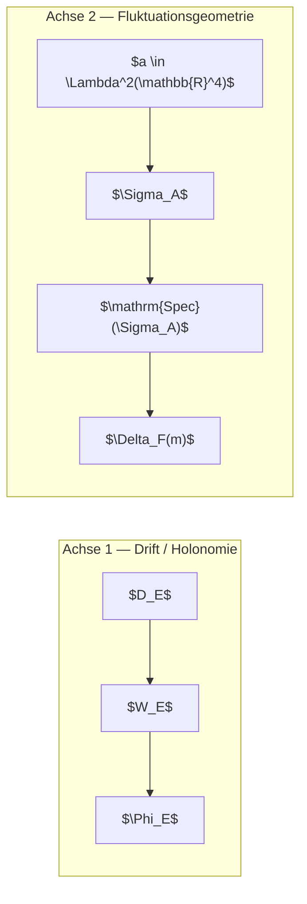

# EABC-Zirkulationshypothese

**Status:** Detailhypothese (Zählgrößen, Fehlerterm, Prime Race) — **primäre kanonische Formulierung:** `collatz_eabc_diskrete_geometrie.md`  
**Branch:** `collatz/eabc-05-holonomie-fehlerterm` (PR #59)  
**Tao-Labels:** Definition | Vermutung | Hypothese | Experiment | Analogie

$$\boxed{\;\text{Primärdokument: } \texttt{collatz\_eabc\_diskrete\_geometrie.md} \text{ — } \Phi_E,\; E^\pm,\; \langle\omega_E,h\rangle.\;}$$

**Querverweise:**
- `collatz_eabc_diskrete_geometrie.md` — **kanonisch:** $G_E$, $E^+$, $E^-$, $\Phi_E$, EABC-Vermutung, drei Ebenen
- `collatz_eabc_holonomie_stufen.md` — drei Stufen (Analogie / echte Holonomie / Wilson) + Fall A/B/C in $N$
- `collatz_eabc_epistemik_physik.md` — **kanonische Abgrenzung:** Holonomie/Zirkulation ja; Zwillingsparadoxon/Zeitdilatation nein
- `collatz_eabc_epistemik_schichten.md` — Schichten A/B/C/R; Lakatos-Einordnung und Ebenen 0–4 in §4; state-centric Hierarchie §0 + §4.7; asymptotische Chiralität in §4.1; erster Belastungstest harter Kern in §4.3; Literaturpositionierung in §4.5; Level-2-Fluktuationsgeometrie in §4.8; Spin-Liquid-Analogie (methodisch) in §4.8.1; Nullmodell-Hierarchie in §4.8.2; Fibonacci-Kamm-Hypothese (paper-ready) in §4.8.5; **EABC–Fibonacci-Kamm-Kopplung (Gesamtbaustein)** in §4.8.6; **Wissenschaftstheoretische Einordnung und Hypothesenleiter** in §4.8.7; **Beobachtungsgeometrie als Kompressionsoperator, strukturstabile Kompression** in §4.8.8; numerischer Robustheitstest (Stub) §4.8.9; **Orientierungsvektor-Erweiterung (Gedankenexperiment)** §4.8.10; **diskrete Orientierungsgeometrie vs. etablierte QM (Hypothese, nicht Erklärung)** §4.8.11; **SU(2)-Prüfstein und Orientierungshebung** §4.8.12; **Wirkungsquantum vs. Richtungsquantisierung (Gedankenexperiment)** §4.8.13; **Prägeometrie der Wirkung: $(\hbar,\sigma)$** §4.8.14 (Präzisierung: Phasenraum-Orientierung statt Raumrichtung, Abschnitt 9); **Symplektische Orientierung und EABC-Vierfachstruktur** §4.8.15; **Lean-Formalismus und Schichtentrennung** §4.8.16; **Lean-Theorem-Backlog (Stufe 0–4)** §4.8.17; Zeta-Exponential-Gedankenexperiment (Schicht **C**) in §4.9
- `collatz_eabc_zeta_exponential_gedankenexperiment.md` — **Gedankenexperiment / Analogie:** $\zeta$ als Exponentialsumme auf Log-Prim-Geometrie; Euler-Streifen $(1\pm p^{-s})$; $\xi$-Spiegelung; Brücke zu Log-Koordinaten, $\gamma^\pm$-Paarung, Level-2; §6–§10: Ganzzahl/Halbzahl-Exponenten, Oktanionen (Schicht C), Bernoulli-Subtraktion, Fibonacci-Zeta (kein RH-/EABC-Theorem)
- `collatz_eabc_zirkulation_spektral.md` — Spektralgeometrie, diskrete 1-Form $\alpha$, $\mathrm{Spec}(L_E)$
- `collatz_eabc_fehlerterm_hypothese.md` — **Teilhypothese:** Fehlerterm $D_E$, $\widetilde{D}_E$ (eingebettet in §5)
- `collatz_eabc_sagnac.md` — **Intuition only:** Sagnac-Bild für $\gamma^\pm$ (kein physikalischer Kern)
- `collatz_eabc_zyklus_holonomie.md` — Hierarchie Klasse→Kante→Pfad→Zyklus→Holonomie
- `collatz_eabc_transport.md` — $G_E$, Transport $T_n$
- `collatz_eabc_bell_holonomie.md` — **sekundäre** Analogie Bell/CHSH (nicht primäre Lesart)
- `collatz_eabc_holonomie_beweisversuch.md` — analytischer Beweisversuch
- `collatz_eabc_sagnac_circulation.py` — $C_E(X)$, $\omega(e)$, $\alpha$
- `collatz_eabc_holonomie_fehlerterm.py` — $N_\pm$, $D_E$, $S_E$, $\widetilde{D}_E$
- `eabc_quadruplets_1e10.py` — Vierlings-Zählung bis $X$, $W_E$, $R_\beta$ (`Z_E` nur Diagnose-Alias), mod-$420$-Diagnostik
- `eabc_witness_54044321_verify.py` — Verifikation Zeuge $p=54\,044\,321$ (§4.4, mod-$60060$-Kanal)
- `eabc_quadruplets_fit_alpha.py` — Stufen 0–3: Diagnostik (nicht Theorie); $\alpha_E$-Plateau, H₀a/H₀b–H₃
- `eabc_quadruplets_plot.py` — Vierfeld-Diagnose-Plot ($W_E$, $R_{1/2}$, $\alpha_{\mathrm{loc}}$, $R_\beta$)
- `eabc_occupancy_tree.py` — monoidale Vierlings-Besetzungszustände $Z=(O,T,n)$, Williams-Baum (§4.6–4.7)
- `collatz_eabc_core/CollatzEabc/OccupancyMonoid.lean` — Lean: kommutatives Monoid $(Z,\oplus,Z_0)$, `blockScan_append` (§4.6–4.7; Build-Artefakt, Quelle ggf. auf Hauptbranch)
- `collatz_eabc_core/CollatzEabc/EABCCompression.lean` — Lean: $\mathcal{C}_E$, Stufe 0–4 Backlog (§4.8.17, Schicht **A**/**B**/**R**)
- `collatz_eabc_graph_laplacian.py` — $\mathrm{Spec}(L_E)$
- `collatz_eabc_evolution_analytik.md` — **Evolutionspfad** Bell→Sagnac→$C_E$→$\mathrm{Spec}(L_E)$, Wachstumsszenarien, Dirichlet-Stub
- `collatz_eabc_D_growth.py` — Wachstumsdiagnostik $D_E(X)$, Charakter-Koeffizienten $a_\chi$
- `collatz_eabc_kritische_abbildung.md` — **Modellabbildung:** Geschwindigkeitsmodell $s_v(x)$, ABCEA/CEABC in der komplexen Ebene; **Holonomie-Sensor** $v_j=\gamma_{\mathrm{ref}}/\ell_j$
- `collatz_eabc_chirale_polarisation.md` — **Helizität** $\lambda=\pm 1$, $N_R/N_L$, $\phi_R/\phi_L$, Stufe-2-Upgrade
- `collatz_eabc_brachistochrone.md` — $T_R$, $T_L$, Birefringenz-Analogie
- `collatz_eabc_wigner_analog.md` — Wigner-Analogie: $W_E$ (4-Pfad) vs. $D_E$ (5-Zyklus), $W_{ab}$
- `collatz_eabc_uebergangsraum.md` — **Detail:** $C_4\cong S^1$, $\langle\omega_E,h\rangle$, $L_{\mathrm{mag}}$
- `collatz_eabc_signierte_massstruktur.md` — signierte Maßstruktur auf $G_E$, arithmetische Wigner-Negativität
- `collatz_eabc_hodge_eabc.py` — `Phi_E`, `flux_density_limit`, `harmonic_holonomy_component`, `magnetic_laplacian`
- `collatz_eabc_kritische_abbildung.py` — Numerik $x_{n,v}$, Schaltkreis-Trajektorien, `edge_velocities_from_gaps`, `holonomy_sensor_trajectory`
- `collatz_generalangriff_2026.md` — Gesamtarchitektur PR #54 / PR #59

---

## 0. Boxed These (verweist auf kanonisches Dokument)

$$\boxed{\;\text{EABC = Theorie des priminduzierten Flusses auf } C_4\cong S^1 \text{ — nicht Zählstatistik ABCE/CEAB.}\;}$$

Vollständige paper-ready Definitionen ($G_E$, $E^\pm$, $\Phi_E$, Vermutungen): **`collatz_eabc_diskrete_geometrie.md`**.

$$\boxed{\;\text{Shift: } E(a,b) \;\to\; \oint_\gamma \alpha \quad\text{(Paarstatistik } \to \text{ Zyklusgeometrie).}\;}$$

**Epistemische Abgrenzung:** Das EABC-Programm ist **keine** Bell-Korrelationstheorie und **kein** quantenphysikalischer Effekt. Es ist **diskrete Zirkulation** auf einem gerichteten Restklassengraphen.

---

## 1. Setup

**Zustandsraum:**
$$V = \{E, A, B, C\},\qquad E\equiv 1,\; A\equiv 5,\; B\equiv 7,\; C\equiv 11 \pmod{12}.$$

**Primfolge-Labels:**
$$X_n := \kappa(p_n),$$
wobei $(p_n)_{n\ge 1}$ die aufsteigende Folge aller Primzahlen $>3$ ist.

**Gerichteter Pfad auf $V$:** Aufeinanderfolgende Transportkanten
$$\tau_n := (X_n, X_{n+1}) = (\kappa(p_n), \kappa(p_{n+1}))$$
bilden einen **gerichteten Pfad** auf dem EABC-Transportgraphen $G_E=(V,E)$.

**Elementarer Zyklus:**
$$A \longrightarrow B \longrightarrow C \longrightarrow E \longrightarrow A.$$

**Label:** $V$, $X_n$, $\tau_n$, elementarer Zyklus = **Definition**.

---

## 2. Zwei Orientierungen

Auf demselben $C_4$-Gerüst $A\!\to\!B\!\to\!C\!\to\!E\!\to\!A$ betrachten wir zwei **Orientierungen** in $H_1(C_4,\mathbb{Z})$:

| Orientierung | Wort | Vorzeichen |
|--------------|------|------------|
| $\gamma^+$ | ABCEA | $+1$ | $R$ ($\lambda=+1$) |
| $\gamma^-$ | CEABC | $-1$ | $L$ ($\lambda=-1$) |

**Chirale Lesart** (`collatz_eabc_chirale_polarisation.md`): $C_E = \sum \omega(\gamma) = N_R - N_L$ als diskreter **Chiralitätsfluss** / Polarisationsoperator — nicht nur Umlaufzahl.

Beide Wörter tragen dasselbe Lückenmuster $(2,4,2,4)$ mod $12$; sie unterscheiden sich durch **zyklische Verschiebung** der Orientierung auf demselben Zyklus.

**Geschlossenes 5-Fenster:**
$$C_n^{(5)} := (X_n, X_{n+1}, X_{n+2}, X_{n+3}, X_{n+4}).$$

**Label:** $\gamma^\pm$, ABCEA, CEABC = **Definition**.

---

## 3. Zählgrößen und Zirkulation

Für Prim-Obergrenze $X$:

$$N_+(X) := \#\{n:\,p_{n+4}\le X,\; C_n^{(5)}=\mathrm{ABCEA}\},$$
$$N_-(X) := \#\{n:\,p_{n+4}\le X,\; C_n^{(5)}=\mathrm{CEABC}\}.$$

**Legacy-Aliase:** $N_{\mathrm{ABCEA}}:=N_+$, $N_{\mathrm{CEABC}}:=N_-$.

**Zirkulation:**
$$C_E(X) := N_+(X) - N_-(X).$$

**Normalisierte Observable:**
$$S_E(X) := \frac{N_+(X) - N_-(X)}{N_+(X) + N_-(X)} = \frac{C_E(X)}{N_+(X)+N_-(X)}.$$

**Fehlerterm (Alias):**
$$D_E(X) := N_+(X) - N_-(X) = C_E(X).$$

**Normalisierter Fehlerterm:**
$$\widetilde{D}_E(X) := \frac{D_E(X)}{\sqrt{N_+(X)+N_-(X)}}.$$

**Legacy-Aliase:** $\Delta_E(X):=D_E(X)$; $\chi_{\mathrm{Hol}}(X):=S_E(X)$; $\mathrm{Hol}_E:=\lim_{X\to\infty} S_E(X)$.

$$\boxed{\;C_E(X) = N_+(X) - N_-(X) = D_E(X).\;}$$

**Label:** $N_\pm$, $C_E$, $S_E$, $D_E$, $\widetilde{D}_E$ = **Definition**.

---

## 4. Einleitung: Paradigmenwechsel und orientierter Zirkulationsfehler

$$\boxed{\;\text{Der größte Fortschritt ist nicht die Einführung neuer Größen, sondern die Entkopplung des Programms von }\Phi_E.\;}$$

Ein negatives $\Phi_E$-Ergebnis ist **Antwort auf eine von mehreren Fragen**, nicht Projekt-Zusammenbruch.

### Forschungsprogramm vs. Theorie

**Gegenwärtiger Status:** EABC ist wissenschaftstheoretisch eher **Forschungsprogramm** als bereits **Theorie**.

| Begriff | Inhalt |
|---------|--------|
| **Theorie** | erklärt einen zusammenhängenden Phänomenbereich durch einen stabilen Prinzipiensatz |
| **Forschungsprogramm** | definiert Gegenstandsbereich, Observablen, Invarianten, Hierarchie offener Fragen |

Genau das ist hier passiert — explizit in diesem Abschnitt (neben/ergänzend zur Lakatos-Einordnung unten). Das Programm legt fest, **was** untersucht wird ($G_E$, $D_E$, Skalierungsobservablen), **welche** Fragen in welcher Reihenfolge sinnvoll sind, und **welche** Aussagen den harten Kern nicht berühren dürfen.

### Konservative Paper-Einleitung

> Wir betrachten einen gerichteten Restklassengraphen $G_E$, der aus den vier nichttrivialen Restklassen modulo $12$ besteht. Aus der durch die Primzahlfolge induzierten Orientierung ergeben sich Zykluszählfunktionen $N_+(X)$ und $N_-(X)$ sowie die orientierte Zyklusdifferenz $D_E(X)=N_+(X)-N_-(X)$. Ziel der vorliegenden Untersuchung ist die Analyse der Größenordnung und Skalierung dieser Differenz. Hierzu werden normierte Observablen $R_\beta(X)$, lokale Skalierungsgrößen $\alpha_{\mathrm{eff}}(X)$ sowie die normierte Orientierung $W_E(X)$ betrachtet. Die Frage nach der Existenz eines asymptotischen Orientierungsparameters $\Phi_E=\lim W_E(X)$ wird als mögliche Endstufe einer allgemeineren Untersuchung der Skalierungsstruktur von $D_E(X)$ verstanden und **nicht** als Ausgangsannahme vorausgesetzt.

**Referee-Perspektive:** „Ich glaube noch nicht $\Phi_E\neq 0$ — aber $D_E(X)$ ist definiert und ihre Größenordnung untersuchbar." Die methodische Verschiebung geht von „Ist die Vermutung wahr?" zu „Welche Eigenschaften besitzt die Observable?"

$$\boxed{\;\text{Das EABC-Programm untersucht primär die Wachstumsordnung der orientierten Zyklusdifferenz }D_E(X)\text{, während die Holonomie }\Phi_E\text{ als mögliche Endstufe dieser Skalierungstheorie erscheint.}\;}$$

**Programm (primär):** Fehlertermtheorie des **orientierten Zirkulationsfehlers** $D_E(X)=A(X)-C(X)$ auf dem EABC-Kreisgraphen — Prime-Race-/Fehlertermstruktur zwischen den gegenläufigen Zyklusorientierungen $\gamma^+$ (ABCEA) und $\gamma^-$ (CEABC). Die Holonomiefrage ($\Phi_E\neq 0$) ist **Ebene 4** (§4.2), nicht Eingangsthese.

**Paradigmenwechsel** (Verschiebung des mathematischen Objekts, nicht nur methodische Verbesserung):

| Früher | Jetzt |
|--------|-------|
| **Grenzwerttheorie** $W_E\to\Phi_E\neq 0$ (Ergodentheorie / Dichtetheorie) | **Fehlertermtheorie** $D_E(X)=N_+(X)-N_-(X)$ (analytische Zahlentheorie) |
| Eingangsfrage: existiert nichttrivialer Grenzwert? | Eingangsfrage: welche Wachstumsordnung hat $|D_E|$ relativ zu $Q$? |

Die Verschiebung $\Phi_E \to D_E$ ändert das **mathematische Objekt** des Programms: nicht der normierte Quotient steht im Zentrum, sondern die absolute orientierte Zyklusdifferenz als primäre arithmetische Observable. Der Forschungsgegenstand ist von einer einzelnen Vermutung entkoppelt.

### Lakatos-Einordnung und Programmversionen

Im Sinne eines **Lakatos'schen Forschungsprogramms** (harter Kern, Schutzmantel, progressive vs. degenerative Verschiebungen):

| Rolle | Objekt | Ebene |
|-------|--------|-------|
| **Harter Kern** | gerichteter EABC-Kreisgraph $G_E$; orientierte Zyklusdifferenz $D_E(X)=N_+(X)-N_-(X)$; daraus induzierte Skalierungsobservablen | 0–1 |
| **Primäre Theorie** | $D_E(X)$, $Q(X)=N_+(X)+N_-(X)$ | 1 |
| **Sekundäre Schutzmantel** | $R_\beta$, $\alpha_{\mathrm{loc}}$, $\alpha_{\mathrm{eff}}$, $\alpha_E$ | 2 |
| **Orientierung** | $W_E(X)=D_E(X)/Q(X)$ | 3 |
| **Endfrage** | $\Phi_E=\lim_{X\to\infty} W_E(X)$ | 4 |

Der **harte Kern** ist nicht mehr „Holonomie", sondern: (1) der gerichtete EABC-Kreisgraph $G_E$, (2) die orientierte Zyklusdifferenz $D_E(X)$, (3) die daraus induzierte Familie von Skalierungsobservablen. Erst darauf bauen alle weiteren Fragen.

$$\boxed{\;\text{Das Programm hängt nicht mehr an einer Vermutung.}\;}$$

**Programmversionen** (Paradigmenwechsel in epistemischer Lesart):

| | **V1** (früher) | **V2** (jetzt) |
|---|-----------------|----------------|
| Eingang | $\Phi_E\neq 0$ als Leitvermutung (Grenzwerttheorie) | $D_E(X)$, $|D_E|$ relativ zu $Q$ als Leitfrage (Fehlertermtheorie) |
| Hilfsgrößen | $W_E$, Skalierung nachträglich zur Stützung von $\Phi_E$ | $R_\beta$, $\alpha_{\mathrm{loc}}$, $\alpha_E$ dienen der $D_E$-Theorie |
| $\Phi_E$ | Zielobjekt / Eingangsfrage | **Endfrage** der $D_E$-Skalierungstheorie (falls $\alpha_E=1$ und der Grenzwert existiert) |

**Stabilisierungskette** (Vorwärtsführung; $\Rightarrow$ für bewiesene Implikationen, $\leadsto$ für offene Fragen):

$$G_E \;\leadsto\; (D_E,\,Q_E) \;\leadsto\; (R_\beta,\,\alpha_{\mathrm{eff}},\,\alpha_{\mathrm{loc}}) \;\leadsto\; (\alpha_E,\,W_E) \;\leadsto\; \Phi_E.$$

Selbst $\Phi_E=0$ bleibt **wissenschaftlich interessant**: offen bleiben $\alpha_E=\tfrac{1}{2}$?, $\alpha_E>\tfrac{1}{2}$?, $\alpha_{\mathrm{loc}}$-Plateaus?, kritische $R_\beta$ — als eigenständige Prime-Race-/Fehlertermstruktur auf dem EABC-Zyklus (vgl. §4.2).

**Hauptterm-Vermutung.** Asymptotische Symmetrie der gegenläufigen Zyklusorientierungen:
$$N_+(X) \sim N_-(X)\qquad (X\to\infty),$$
und damit
$$S_E(X) \to 0.$$

**Sekundäre Frage (Ebene 4).** Normalisierter Magnetfluss / arithmetische Orientierungsklasse (`collatz_eabc_diskrete_geometrie.md` §2):
$$\Phi_E := \lim_{X\to\infty} W_E(X) = \lim_{X\to\infty}\frac{C_E(X)}{N_+(X)+N_-(X)} \;\stackrel{?}{\neq}\; 0.$$

$$\boxed{\;\text{Ob die Wachstumsordnung von }D_E\text{ bis zur linearen Skala }(|D_E|\asymp Q)\text{ reicht und damit eine nichtverschwindende Holonomie }\Phi_E\text{ erzeugt — sekundäre Frage (Ebene 4).}\;}$$

| Grenzfall | Folgerung |
|-----------|-----------|
| $\lim S_E = 0$ | keine bevorzugte globale Orientierung (Hauptterm) |
| $\lim S_E \neq 0$ | nichttriviale **arithmetische Orientierungsklasse** (H₃) |

**Numerik:** `flux_density_limit` in `collatz_eabc_hodge_eabc.py`.

**Label:** Hauptterm-Vermutung = **Vermutung**; Orientierungsfrage (H₃) = **Vermutung** / **Forschungsfrage** (Ebene 4).

### 4.1 Asymptotische Chiralität (methodische Lesart)

$$\boxed{\;\text{Die EABC-Holonomie-Vermutung behauptet eine asymptotisch stabile, nichtverschwindende Richtungspräferenz der priminduzierten Zyklen auf dem EABC-Kreisgraphen.}\;}$$

**Kerngröße** (Schicht **B**, Definition):

$$W_E(X) = \frac{N_+(X)-N_-(X)}{N_+(X)+N_-(X)}$$

| Status | Aussage | Lean (`HolonomyCore.lean`) |
|--------|---------|---------------------------|
| **GREEN** | $-1 \le W_E(X) \le 1$ für alle $X$ | `W_E_bounds` (bewiesen) |
| **RED** | $\displaystyle\lim_{X\to\infty} W_E(X) = \Phi_E \neq 0$ | `HasNonzeroHolonomyLimit`, `EABC_holonomy_limit_conjecture` (`sorry`) |

**Asymptotische Chiralität** heißt: $W_E(X)$ **stabilisiert sich asymptotisch gegen einen Grenzwert** $\Phi_E$ — eine **asymptotisch nichtverschwindende Orientierungspräferenz** auf $C_4$. Das ist weder „Ruhe“ der Einzelprimzahlen noch eine metaphorische „statistische Ruhe im Unendlichen“; lokal bleibt die Primfolge chaotisch.

| Lesart | Inhalt | Label |
|--------|--------|-------|
| **Definition** | $N_\pm(X)$ zählt ABCEA- bzw. CEABC-Fenster unter der Bedingung $p_{n+4}\le X$; $W_E(X)$ ist der Quotient oben. Primzahlen **laufen** nicht — es gibt nur eine **priminduzierte EABC-Zählung** auf $G_E$. | **Definition** (Schicht **B**) |
| **Vermutung (stark)** | $\exists\,\Phi\neq 0:\; W_E(X)\to\Phi$ — asymptotisch nichtverschwindende Orientierungspräferenz / asymptotische Chiralität. | **Vermutung** (Schicht **R**) |
| **Vermutung (konservativ, Hauptterm)** | $N_+(X)\sim N_-(X)\;\Rightarrow\;\Phi_E=0$ — Symmetrie der gegenläufigen Zyklusorientierungen. | **Vermutung** (Schicht **B**/**R**) |
| **Experiment** | Numerik bei endlichem $X$ (z. B. $X\approx 10^6$, $W_E\approx 0{,}12$) ist **Stichprobe**, kein Beweis des Grenzwerts. | **Experiment** |

**Methodische Präzisionen (populärwissenschaftliche Lesart vermeiden):**

1. **Kein Lauf-Bild.** Metaphern wie „Primzahlen laufen im Kreis“ gehören zur Ikone-Spur (Schicht **C**). Mathematisch fixiert ist nur $N_\pm(X)$ und der daraus gebildete Quotient $W_E(X)$ auf Schicht **B**.
2. **Stabilisierung des Quotienten.** Selbst wenn $W_E(X)\to\Phi_E\neq 0$, bleibt die Primfolge lokal chaotisch; **$W_E(X)$ stabilisiert sich asymptotisch gegen einen Grenzwert**, nicht die Einzelereignisse $C_n^{(5)}$.
3. **Keine unumkehrbare Tendenz.** Eine nichttriviale Grenzpräferenz $\Phi_E\neq 0$ ist eine **asymptotisch nichtverschwindende Orientierungspräferenz** — keine behauptete „unumkehrbare“ physikalische Tendenz.
4. **Zwei konkurrierende asymptotische Lesarten.** Die **starke EABC-Vermutung** ($\Phi_E\neq 0$) und die **konservative Nullhypothese** ($N_+\sim N_-\Rightarrow\Phi_E=0$, vgl. Hauptterm oben) sind bewusst getrennt zu halten — Experimente entscheiden nicht zwischen ihnen.

### 4.2 Fünf-Ebenen-Architektur und Hypothesenhierarchie (H₀a/H₀b–H₃)

$$\boxed{\;\text{Nicht }\Phi_E\text{ ist der Anfang, sondern }D_E(X).\;}$$

**Vorwärtskette** (bewiesene Implikationen: $\Rightarrow$; offene Forschungsfragen: $\leadsto$):
$$G_E \;\leadsto\; D_E(X) \;\leadsto\; \alpha_E \;\leadsto\; W_E(X) \;\leadsto\; \Phi_E.$$
$$\Phi_E \neq 0 \;\Longrightarrow\; D_E(X)\sim\Phi_E\,Q(X) \;\Longrightarrow\; \alpha_E=1 \quad\text{(nur diese Richtung; keine Äquivalenz).}$$

$$\boxed{\;\begin{array}{c}\textbf{Ebene 0 — Geometrie:}\; G_E=(E,A,B,C),\;\gamma^+=\mathrm{ABCEA},\;\gamma^-=\mathrm{CEABC}\\[4pt]\textbf{Ebene 1 — Zirkulationsfehler:}\; D_E(X)=N_+(X)-N_-(X)\;\text{(primäre arithmetische Observable)}\\[4pt]\textbf{Ebene 2 — Skalierung:}\; R_\beta(X)=D_E(X)/Q(X)^\beta,\;\alpha_{\mathrm{loc}}(X)=\Delta\log|D_E|/\Delta\log Q,\;\alpha_E=\lim\alpha_{\mathrm{loc}}(X)?\\[4pt]\textbf{Ebene 3 — Orientierung:}\; W_E(X)=D_E(X)/Q(X)\\[4pt]\textbf{Ebene 4 — Holonomie:}\; \Phi_E=\lim_{X\to\infty} W_E(X)\end{array}\;}$$

**Referee-sicher:** Scheitern von $\Phi_E\neq 0$ zerstört das Programm nicht. Selbst bei $\Phi_E=0$ bleiben eigenständige Probleme: $\alpha_E=\tfrac{1}{2}$? $\alpha_E>\tfrac{1}{2}$? $\alpha_{\mathrm{loc}}$-Plateaus? kritische $R_\beta$ — als Prime-Race-/Fehlertermstruktur auf dem EABC-Zyklus.

**Methodische Leitlinie (Tao-Stil):** Fünf **Ebenen** — Geometrie → Fehlerterm → Skalierung → Orientierung → Holonomie. Keine Exponentenannahme vor Ebene 2; Holonomie-Hypothese (Ebene 4) **am Ende**, nicht am Anfang. Die Hypothesen H₀a–H₃ referenzieren jeweils eine Ebene; sie ersetzen sie nicht.

#### Ebene 0 — Geometrie

**Kreisgraph** $G_E=(V,E)$ mit $V=\{E,A,B,C\}$ (Restklassen $1,5,7,11$ mod $12$). Zwei **orientierte Zyklen** in $H_1(C_4,\mathbb{Z})$:

| Orientierung | Wort | Vorzeichen |
|--------------|------|------------|
| $\gamma^+$ | ABCEA | $+1$ |
| $\gamma^-$ | CEABC | $-1$ |

Beide tragen dasselbe Lückenmuster $(2,4,2,4)$; sie unterscheiden sich durch **zyklische Verschiebung** der Orientierung auf demselben $C_4$-Gerüst. Vollständige Definitionen: §1–2, `collatz_eabc_diskrete_geometrie.md`.

**Label:** **Definition** (Ebene 0).

#### Ebene 1 — Zirkulationsfehler (primäre Observable)

$$A(X) := N_+(X)\quad(\mathrm{ABCEA}),\qquad C(X) := N_-(X)\quad(\mathrm{CEABC}),$$
$$D_E(X) := A(X)-C(X) = N_+(X)-N_-(X),\qquad Q(X) := A(X)+C(X).$$

$D_E(X)$ ist die **primäre arithmetische Observable** des EABC-Programms — absolute orientierte Zyklusdifferenz, nicht normierter Quotient. Prime-Race-Analogie: wie $\Delta(x)=\pi(x;a,q)-\pi(x;b,q)$ fragt man zuerst nach der **Größenordnung** von $|D_E|$.

**Label:** **Definition** (Ebene 1).

#### Ebene 2 — Skalierung

$$R_\beta(X) := \frac{D_E(X)}{Q(X)^\beta}\quad(\beta\in\mathbb{R}_+).$$

Man untersucht $R_\beta(X)$ **ohne** die Existenz eines Exponenten vorauszusetzen: bleibt $R_{1/2}$ beschränkt? wächst $R_{2/3}$? Kein Zufallsmodell, keine Vermutung auf dieser Ebene.

**Lokale Skalierung** (numerisch primär):
$$\alpha_{\mathrm{loc}}(X_i) := \frac{\log|D_E(X_{i+1})| - \log|D_E(X_i)|}{\log Q(X_{i+1}) - \log Q(X_i)}\quad\text{zwischen Checkpoints }X_i, X_{i+1}.$$

**Grobe Gesamtindikation** (sekundär):
$$\alpha_{\mathrm{eff}}(X) := \frac{\log|D_E(X)|}{\log Q(X)}\quad (D_E\neq 0,\; Q>1).$$

**$\alpha_{\mathrm{loc}}$ ist für die Numerik wichtiger:** Drift, Übergangsbereiche und transiente Plateaus werden sichtbar, die $\alpha_{\mathrm{eff}}(X)$ als punktuelle Gesamtindikation überdeckt. **Wichtiger Vorbehalt:** $\alpha_{\mathrm{loc}}$ **muss nicht konvergieren** — in der analytischen Zahlentheorie kann ein Exponent über lange Bereiche stabil erscheinen und später driften oder oszillieren.

**Asymptotischer Exponent** (Vermutung, erst wenn Daten es nahelegen):
$$\boxed{\;\text{Existiert }\alpha_E\text{ mit }|D_E(X)|=Q(X)^{\alpha_E+o(1)}\text{?}\;}$$
$$\alpha_E := \inf\{\beta\in\mathbb{R}_+ : R_\beta(X)\text{ bleibt beschränkt für }X\to\infty\}.$$

Formal: $\alpha_E=\lim_{X\to\infty}\alpha_{\mathrm{loc}}(X)$ **falls** der Limes existiert — offene Frage.

| Begriff | Rolle | Ebene |
|---------|-------|-------|
| **$D_E$, $Q$** | primäre Zählgrößen | 1 |
| **$R_\beta$** | Skalierungs-Observable | 2 |
| **$\alpha_{\mathrm{loc}}$** | lokale Skalierung (Numerik primär) | 2 |
| **$\alpha_{\mathrm{eff}}$** | grobe Gesamtindikation | 2 |
| **$\alpha_E$** | kritischer Exponent | 2 |

**Kein** $Z_E=D/\sqrt{Q}$ auf der Definitionsebene — nur $D_E$, $Q$, $R_\beta$. Spezialfälle: $R_1(X)=W_E(X)$; $R_{1/2}$, $R_{2/3}$, $R_{3/4}$, $R_{0.9}$ sind **diagnostische** Normierungen (Ebene 2), keine Kerngrößen.

**Heuristik** (Diskussion, nach Ebene 2): $Z_E := R_{1/2}(X)=D_E(X)/\sqrt{Q(X)}$ — in CSV/Plot als Spalte `R_1_2` bzw. Alias $Z_E$ (**Heuristik/Diagnose**). $\alpha_E=\tfrac{1}{2}$ entspräche einem **naiven Zufallsmodell** ($|D_E|\approx\sqrt{Q}$) — **Heuristik**, keine bewiesene Referenz.

**Testarchitektur** (Ebene 2):

| Observable | $\beta$ | Lesart |
|------------|---------|--------|
| $R_{1/2}$ | $\tfrac{1}{2}$ | Wurzelrauschen-Heuristik (H₀a/H₁) |
| $R_{2/3}$, $R_{3/4}$, $R_{0.9}$ | Zwischenwerte | sublinearer Bias (H₂-Diagnostik) |
| $R_1=W_E$ | $1$ | Orientierung (Ebene 3; H₀b/H₃) |

**Drei Skalierungsfälle** (an $\alpha_E$ gebunden, **unter H₂**):

| Fall | $\alpha_E$ | $R_{1/2}$ | $W_E$ | Lesart |
|------|------------|-----------|-------|--------|
| 1. Rauschen | $\le \tfrac{1}{2}$ | $O(1)$ | $\to 0$ | Wurzelrauschen (H₀a) |
| 2. Sublinearer Bias | $\tfrac{1}{2} < \alpha_E < 1$ | $\to\infty$ | $\to 0$ | arithmetischer Bias (H₁–H₂, nicht H₃) |
| 3. Starke Holonomie | $= 1$ | $\to\infty$ (langsamer als Fall 2) | $\to \Phi_E \neq 0$ | Holonomie-Grenzfall (H₃) |

Unter H₂ folgen formal: $W_E(X) \sim Q(X)^{\alpha_E-1}$, $R_{1/2}(X) \sim Q(X)^{\alpha_E-1/2}$, $R_\beta(X) \sim Q(X)^{\alpha_E-\beta}$.

**Wichtig:** Auch bei $\Phi_E=0$ kann $\alpha_E>\tfrac{1}{2}$ gelten — ein **eigenständiges arithmetisches Phänomen**, nicht äquivalent zur Holonomiefrage.

**Label:** $\alpha_E$ = **Definition** (Ebene 2); H₂ = **Hypothese**; $\alpha_{\mathrm{loc}}$-Diagnose / $\alpha_E$-Schätzung = **Experiment**.

#### Ebene 3 — Orientierung

$$W_E(X) := \frac{D_E(X)}{Q(X)} = \frac{N_+(X)-N_-(X)}{N_+(X)+N_-(X)}.$$

$W_E(X)$ ist **Definition** — kein Grenzwert, kein Exponent. Es misst die **normierte Orientierung** — unabhängig von jeder Skalierungsexponentenannahme.

$$\boxed{\;\text{Orientierung: }W_E(X)\to 0\quad\text{oder}\quad W_E(X)\to\Phi_E\neq 0\text{?}\;}$$

- **H₀b** (keine Orientierung): $W_E(X)\to 0$ — analytische Nullhypothese.
- **H₃-Vorstufe:** $W_E(X)$ stabilisiert sich gegen einen **nichtverschwindenden** Grenzwert — noch ohne Existenzbehauptung für $\Phi_E$.

**Label:** **Definition** (Ebene 3); H₀b = **Nullhypothese**.

#### Ebene 4 — Holonomie

$$\Phi_E := \lim_{X\to\infty} W_E(X)\quad\text{(falls der Grenzwert existiert).}$$

Holonomie **am Ende**, nicht am Anfang. Entspricht Lean-**RED** `HasNonzeroHolonomyLimit`, `EABC_holonomy_limit_conjecture`.

- **H₃** (starke Holonomie): $W_E(X)\to\Phi_E\neq 0$ — Vermutung.

**Label:** **Vermutung** (Ebene 4; Lean-RED).

#### Implikationskette (Referee-präzise)

$$\boxed{\;\Phi_E\neq 0 \;\Rightarrow\; D_E(X)\sim\Phi_E\,Q(X) \;\Rightarrow\; \alpha_E=1.\;}$$

**Nicht umgekehrt:** $\alpha_E=1$ impliziert **keinen** Grenzwert von $W_E$.

**Gegenbeispiel:** $D_E(X)=Q(X)\sin(\log\log Q(X))$ — $\alpha_E=1$, aber $W_E(X)$ **ohne** Grenzwert.

| Parameter | Stärke | Bedeutung |
|-----------|--------|-----------|
| **$\Phi_E$** | Orientierungsparameter (stärker) | normierter Grenzwert $W_E$ |
| **$\alpha_E$** | Skalenparameter (schwächer) | Größenordnung von $|D_E|$ relativ zu $Q$ |

Weitere Vorwärtsimplikationen (H₀a/H₀b–H₃):

- **H₃ $\Rightarrow$ H₂** (mit $\alpha_E=1$), aber **H₂ $\nRightarrow$ H₃** (jedes $\alpha_E\in(\tfrac{1}{2},1)$ lässt $W_E\to 0$).
- **H₂ $\Rightarrow$ H₁** auf hinreichend großen Skalen ($R_{1/2}\to\infty$), aber **H₁ $\nRightarrow$ H₂** (transienter Bias reicht nicht).
- **H₀b $\nRightarrow$ H₀a** und **H₀a $\nRightarrow$ H₀b** — analytische Orientierung und Wurzelnormierung sind **getrennte** Fragen.
- **H₂ mit $\alpha_E>\tfrac{1}{2}$ $\nRightarrow$ H₃** — auch $\Phi_E=0$ ist mit $\alpha_E>\tfrac{1}{2}$ vereinbar.

#### Boxed Kernfragen (entschärft)

1. **Ebene 1/2:** Welche Wachstumsordnung hat $D_E(X)$? Bleibt $R_{1/2}$ beschränkt? Was zeigt $\alpha_{\mathrm{loc}}$? — **$D_E$ zuerst.**
2. **Ebene 2:** Existiert $\alpha_E$ mit $|D_E(X)|=Q(X)^{\alpha_E+o(1)}$? — **nur wenn Daten es nahelegen.**
3. **Ebene 3/4:** Reicht die Wachstumsordnung bis zur linearen Skala und folgt $W_E(X)\to\Phi_E\neq 0$? — **Holonomie danach.**

#### Hypothesen (H₀a/H₀b–H₃)

Schrittweise Eskalation entlang der Ebenen: **1/2** Fehlerterm/Skalierung → **3** Orientierung → **4** Holonomie.

| Hypothese | Aussage | Ebene | Label |
|-----------|---------|-------|-------|
| **H₀a** (Wurzelrauschen) | $\alpha_E \le \tfrac{1}{2}$ — $R_{1/2}(X)$ **bleibt beschränkt** | 2 | **Heuristik** (naives Zufallsmodell) |
| **H₁** (mehr als Wurzelrauschen) | $\alpha_E > \tfrac{1}{2}$ empirisch — $R_{1/2}(X)\to\infty$ | 2 | **Experiment** |
| **H₂** (asymptotischer Bias) | $|D_E(X)| \asymp Q(X)^{\alpha_E}$ mit $\alpha_E > \tfrac{1}{2}$ asymptotisch | 2 | **Hypothese** (arithmetisch stark) |
| **H₀b** (keine Orientierung) | $W_E(X)\to 0$ — analytische Nullhypothese; **H₀b $\nRightarrow$ $\alpha_E\le\tfrac{1}{2}$** | 3 | **Nullhypothese** (analytisch) |
| **H₃** (starke Holonomie) | $W_E(X)\to\Phi_E\neq 0$ — impliziert $D_E(X)\sim\Phi_E Q(X)$, $\alpha_E=1$ | 4 | **Vermutung** (Lean-**RED**: `HasNonzeroHolonomyLimit`) |

#### Prime-Race-Analogie ($\pi(x)$–$\mathrm{Li}(x)$)

Klassisch trennt man beim Primzahlgesetz **Hauptterm** und **Fehlerterm**:

| Klassisch | EABC-Analog |
|-----------|-------------|
| Hauptterm $\mathrm{Li}(x)\sim x/\log x$ | Symmetrie $N_+(X)\sim N_-(X)$, $Q(X)\to\infty$ |
| Fehlerterm $\pi(x)-\mathrm{Li}(x)$ (Größenordnung zuerst) | $D_E(X)=N_+(X)-N_-(X)$ (absolute Zyklusdifferenz) |
| Prime Race $\Delta(x)=\pi(x;a,q)-\pi(x;b,q)$ | orientierter Race $\gamma^+$ vs. $\gamma^-$ auf demselben $C_4$-Zyklus |
| Quotient $\Delta(x)/(\pi(x;a,q)+\pi(x;b,q))$ (Grenzwert sekundär) | $W_E(X)=D_E/Q$, $\Phi_E=\lim W_E$ (Ebene 3/4) |

Wie bei $\pi(x)-\mathrm{Li}(x)$ und bei $\Delta(x)=\pi(x;a,q)-\pi(x;b,q)$ fragt man zuerst nach der **Größenordnung** von $|D_E|$ relativ zu $Q$ — nicht nach einem Grenzwert des Quotienten. $D_E(X)$ ist ein orientierter Prime Race auf demselben EABC-Zyklus. Die asymptotische Orientierungsfrage (Ebene 4: $W_E\to 0$ oder $\Phi_E\neq 0$) ist von der Skalierungsfrage (Ebene 2: $\alpha_E$ via $R_\beta$) **methodisch getrennt** — analog zur Trennung von $\pi(x)-\mathrm{Li}(x)$ und mod-$q$-Races.

**Numerik und Diagnose-Plot.** `eabc_quadruplets_1e10.py` erzeugt Checkpoints mit $Q$, $D_E$, $W_E$, $R_\beta$ für $\beta\in\{\tfrac{1}{2},\tfrac{2}{3},\tfrac{3}{4},0{,}9,1\}$ (CSV-Spalten `R_1_2`, `R_2_3`, `R_3_4`, `R_9_10`, `R_1`; Alias `Z_E`=`R_1_2` nur Diagnose), $\alpha_{\mathrm{eff}}$ (`eabc_quadruplets.csv`). `eabc_quadruplets_fit_alpha.py` strukturiert die Ausgabe nach **Ebenen 0–4**; schätzt $\alpha_E$ heuristisch aus $R_\beta$-Plateaus (**Experiment**, kein Theorem). `eabc_quadruplets_plot.py` (oder `fit_alpha --plot`) erzeugt ein Vierfeld-Diagramm (`eabc_quadruplets_diagnose.png`):

| Panel | Kurve | Ebene / Lesart |
|-------|-------|----------------|
| 1 | $R_{1/2}(X)$ ($Z_E$ Alias) | Ebene 2: Skalierung (H₀a / H₁) |
| 2 | $\alpha_{\mathrm{loc}}(X)$ | Ebene 2: $\alpha_{\mathrm{loc}}$-Diagnose (primär; kein Satz) |
| 3 | $R_\beta$ für $\beta\in\{\tfrac{1}{2},\tfrac{2}{3},\tfrac{3}{4},0{,}9,1\}$ | Ebene 2: Skalierungsdiagnostik |
| 4 | $W_E(X)=R_1(X)$ | Ebene 3/4: H₀b / H₃ (Orientierung / Holonomie) |

**Label:** Ebene 0/1 = **Definition**; Ebene 2 / H₂ = **Hypothese**; $\alpha_{\mathrm{loc}}$-Diagnose = **Experiment**; Ebene 4 / H₃ = **Vermutung** (Lean-RED); H₀a = **Heuristik**; H₀b = **Nullhypothese**.

### 4.3 Numerischer Stand und erster Belastungstest (bis $10^{10}$)

$$\boxed{\;\text{Zeigt }D_E(X)\text{ überhaupt ein reproduzierbares, nichttriviales Wachstum?}\;}$$

**Scope des Tests:** nur $(G_E,\,N_+,\,N_-,\,D_E)$ und die daraus abgeleiteten Skalierungsobservablen — **kein** $\Phi_E$, **keine** Holonomie. Der Belastungstest prüft den harten Kern (Ebene 0–2), nicht die Endfrage Ebene 4.

**Methodische Leitlinie (Tao-Stil):** Alle folgenden Befunde sind **Experimente** an endlichem $X$, keine Theoreme und keine Vermutungsbestätigungen. Die **Nullhypothese H₀a** lautet $|D_E(X)|=O(\sqrt{Q(X)})$, d. h. $R_{1/2}(X)=D_E(X)/\sqrt{Q(X)}$ bleibt beschränkt.

**Pipeline** (Vollauf bis $X=10^{10}$):

```bash
python3 eabc_quadruplets_1e10.py --X 10000000000
python3 eabc_quadruplets_fit_alpha.py eabc_quadruplets.csv --plot --plot-loglog
python3 eabc_quadruplets_plot.py eabc_quadruplets.csv --plot-loglog
```

**Checkpoint-Strategie:** geometrische Serie $10^e$, $2\times 10^e$, $5\times 10^e$ für $e=6,\ldots,10$ — **13 Checkpoints** in `eabc_quadruplets.csv`.

#### Boxed Hauptaussagen (Belastungstest $10^{10}$, Experiment)

$$\boxed{\;\text{Bis }10^{10}\text{ gibt es keinen numerischen Hinweis auf Holonomie }(\Phi_E\neq 0).\;}$$

$$\boxed{\;\text{Bis }10^{10}\text{ gibt es auch keinen klaren Hinweis auf einen sublinearen Bias }(\alpha_E>\tfrac{1}{2}).\;}$$

$$\boxed{\;\text{Bis }10^{10}\text{ verhält sich }D_E(X)\text{ vollständig kompatibel mit einem Fehlerterm auf Wurzelskala }(|D_E|=O(\sqrt{Q})).\;}$$

#### Datenstand (13 Checkpoints, Experiment)

**Kompakte Referenztabelle** (Schlüsselgrößen; vollständige Spalten in `eabc_quadruplets.csv`):

| $X$ | $Q$ | $D_E$ | $W_E$ | $R_{1/2}$ | $W_{420}$ |
|-----|-----|-------|-------|-----------|-----------|
| $10^6$ | 166 | $+2$ | 0,0120 | 0,15 | 0,218 |
| $2\times 10^6$ | 295 | $+9$ | 0,0305 | 0,52 | 0,184 |
| $5\times 10^6$ | 546 | $+24$ | 0,0440 | 1,03 | 0,220 |
| $10^7$ | 899 | $+1$ | 0,0011 | 0,03 | 0,140 |
| $2\times 10^7$ | 1468 | $-26$ | $-0,0177$ | $-0,68$ | 0,196 |
| $5\times 10^7$ | 2847 | $+27$ | 0,0095 | 0,51 | 0,129 |
| $10^8$ | 4768 | $+48$ | 0,0101 | 0,70 | 0,083 |
| $2\times 10^8$ | 8097 | $+63$ | 0,0078 | 0,70 | 0,048 |
| $5\times 10^8$ | 16331 | $+137$ | 0,0084 | 1,07 | 0,043 |
| $10^9$ | 28388 | $+52$ | 0,0018 | 0,31 | 0,026 |
| $2\times 10^9$ | 49262 | $-16$ | $-0,0003$ | $-0,07$ | 0,017 |
| $5\times 10^9$ | 102950 | $-58$ | $-0,0006$ | $-0,18$ | 0,008 |
| $10^{10}$ | 180529 | $+25$ | 0,00014 | 0,06 | 0,0065 |

**$D_E$:** schwaches Wachstum der absoluten Differenz; bei $X=10^{10}$ ist $D_E=25$ bei $Q=180529$ — nichttrivial ($D_E\neq 0$), aber weit unter linearer Skala ($|D_E|\ll Q$).

**$W_E$-Verlauf** (Orientierung, Ebene 3): $|W_E(10^6)|\approx 1{,}20\times 10^{-2}$, $|W_E(10^8)|\approx 1{,}01\times 10^{-2}$, $|W_E(10^{10})|\approx 1{,}38\times 10^{-4}$ — **Vorzeichenwechsel** ($D_E$ wechselt das Vorzeichen bei $2\times 10^7$, $2\times 10^9$, $5\times 10^9$), kein Stabilisierungstrend. Das spricht für **H₀b** ($W_E\to 0$), nicht für H₃.

**$R_{1/2}$-Folge** (13 Werte, gerundet):
$$0{,}15,\;0{,}52,\;1{,}03,\;0{,}03,\;-0{,}68,\;0{,}51,\;0{,}70,\;0{,}70,\;1{,}07,\;0{,}31,\;-0{,}07,\;-0{,}18,\;0{,}06.$$
Keine monotone Drift — Schwankungen der Größenordnung $O(1)$, kompatibel mit **H₀a** (Wurzelrauschen). Die erste große Überraschung wäre **nicht** $\Phi_E\neq 0$, sondern ein **reproduzierbarer Drift** von $R_{1/2}$ weg von $O(1)$; bis $10^{10}$ nicht erkennbar.

**$\widehat{\alpha}_E\approx 0{,}3645$** (Log-log-Fit über alle Checkpoints): **trügerisch** — dominiert von $\log|D_E|$-Sprüngen bei kleinen $|D_E|$ (insbesondere $D_E=+1$ bei $10^7$). Die $\alpha_{\mathrm{loc}}$-Liste zeigt Rauschen ohne stabilisierenden Exponenten; kein empirischer Beleg für $\alpha_E>\tfrac{1}{2}$.

**$W_{420}$ (Nebenkanal):** Spannweite der sechs regulären mod-$420$-Klassen, normiert — fast **monoton fallend** ($0{,}218\to 0{,}0065$). Systematischer als $W_E$, aber **separate Diagnostik** (mod-$420$-Prime-Race, nicht ABCEA/CEABC-Zyklus); nur **Experiment**, kein Theorem.

#### Referee-Diagnose (6 Punkte, Experiment)

| # | Befund | Label |
|---|--------|-------|
| 1 | **Gesichert:** $D_E(X)=N_+(X)-N_-(X)$ ist wohldefiniert und auf endlichen Skalen berechenbar | **Definition** |
| 2 | **Numerisch:** $D_E\neq 0$ auf allen 13 Checkpoints (Vorzeichenwechsel inklusive) | **Experiment** |
| 3 | **Nicht sichtbar:** $\alpha_E>\tfrac{1}{2}$ — $R_{1/2}$ bleibt $O(1)$, kein Drift | **Experiment** (H₀a kompatibel) |
| 4 | **Nicht sichtbar:** $\Phi_E\neq 0$ — $W_E$ instabil, $|W_E|\to 0$ auf großen Skalen | **Experiment** (H₀b kompatibel) |
| 5 | **Hypothesen-Ranking:** H₀a und H₀b haben **stärkere numerische Unterstützung** als H₂ (sublinearer Bias) und H₃ (Holonomie) | **Experiment** |
| 6 | **Offen:** ob $|D_E|=O(\sqrt{Q})$ asymptotisch gilt — bis $10^{10}$ weder widerlegt noch bewiesen | **Forschungsfrage** |

**Schluss (Experiment, nicht Theorem):** Der Belastungstest bis $10^{10}$ bestätigt den harten Kern ($D_E$ definiert, nichttrivial, berechenbar) und liefert **keinen** numerischen Anlass, H₂ oder H₃ gegen H₀a/H₀b zu bevorzugen. Holonomie ($\Phi_E\neq 0$) bleibt **Ebene 4** und wird erst relevant, wenn $R_{1/2}$ oder $W_E$ ein klares asymptotisches Signal zeigen — bis $10^{10}$ nicht der Fall.

**Verknüpfung:** vgl. `collatz_eabc_epistemik_schichten.md` §0 (10$^{10}$-Referenzpunkt); Diagnose-Plot: `eabc_quadruplets_diagnose.png`.

**Label:** Belastungstest = **Experiment**; H₀a/H₀b = **Heuristik/Nullhypothese**; H₂/H₃ = **Hypothese/Vermutung** (numerisch nicht gestützt bis $10^{10}$).

### 4.4 mod-$60060$-Zeuge: Primvierling $p=54\,044\,321$ (13-verfeinerte Schale)

$$\boxed{\;p=54\,044\,321,\quad p\bmod 60060=50\,381,\quad \text{Orientierung ABCE.}\;}$$

**Label:** **Beispiel/Zeuge** — struktureller Beleg für A-Startklasse und späten mod-$60060$-Kanal; **kein** Holonomie-Theorem, **kein** Beleg für $\Phi_E\neq 0$.

#### Setup

| Größe | Wert | Lesart |
|-------|------|--------|
| Primvierling | $(54\,044\,321,\;54\,044\,323,\;54\,044\,327,\;54\,044\,329)$ | alle vier Positionen prim |
| $p\bmod 12$ | $5$ | **A-Startklasse** → 4-Fenster **ABCE** ($\gamma^+$-Vierling) |
| $p\bmod 60060$ | $50\,381$ | **13-verfeinerte Schale** $60060=2\cdot3\cdot5\cdot7\cdot11\cdot13$ |
| Orientierung | ABCE | **nicht** CEAB ($p\bmod 12=11$ wäre $\gamma^-$-Vierling) |

Die mod-$420$-Diagnostik in §4.3 und `eabc_quadruplets_1e10.py` nutzt sechs reguläre HL-Kanäle. Die **13-verfeinerte Schale** mod $60060$ zerlegt jeden mod-$420$-Kanal weiter; es gibt $378$ HL-zulässige Startrestklassen mod $60060$ (Hardy–Littlewood: alle vier Positionen $p,p{+}2,p{+}6,p{+}8$ sind $\not\equiv 0$ mod jedes $q\in\{2,3,5,7,11,13\}$; vgl. `eabc_hl_coefficient_hypotheses.py`, `admissible_mod`).

#### CERN-Motiv (didaktisch, **Analogie**)

Wie eine theoretisch zugelassene, lange leere Detektorkammer, die schließlich ein Ereignis registriert: Der Kanal $r=50\,381$ ist **arithmetisch zulässig** (HL-Sieb), aber unter den **spätesten** mod-$60060$-Kanälen, die bis $X=10^8$ erstmals einen Primvierling tragen. Erst bei $p=54\,044\,321$ erscheint dort ein Vierling — der **letzte** der zehn spätesten HL-Kanäle in dieser Reichweite.

**Späteste zehn HL-Kanäle mod $60060$ bis $10^8$** (Erstauftreten $p_1(r)$ absteigend; **Experiment**, reproduzierbar):

| Rang | Kanal $r$ | Orient. | erstes $p$ |
|------|-----------|---------|------------|
| 1 | $50\,381$ | ABCE | $54\,044\,321$ |
| 2 | $34\,211$ | CEAB | $33\,067\,211$ |
| 3 | $54\,911$ | CEAB | $31\,706\,531$ |
| 4 | $46\,301$ | ABCE | $26\,953\,181$ |
| 5 | $18\,281$ | ABCE | $26\,684\,921$ |
| 6 | $36\,011$ | CEAB | $26\,282\,231$ |
| 7 | $39\,041$ | ABCE | $21\,720\,701$ |
| 8 | $18\,371$ | CEAB | $20\,799\,131$ |
| 9 | $11\,651$ | CEAB | $20\,612\,231$ |
| 10 | $2\,411$ | CEAB | $20\,062\,451$ |

Unter diesen zehn ist **nur** Kanal $50\,381$ ein **ABCE**-Start ($p\bmod 12=5$); die übrigen neun sind **CEAB** ($p\bmod 12=11$). Der Zeuge füllt damit den spätesten **A-Start**-HL-Kanal in dieser Liste — konsistent mit §2 ($\gamma^+$ vs. $\gamma^-$), ohne eine Holonomie-Aussage.

#### Verifikation

```bash
python3 eabc_witness_54044321_verify.py
python3 eabc_witness_54044321_verify.py --scan   # optional: 10-späteste-Kanäle bis 10^8
```

Lean (`PatternCount.lean`): Kommentar-Zeuge $p=54\,044\,321$ — ABCE-Vierling, mod-$60060$-Kanal $50\,381$ (**Beispiel**).

**Abgrenzung:** Dieser Abschnitt dokumentiert **Geometrie und Restklassenstruktur** (Ebene 0), nicht $D_E$-Skalierung (Ebene 1–2) und nicht $\Phi_E$ (Ebene 4). Ein spät gefüllter HL-Kanal ist **kein** Widerspruch zu H₀a/H₀b aus §4.3.

### 4.5 Literaturpositionierung und Novelty

$$\boxed{\;\text{EABC ist keine neue Zahlentheorie ex nihilo, sondern eine neue gerichtete Observable auf einem bekannten Literaturfeld.}\;}$$

**Kernthese (Positionierung).** Das EABC-Programm führt **keine** neue modulare Zahlentheorie „von Grund auf“ ein. Es definiert vielmehr eine **gerichtete Observable** auf einem etablierten Gegenstandsbereich:

| Literaturfeld | Bezug zu EABC |
|---------------|---------------|
| **Prime Races** / Chebyshev-Bias | $D_E(X)$ als orientierter Race zwischen zwei Zählfunktionen |
| **Consecutive-prime biases** mod $q$ | Primfolge-induzierte Kanten auf $(\mathbb{Z}/12\mathbb{Z})^\times$ |
| **Hardy–Littlewood $k$-Tupel** | Vierlings-/Fünferfenster, HL-zulässige Startrestklassen (vgl. §4.4) |
| **Sieve gap cycles** / primoriale Kanäle | mod-$420$-, mod-$60060$-Verfeinerung, späte Kanalfüllung |

$$\boxed{\;\text{Neu ist nicht mod }12,\text{ sondern die gerichtete EABC-Zählung.}\;}$$

#### Definition — orientierter Prime-Race-Parameter

Auf dem reduzierten Restklassengraphen
$$(\mathbb{Z}/12\mathbb{Z})^\times = \{1,5,7,11\} \;\cong\; \{E,A,B,C\}$$
mit dem elementaren Zyklus $A\to B\to C\to E\to A$ (vgl. §1–2) ist
$$D_E(X) := N_+(X) - N_-(X)$$
ein **orientierter Prime-Race-Parameter**: $N_+(X)$ zählt geschlossene 5-Fenster vom Typ **ABCEA** ($\gamma^+$), $N_-(X)$ vom Typ **CEABC** ($\gamma^-$). Die beiden Wörter sind **chiral entgegengesetzte Orientierungen** desselben $C_4$-Gerüsts — nicht zwei verschiedene Lückenmuster, sondern zyklisch verschobene Richtungen auf demselben Kreis.

**Label:** $D_E$, ABCEA vs. CEABC als chirale Gegenrichtungen = **Definition** (Ebene 0–1).

#### Literatur — Nachbarn und Lesart

Während mod-$q$-Biases aufeinanderfolgender Primzahlen und Prime Races gut untersucht sind, wird hier eine **spezifische gerichtete Observable** auf $(\mathbb{Z}/12\mathbb{Z})^\times$ eingeführt. Die beiden chiralen Fünferfenster ABCEA und CEABC definieren eine Zirkulationszählung $D_E(X)$. Diese Observable ist als **Spezialisierung** der Literatur zu consecutive-prime biases und Prime Races lesbar; in genau dieser **graphorientierten, EABC-chiralen Form** scheint sie jedoch **nicht dokumentiert** zu sein (vgl. Prior-Art-Suche unten).

| # | Referenz | arXiv / Quelle | Relevanz für EABC |
|---|----------|----------------|-------------------|
| 1 | **Lemke-Oliver & Soundararajan** | [arXiv:1603.03720](https://arxiv.org/abs/1603.03720) | Unerwartete Biases in aufeinanderfolgenden Prim-Mustern mod $q$; HL-Heuristik für $k$-Tupel |
| 2 | **Rubinstein & Sarnak** | *Experimental Mathematics* **3** (1994), 173–197 | Klassischer Prime Race / Chebyshev-Bias unter GRH/GSH; Vorlage für $D_E$ als orientierte Differenz |
| 3 | **Goldston, Graham, Pintz, Yildirim** | [arXiv:1510.00743](https://arxiv.org/abs/1510.00743) | Eratosthenes-Sieb-Lückenzyklen, primoriale Kanäle; Verfeinerungsschalen (§4.4) |
| 4 | **Pomerance, Rubinstein & Sarnak** | [arXiv:1709.06168](https://arxiv.org/abs/1709.06168) | Set von Primzahlen mit vorgegebenen Anfangslücken; HL-/Sieve-Kontext |
| 5 | **Lamzouri** | [arXiv:1101.0836](https://arxiv.org/abs/1101.0836) | Prime-Race-Oszillationen, Vorzeichenwechsel (vgl. §4.3) |
| 6 | *(weitere Prime-Race-Literatur)* | [arXiv:2405.03540](https://arxiv.org/abs/2405.03540) | Aktuelle Race-/Bias-Forschung; Einordnung als Nachbarfeld |

**Label:** Tabelle = **Literatur** (extern); Zuordnung zu $D_E$ = **Analogie** / **Spezialisierung**, kein Zitat-Beweis.

#### Prior Art — arXiv-Suche (Explizit)

Eine gezielte Suche nach **ABCEA**, **CEABC**, **EABC-orientierter Zählung** und der Kombination „mod $12$ + chiral + consecutive primes + 5-cycle“ in arXiv und einschlägiger Primzahl-Literatur lieferte **keine direkte Vorarbeit** für genau diese graphorientierte, chirale Fünferfenster-Zählung $D_E(X)$.

| Suchgegenstand | Ergebnis |
|----------------|----------|
| ABCEA / CEABC als orientierte 5-Zyklus-Wörter | **kein** direkter Treffer in etablierter Literatur |
| $D_E(X)=N_+ - N_-$ auf $G_E$ | **kein** dokumentiertes Analogon unter diesem Namen/Setup |
| mod-$12$-Restklassengraph + chirale Zirkulation | Nachbarliteratur (L&O, Rubinstein–Sarnak), aber **nicht** in EABC-Form |

$$\boxed{\;\text{Keine direkte Prior Art für die orientierte ABCEA/CEABC-Zählung }D_E(X)\text{ gefunden (arXiv-Suche).}\;}$$

Das ist **kein** Behaupten mathematischer Neuheit im Sinne eines Theorems — nur eine **ehrliche Einordnung**: Die Observable sitzt im Nachbarfeld bekannter Biases, die **spezifische gerichtete Zählung** auf dem EABC-Zyklus ist jedoch (Stand Dokumentation) **nicht zitiert**.

**Label:** Prior-Art-Statement = **Literatur-Recherche** (offen für Widerspruch durch Referee).

#### Zeuge — numerische Fallstudie (Querverweis §4.4)

Der mod-$60060$-Zeuge $p=54\,044\,321$ ($p\bmod 60060=50\,381$, $50\,381\equiv A\pmod{12}$) illustriert die HL-/Kanal-Seite der Positionierung: **spätes Erstauftreten** eines zulässigen **13-verfeinerten ABCE-Kanals** unter den spätesten HL-Kanälen bis $10^8$. Details, Verifikation und Tabelle der zehn spätesten Kanäle: **§4.4**.

| Größe | Wert | Lesart |
|-------|------|--------|
| $p$ | $54\,044\,321$ | Primvierling-Start |
| $p\bmod 60060$ | $50\,381$ | 13-verfeinerte HL-Schale |
| $p\bmod 12$ | $5$ ($A$) | $\gamma^+$-Startklasse → ABCE-Vierling |
| Rolle | spätester ABCE-Kanal (Rang 1) | **Experiment** / **Beispiel** |

Der Zeuge stützt die **geometrische** Lesart (Ebene 0) und die HL-Nachbarschaft — **nicht** $\Phi_E\neq 0$ oder $D_E$-Skalierung über $10^{10}$ (§4.3).

**Label:** Zeuge = **Experiment** / **Beispiel** (konsistent mit §4.4).

#### Collatz — defensive Abgrenzung (Programmarchitektur)

$$\boxed{\;\text{Collatz}\;\leftrightarrow\;\text{EABC}\;\leftrightarrow\;\text{Quaternion}\;}$$

ist **derzeit programminterne Heuristik/Architektur**, **nicht** etablierte Literatur. Die Verknüpfung Collatz–EABC–Quaternion dient der Forschungsorganisation (`collatz_generalangriff_2026.md`, Schicht **C** in `collatz_eabc_epistemik_schichten.md`) — sie darf **nicht** als zitierte mathematische oder physikalische These ausgegeben werden.

| Aussage | Status | Label |
|---------|--------|-------|
| $D_E(X)$, $G_E$, ABCEA/CEABC | definiert, programmintern kanonisch | **Definition** |
| Collatz $\Rightarrow$ EABC $\Rightarrow$ Quaternion | interne Brückenheuristik | **Heuristik** / **Ikone** (Schicht **C**) |
| Collatz–EABC–Quaternion in der Literatur | **nicht** etabliert | **explizit nicht behauptet** |

**Label:** Collatz-Box = **Heuristik** (defensiv); keine Literaturbehauptung.

### 4.6 Monoid der Vierlings-Besetzungszustände (Cook–Mertz / Williams)

$$\boxed{\;\Phi_E \longrightarrow D_E \longrightarrow Z\;}$$
**Perspektivwechsel:** von einer asymptotischen Observable zu einer **algebraischen Streaming-Struktur**. EABC erscheint hier nicht primär als Holonomie- oder Fehlerterm-Theorie, sondern als **kommutative Streaming-Kompression arithmetischer Muster**; $N_\pm$, $D_E$, $Q_E$ werden **Auswertungen** eines algebraischen Endzustands (vgl. unten).

---

#### Ebene 1 — Abstraktes Monoid (unabhängig von Primzahlen)

**Definition (Zustandsmonoid, abstrakt).** Sei $Z=(O,T,n)$ mit

- $O$ in einer Menge mit assoziativer, kommutativer Vereinigung $\cup$;
- $T$ in einer Menge mit idempotenter Meet-Operation $\wedge$ (hier: punktweises $\min$ auf Triggerwerten);
- $n$ in einem kommutativen Monoid $(\mathcal N,+)$ (hier: $\mathbb N$-Zähler / `Counter` pro Kanal).

Definiere
$$Z_1 \oplus Z_2 = \bigl(O_1 \cup O_2,\; T_1 \wedge T_2,\; n_1 + n_2\bigr), \qquad Z_0 = (\varnothing,\, \top,\, 0),$$
wobei $\top$ das neutrale Element der Meet-Operation ist (in der Implementierung: leeres Trigger-Dictionary als $\top$ auf dem **Support** der später besetzten Kanäle).

$$\boxed{(Z,\oplus,Z_0)\ \text{ ist ein kommutatives Monoid.}}$$

**Beweis (Komponentenweise).** Assoziativität und Kommutativität von $\oplus$ reduzieren sich auf die Standardgesetze von $\cup$, $\wedge$ und $+$:
$$(A\cup B)\cup C = A\cup(B\cup C), \quad \wedge(\wedge(a,b),c)=\wedge(a,\wedge(b,c)), \quad (n_1+n_2)+n_3=n_1+(n_2+n_3).$$

**Folgerung (Theorem).** $\bigoplus_{i=1}^{k} Z_i$ ist **wohldefiniert**. Lineare Auswertung, binäre Tree-Reduction, parallele Auswertung und MapReduce-artige Verarbeitung liefern **exakt denselben Endzustand** — mathematisch stärker als „der Python-Code funktioniert“.

**Label:** Ebene 1 = **Definition** + **Theorem** (reine Algebra).

---

#### Ebene 2 — EABC-Interpretation

Erst auf Ebene 2 wird $Z$ zum **EABC-Zustandsraum** (HL-Kanäle mod $60060$, $|C_M|=378$):

| Komponente | EABC-Lesart |
|------------|-------------|
| $O$ | Menge **offener** (besetzter) Muster / Kanäle $O\subseteq C_M$ |
| $T(c)$ | **früheste Trigger-** / Erstbesetzungsinformation (Prim $p$ auf Kanal $c$) |
| $n(c)$ | Zählvektor ($N_+$, $N_-$, Ereignisse pro Kanal/Faser — je nach Auswertung) |

**Scan:** Primstrom $\to$ lokale Blockzustände $Z_i$ via `scan_block`; **Merge:** $Z(N)=\bigoplus_i Z_i$ via `merge_state` / `reduce_tree`.

**Zwei Architekturen:**

| Bisher (Holonomie-Hierarchie) | Neu (Streaming) |
|------------------------------|-----------------|
| Primzahlen $\to N_\pm \to D_E \to W_E$ | Primstrom $\to$ lokale $Z_i$ $\to$ Monoid-Merge $\to Z_{\mathrm{final}}$ |
| asymptotische Observable zuerst | algebraischer Endzustand zuerst |

Der Endzustand $Z_{\mathrm{final}}$ enthält genügend Information, um $N_+$, $N_-$, $D_E$, $Q_E$ **zu rekonstruieren** (Auswertungsfunktional, nicht Teil des Monoid-Beweises).

#### Williams-Pipeline

$$\text{lange Prim-/Vierlingshistorie} \longrightarrow \text{lokale Blockzustände} \longrightarrow \text{monoidale Tree-Evaluation} \longrightarrow \text{kompakter EABC-Endzustand}$$

Holonomie ($\Phi_E$, Ebene 4) ist **sekundär**; sie setzt eine stabile asymptotische Lesart von Auswertungen auf $Z$ voraus (vgl. §4.1–4.3).

**Implementierung:** `eabc_occupancy_tree.py` — `identity_state` ($Z_0$), `merge_state` ($\oplus$), `state_equal`, `scan_block`, `reduce_tree`; Tests: `tests/test_eabc_occupancy_tree.py` (Assoziativität, Kommutativität).

```bash
python3 eabc_occupancy_tree.py --N 100000000 --simple
pytest tests/test_eabc_occupancy_tree.py -q
```

**Label:** Ebene 2 + Williams-Pipeline = **Definition** / **Heuristik** (algorithmische Lesart); $\rho(N)=|O(N)|/|C_M|$ bei $N=10^8$: **Experiment** (`test_scan_occupancy_reference_1e8`).

**Lean (Ebene 1, GREEN):** `collatz_eabc_core/CollatzEabc/OccupancyMonoid.lean` — `CommMonoid (OccupancyState α β)`, `foldMerge_perm`, `blockScan_append` (Streaming-Faktorisierung $F(P_1\sqcup P_2)=F(P_1)\oplus F(P_2)$ auf Blocklisten).

---

### 4.7 Zustandszentrierte Mathematik (state-centric shift)

**Shift:** objektzentriert $\longrightarrow$ **zustandszentriert**

| Alt (objektzentriert) | Neu (zustandszentriert) |
|-----------------------|-------------------------|
| „Welche Eigenschaft haben Primzahlen?" | „Welcher Zustand genügt zur Beschreibung des Prozesses?" |

**Hierarchie (kanonisch):**
$$\text{Primstrom} \longrightarrow \text{Streaming-Monoid} \longrightarrow \text{Observablen} \longrightarrow \text{Interpretation}$$
$$P \;\longrightarrow\; Z \;\longrightarrow\; (D_E,\,Q_E,\,W_E,\,\ldots) \;\longrightarrow\; \Phi_E$$

$$\boxed{\;Z\ \text{ist zentral — nicht } D_E,\ \text{nicht } \Phi_E.\;}$$

**Harter Kern (Lakatos):** Das Monoid $(Z,\oplus,Z_0)$ ist **vollständig beweisbar** — unabhängig von Primzahlen, HL, RH, Holonomie. Das ist der algebraische **Hard Core** des Programms; alles Weitere (EABC-Lesart, $D_E$, $\Phi_E$) ist Schutzgürtel oder Interpretationsschicht.

**Satz (Streaming-Faktorisierung, paper-ready).** Es existiert ein Monoid-Homomorphismus
$$F:\ \text{PrimeStream} \longrightarrow M = (Z,\oplus,Z_0)$$
(kommutatives Monoid), sodass für jede Partition $P = P_1 \sqcup \cdots \sqcup P_k$ gilt:
$$\boxed{\;F(P) = F(P_1) \oplus \cdots \oplus F(P_k).\;}$$
**Label:** **Theorem** (Ebene 1; Lean: `blockScan_append`, `foldMerge_append` in `OccupancyMonoid.lean`).

**Observablen als Funktoren** auf dem Endzustand $Z_{\mathrm{final}}$ (Ebene 2, Struktur — nicht Teil des Monoid-Beweises):
$$f_D(Z) = D_E,\qquad f_Q(Z) = Q_E,\qquad f_W(Z) = W_E.$$

$$\boxed{\;\text{Die wichtigste Aussage ist nicht }\Phi_E\neq 0,\ \text{sondern}\quad F(P_1 \sqcup P_2) = F(P_1) \oplus F(P_2).\;}$$

**Offene Forschungsfrage (Minimalität).** Ist $Z=(O,T,n)$ **minimal**? Definiere Kompressionskomplexität
$$K_E(N) = \min\{\text{Bitgröße}(S) : S \Rightarrow (D_E,\,Q_E,\,W_E)\}.$$
**Offen:** $K_E(N) = O(\log N)$? $N^\alpha$? $O(1)$?

**Williams — Vorsicht:** Williams beweist **keine** Monoide. Die Verbindung ist **Tree-Evaluation-Philosophie**: der Zustand genügt, die volle Historie nicht. Dieselbe Architektur wie stream $\to$ state $\to$ merge $\to$ query (vgl. §4.6).

**Parallele zu Streaming-Algorithmen:**

| Phase | EABC | Streaming |
|-------|------|-----------|
| Eingabe | Primstrom $P$ | Datenstrom |
| Zustand | lokale $Z_i$, Merge zu $Z_{\mathrm{final}}$ | Sketch / Aggregat |
| Antwort | $f_D(Z)$, $f_Q(Z)$, … | Query auf Endzustand |

**Label:** §4.7 = **Definition** / **Theorem** (Monoid) + **Forschungsfrage** ($K_E$) + **Analogie** (Williams, Streaming).

---

### 4.8 Level-2-Fluktuationsgeometrie auf $\Lambda^2(\mathbb{R}^4)$

**Pivot:** Während Level-1-Observablen ($D_E$, $W_E$, $\Phi_E$) bis $10^{10}$ **keinen robusten Drift** gegenüber Nullmodellen zeigen (§4.3), verschiebt sich der harte Kern des EABC-Programms auf die **antisymmetrische Level-2-Pfadsignatur** im Raum $\Lambda^2(\mathbb{R}^4)$.

#### Zwei Achsen des EABC-Programms



| Achse | Observablen | Status (bis $10^{10}$) |
|-------|-------------|------------------------|
| **Drift / Holonomie** | $D_E$, $W_E$, $\Phi_E$ | Level-1-Nullbefund (§4.3): $W_E\to 0$, H₀a kompatibel |
| **Fluktuationsgeometrie** | $a$, $\Sigma_A$, $\mathrm{Spec}(\Sigma_A)$, $\Delta_F(m)$ | **neues Primärprogramm** (Experiment) |

#### Definitionen (Ebene 0)

**Antisymmetrischer Level-2-Vektor** $a\in\mathbb{R}^6\cong\Lambda^2(\mathbb{R}^4)$ auf einem Fenster der Länge $m$ im EABC-Primstrom:
$$a_{XY} := \frac{N_{XY}-N_{YX}}{N_{XY}+N_{YX}}\in[-1,1],\qquad X,Y\in\{E,A,B,C\},\; X\neq Y,$$
wobei $N_{XY}=\#\{(i,j): i<j,\; w_i=X,\; w_j=Y\}$.

**Mittelwert und Kovarianz** über $K$ disjunkte Fenster:
$$\mu_A := \mathbb{E}[a],\qquad \Sigma_A := \mathbb{E}\bigl[(a-\mu_A)(a-\mu_A)^T\bigr].$$

**Permutations-Nullmodell:** pro Fenster $B$ Zufallspermutationen des EABC-Worts $\Rightarrow\;\Sigma_A^{\mathrm{rand}}(m)$.

**Pflichtmetrik:**
$$\boxed{\;\Delta_F(m)=\frac{\|\Sigma_A^{\mathrm{prime}}(m)-\Sigma_A^{\mathrm{rand}}(m)\|_F}{\|\Sigma_A^{\mathrm{rand}}(m)\|_F}\;}$$
an Checkpoints $m\in\{10^3,\,2\cdot10^3,\,5\cdot10^3,\,10^4,\,2\cdot10^4\}$.

**Label:** $a$, $\mu_A$, $\Sigma_A$, $\Delta_F$ = **Definition**.

#### Schlüssel-Einsicht

$$\boxed{\;\mu_A\approx 0\;\text{widerlegt keine Struktur — die Information liegt in }\Sigma_A=\mathbb{E}[(a-\mu_A)(a-\mu_A)^T].\;}$$

Level-1-Mittelwerte ($D_E$, $W_E$) können gegen Null gehen, während die **Kovarianzgeometrie** im $\Lambda^2$-Raum vom Permutations-Nullmodell abweicht.

#### Boxed Thesen (mit epistemischen Labels)

**Starke These** (nicht Theorem):
$$\boxed{\;\mathrm{Spec}(\Sigma_A^{\mathrm{prime}})\neq\mathrm{Spec}(\Sigma_A^{\mathrm{rand}}).\;}$$
**Label:** **Hypothese**.

**Referee-sichere Formulierung:**
$$\boxed{\;\text{Die antisymmetrische Level-2-Pfadsignatur zeigt eine andere empirische Fluktuationsgeometrie als das Permutations-Nullmodell.}\;}$$
**Label:** **Experiment** / **Hypothese** (je nach $\Delta_F$-Verlauf).

**Paper-These:**
> Während die bisherigen Level-1-Observablen keine robuste Drift gegenüber Nullmodellen zeigen, besitzt die antisymmetrische Level-2-Pfadsignatur eine reproduzierbare Kovarianzstruktur. Der Primstrom scheint weniger durch mittlere Holonomie als durch eingeschränkte Fluktuationsgeometrie im Raum $\Lambda^2(\mathbb{R}^4)$ charakterisiert.

**Label:** **Hypothese** (interpretative Lesart, kein Theorem).

#### Querverweis Level-1 vs. Level-2

| Ebene | Frage | Befund bis $10^{10}$ (§4.3) | Neues Programm |
|-------|-------|----------------------------|----------------|
| Level-1 | Drift / Holonomie? | $W_E$ instabil, $|W_E|\to 0$; H₀a/H₀b bevorzugt | Sekundär |
| Level-2 | Fluktuationsgeometrie? | $\Delta_F(m)\approx 0{,}55$–$0{,}73$ (Experiment, $N=5\cdot 10^5$) | **primär** |

**Kriterium:** Falls $\Delta_F(m)$ **nicht** gegen $0$ kollabiert (über mehrere Checkpoints stabil $>3\%$), liegt ein **reproduzierbarer Level-2-Befund** vor — unabhängig von $\mu_A\approx 0$ und unabhängig von $\Phi_E$.

#### Numerischer Befund (Experiment, $N=5\cdot 10^5$, $B=50$, Seed 42)

| $m$ | $K$ | $\|\mu_A\|$ | $\Delta_F(m)$ |
|-----|-----|-------------|---------------|
| $10^3$ | 500 | 0.0026 | 0.549 |
| $2\cdot 10^3$ | 250 | 0.0012 | 0.603 |
| $5\cdot 10^3$ | 100 | 0.0033 | 0.673 |
| $10^4$ | 50 | 0.0039 | 0.728 |
| $2\cdot 10^4$ | 25 | 0.0039 | 0.725 |

**Lesart:** $\Delta_F(m)$ **kollabiert nicht** gegen $0$; über alle Checkpoints $>50\%$ relative Frobenius-Abweichung. $\|\mu_A\|\ll 1$ bestätigt: Information liegt in $\Sigma_A$, nicht im Mittelwert.

**Epistemische Grenze (Tao/Maynard):** Dies ist **numerische Evidenz**, kein Beweis. Das Permutations-Nullmodell (marginaltreue Zufallspermutation pro Fenster) ist explizit definiert; ein arithmetischer Mechanismus für die Kovarianzdifferenz bleibt offen. **Robustheit gegenüber realistischeren Nullmodellen** (Markov-erhaltend, HL-konsistent) ist Gegenstand von §4.8.2 und `eabc_level2_fluctuation.py`.

#### Pipeline (Experiment)

```bash
python3 eabc_level2_fluctuation.py
python3 eabc_level2_fluctuation.py --n-primes 500000 --B-rand 50
pytest tests/test_eabc_level2_fluctuation.py -q
```

**Module:** `eabc_level2_fluctuation.py` (Δ_F-Checkpoints, JSON); erweiterte Kovarianz-Visualisierung: `eabc_altsig2_covariance.py`; Pfadsignatur-Basis: `eabc_signature_analysis.py`.

**Ausgabe:** `eabc_level2_fluctuation.json`, Terminal-Zusammenfassung mit $\Delta_F(m)$ pro Checkpoint.

**Label:** gesamter Abschnitt = **Definition** (Observablen) + **Experiment** ($\Delta_F$-Test) + **Hypothese** (Spektrum-Unterschied); **kein Theorem**.

#### 4.8.1 Spin-Liquid-Analogie (Schicht **C**, methodisch)

$$\boxed{\;\text{Die folgende Physik-Analogie ist \textbf{methodisch}, nicht \textbf{ontologisch}.}\;}$$

**Label:** **Analogie** / **Ikone** (Schicht **C**) — didaktische Orientierung für das Level-1/Level-2-Programm; **kein** physikalischer Identifikationsanspruch, **kein** Theorem.

**Querverweise:** Level-1-Nullbefund §4.3 ($D_E=O(\sqrt{Q})$, $W_E\to 0$); Level-2-Fluktuationsgeometrie §4.8 ($\Sigma_A$, $\Delta_F$); Zeuge als **Witness** §4.4 ($p=54\,044\,321$); epistemischer Rahmen: `collatz_eabc_epistemik_schichten.md` §3.1.

##### Physik-Lektion: Mittelwert vs. Korrelationsgeometrie

In vielen modernen Phänomenen verschwindet der **Mittelwert**, während **höhere Korrelatoren** stark strukturiert bleiben:

$$\langle X\rangle \approx 0,\qquad \langle XX^T\rangle\ \text{hoch strukturiert.}$$

Beispiele (nur **Analogie**, nicht Identifikation): Spin Liquids, Quanten-Hall-Effekt, topologische Isolatoren, Glas, Turbulenz, neuronale Netze, CMB-Fluktuationsspektrum.

**Lesart:** Ordnung liegt nicht zwingend im Erwartungswert, sondern in der **Geometrie der Fluktuationen**.

##### Herbertsmithite (didaktisches Muster)

Bei Herbertsmithite ($\mathrm{Cu}_3\mathrm{Cu}(\mathrm{OH})_6\mathrm{Cl}_2$) war die **Magnetisierung** $M\approx 0$ über Jahrzehnte der Leitindikator für „keine Ordnung“. Tatsächlich sitzt die Struktur in

$$\langle S_i S_j\rangle\quad\text{und höheren Korrelatoren,}$$

nicht in $\langle S_i\rangle$. **Unreinheiten als Witness** machen vorbestehende Korrelationsgeometrie sichtbar — ohne dass der Mittelwert die richtige Observable war.

**Label:** **Analogie** — kein Behaupten, Primzahlen seien Spins.

##### EABC-Parallel

| Physik (Analogie) | EABC (Programm) |
|-------------------|-----------------|
| Magnetisierung $M$, Mittelwert $\langle S\rangle$ | Alter Fokus: $\Phi_E$, $D_E$, $W_E$ (driftartige Observablen) |
| $M\to 0$, „keine Ordnung“ | **Level-1-Null:** $D_E=O(\sqrt{Q})$, $W_E\to 0$ (§4.3) |
| Korrelationsfunktionen $\langle S_iS_j\rangle$ | **Level-2-Frage:** $\Sigma_A^{\mathrm{prime}}$ vs. $\Sigma_A^{\mathrm{rand}}$, $\mathrm{Spec}(\Sigma_A)$ (§4.8) |
| Nullhypothese: Zufallskorrelationen | **Nullhypothese:** $\Sigma_A^{\mathrm{prime}}=\Sigma_A^{\mathrm{rand}}$ |

**Level-2-Schlüsselmetrik** (Experiment): $\Delta_F(m)$ aus §4.8 — relative Frobenius-Abweichung der Kovarianzmatrizen.

##### Referee-Historie (falsche Observable)

Wiederkehrendes Muster in der Physik — und im EABC-Referee-Verlauf:

| Domäne | Falsche Observable (Mittelwert) | Struktur in |
|--------|----------------------------------|-------------|
| HL-Korrelationen | globale Mittelwerte | Restklassen- / Kanalgeometrie |
| Zufallsmatrix-Eigenwerte | einzelner Erwartungswert | Spektrum, Randstatistik |
| Lyapunov-Spektren | maximaler Exponent allein | volles Spektrum |
| Strukturfunktionen (Turbulenz) | Mittelgeschwindigkeit | Skalenabhängige Korrelatoren |
| Spin-Liquid-Korrelatoren | Magnetisierung $M$ | $\langle S_iS_j\rangle$, Spinon-Spektrum |

**Epistemische Lektion:** Der **Mittelwert war die falsche Observable** — methodisch, nicht ontologisch.

##### Epistemische Tabelle (klassisch vs. modern)

| Klassisch | Modern |
|-----------|--------|
| Ordnung = Mittelwert | Korrelationsgeometrie |
| Magnetisierung | Spinon-Spektrum |
| Drift | Kovarianz |
| Erwartungswert | Fluktuationsraum |
| Ordnungsparameter | Witness |

**EABC-Zuordnung:** $W_E$, $\Phi_E$ ↔ klassische Spalte; $\Sigma_A$, $\mathrm{Spec}(\Sigma_A)$, $\Delta_F$ ↔ moderne Spalte; mod-$60060$-Zeuge §4.4 ↔ **Witness** (macht Kanalgeometrie sichtbar, ohne Level-1-Drift).

##### Wo die Analogie endet

$$\boxed{\;\text{Es wird \textbf{nicht} behauptet, dass }\Sigma_A\text{ Spinons sind oder Primzahlen ein Spin Liquid bilden.}\;}$$

$$\boxed{\;\text{Nur: Struktur liegt nicht im Mittelwert, sondern in der Fluktuationsgeometrie.}\;}$$

**Label:** **Analogie** — Grenze explizit; kein Export in Schicht **B** ohne mathematische Formalisierung.

##### Vier-Ebenen-Architektur (Observablen-Stack)

| Level | Inhalt | Tao-Label |
|-------|--------|-----------|
| **0** | $(Z,\oplus)$ Streaming-Algebra | **Theorem** (Monoid, §4.6–4.7) |
| **1** | $D_E$, $W_E$, $\Phi_E$ — Drift / Holonomie | **Experiment** (§4.3: Nullbefund) |
| **2** | $\Sigma_A$, $\mathrm{Spec}(\Sigma_A)$, $\Delta_F$ — Fluktuationsgeometrie | **Definition** + **Experiment** (§4.8) |
| **3** | Interpretation: Witness, Emergenz, Korrelationsmodelle | **Analogie** / **Hypothese** (§4.4, Schicht **C**) |

**Wissenschaftlicher Gewinn:** Level-2 ist von Nullmodellen unterscheidbar, während Level-1 verschwindet — **methodische** Parallele zur Vielteilchenphysik, **keine** physikalische Identifikation.

**Label:** gesamter Abschnitt §4.8.1 = **Analogie** (Schicht **C**); verknüpft mit **Experiment** (§4.3, §4.8) und **Beispiel** (Witness §4.4).

#### 4.8.2 Nullmodell-Hierarchie für $\Sigma_A$

$$\boxed{\;\text{Der eigentliche Gegner ist das \textbf{falsche Nullmodell} — nicht }\mu_A\approx 0.\;}$$

**Schlüsselfrage:** Gegen welches Ensemble wird $\Sigma_A^{\mathrm{prime}}$ verglichen?

Level-2 testet **Kovarianzgeometrie**, nicht den Mittelwert. Ein Befund $\Delta_F>0$ gegen ein zu schwaches Nullmodell (z.\,B. volle Permutation) ist interessant, aber noch nicht arithmetisch; erst der Vergleich gegen **realistischere** Ensembles trägt epistemisches Gewicht.

##### Stufen 0–4

| Stufe | Nullmodell | Symbol | Status | Epistemische Lesart |
|-------|------------|--------|--------|---------------------|
| **0** | Regulärer goldener Log-Kamm ($\zeta_F$, $\omega_\varphi=\log\varphi$) | $\Sigma_A^{\mathrm{golden}}$ / $\zeta_F$ | **implementiert** | **regelmäßigstes** Referenzgitter — kontrolliertes Gegenmodell |
| **1** | Volle Permutation (marginaltreu) | $\Sigma_A^{\mathrm{perm}}$ | **implementiert** | interessant, nicht sensationell |
| **2** | Markov-erhaltend (lokale Übergänge) | $\Sigma_A^{\mathrm{Markov}}$ | **implementiert** | stärker — zerstört höhere Korrelationen, erhält $P(X_{i+1}\|X_i)$ |
| **3** | Hardy-Littlewood-konsistent | $\Sigma_A^{\mathrm{HL}}$ | **Stub** | wahrhaft arithmetisch — Paar-/Mehrfachkorrelationen |
| **4** | Theoretische Erklärung | — | offen | neue Mathematik |

**Beschreibung der Nullmodelle:**

| ID | Modell | Was erhalten bleibt | Was zerstört wird |
|----|--------|---------------------|-------------------|
| **0** | Fibonacci-Zeta / goldener Kamm ($n\log\varphi$ äquidistant) | **volle** Frequenz-Regularität | arithmetische Prim-Irregularität ($\log p$) |
| **A** | Volle Permutation von $(a_1,\ldots,a_n)$ | Klassenhäufigkeiten pro Fenster | gesamte Pfadordnung |
| **B** | Markov-erhaltend | lokale Übergangswahrscheinlichkeiten $P(w_{i+1}\|w_i)$ | höhere Pfadkorrelationen |
| **C** | Cramér-ähnlicher Primprozess | asymptotische Dichte | mod-$12$-Kanalstruktur |
| **D** | HL-konsistent | Paar-/Mehrfachkorrelationen (Hardy–Littlewood) | feinere arithmetische Constraints |

**Metrik pro Stufe:**
$$\Delta_F^{(\mathrm{null})}(m)=\frac{\|\Sigma_A^{\mathrm{prime}}(m)-\Sigma_A^{\mathrm{null}}(m)\|_F}{\|\Sigma_A^{\mathrm{null}}(m)\|_F},\qquad
\mathrm{null}\in\{\mathrm{golden},\,\mathrm{perm},\,\mathrm{Markov},\,\mathrm{HL}\}.$$

**Stufe 0 (implementiert):** `collect_golden_null_vectors` in `eabc_level2_fluctuation.py` — pro Fenster $B$ Resamples via **Kreisverschiebung** entlang $\theta_\varphi$-sortiertem Gitter bzw. **Shuffle innerhalb goldener Phasen-Bins** ($\omega_\varphi=\log\varphi$). Erhält $\theta_\varphi$-Marginalen, zerstört arithmetische Pfadordnung; $\Sigma_A^{\mathrm{golden}}$ ist das $\zeta_F$-Referenzensemble. Zusätzlich: `ratio_perm_over_golden`, `ratio_markov_over_golden` (welches Nullmodell am „härtesten“ ist).

##### Spin-Liquid-Lektion (Schicht **C**, methodisch)

In der Spinon-Literatur testet man nicht gegen „reine Zufallskorrelationen“, sondern gegen **zunehmend realistische Ensembles** (short-range entanglement, gauge constraints, …). EABC-Parallel:

$$\boxed{\;\Sigma_A^{\mathrm{prime}}\neq\Sigma_A^{\mathrm{perm}}\;\text{belegt noch keine Arithmetik — erst }\Sigma_A^{\mathrm{prime}}\neq\Sigma_A^{\mathrm{HL}}\;\text{wäre stark.}\;}$$

**Label:** **Analogie** — methodische Parallele zur Physik, **keine** physikalische Identifikation.

##### Observable-Verschiebung (Holonomie-Umkehrung)

Frühes EABC suchte Drift/Holonomie ($\Phi_E\to 0$ plausibel unter Null); das neue Programm verschiebt den Fokus:

| Frühes EABC (Level-1) | Aktuelles EABC (Level-2) |
|-----------------------|--------------------------|
| $D_E$ | $\Sigma_A$ |
| $W_E$ | $\mathrm{Spec}(\Sigma_A)$ |
| $\Phi_E$ | $\Delta_F$ |

**Holonomie-Umkehrung:** $\Phi_E=0$ ist ein plausibles Nullmodell auf Level-1; die neuen Fragen sind $\Sigma_A^{\mathrm{prime}}=?$ und $\mathrm{Spec}(\Sigma_A)=?$.

##### Numerischer Befund Multi-Null (Experiment, $N=5\cdot 10^5$, $B=50$, Seed 42)

| $m$ | $\Delta_F^{\mathrm{golden}}$ | $\Delta_F^{\mathrm{perm}}$ | $\Delta_F^{\mathrm{Markov}}$ | perm/gold | mark/gold |
|-----|------------------------------|---------------------------|------------------------------|-----------|-----------|
| $10^3$ | 0.379 | 0.549 | 0.437 | 1.46 | 1.15 |
| $2\cdot 10^3$ | 0.418 | 0.600 | 0.505 | 1.44 | 1.18 |
| $5\cdot 10^3$ | 0.485 | 0.684 | 0.595 | 1.41 | 1.23 |
| $10^4$ | 0.464 | 0.729 | 0.651 | 1.57 | 1.40 |
| $2\cdot 10^4$ | 0.475 | 0.722 | 0.644 | 1.52 | 1.36 |

**Querverweis:** Golden-Spalte = Stufe 0 (`delta_F_golden`); Perm-Spalte = früherer Einzelnull-Befund §4.8; Markov-Spalte aus `eabc_level2_fluctuation.py` (`delta_F_markov`); HL-Spalte = Stub (`delta_F_hl=null`).

```bash
python3 eabc_level2_fluctuation.py --n-primes 500000 --B-rand 50
pytest tests/test_eabc_level2_fluctuation.py -q
```

**Lesart:** $\Delta_F^{\mathrm{golden}}$ (Stufe 0) ist durchgängig **15–20 Prozentpunkte unter** $\Delta_F^{\mathrm{perm}}$ und **5–10 Prozentpunkte unter** $\Delta_F^{\mathrm{Markov}}$ — das goldene $\theta_\varphi$-Referenzensemble ist das **härteste** implementierte Nullmodell (niedrigstes $\Delta_F$). Die Prim-Kovarianz weicht stärker von der regulären goldenen Phasengeometrie ab als von Permutations- oder Markov-Zerstörung allein; perm/gold $\approx1{,}4$–$1{,}6$, mark/gold $\approx1{,}15$–$1{,}4$. $\Delta_F^{\mathrm{Markov}}$ liegt wie zuvor **10–15 Prozentpunkte unter** $\Delta_F^{\mathrm{perm}}$, kollabiert aber **nicht** gegen $0$. Erst Stufe 3 (HL) entscheidet über arithmetische Signifikanz.

**Stufe 0 — regulärer Kamm (Hypothese/Modell, Schicht C):** Die Fibonacci-Zeta $\zeta_F(s)=\sum F_n^{-s}$ mit **meromorpher Normalform** (§9.8 in `collatz_eabc_zeta_exponential_gedankenexperiment.md`) auf dem **äquidistanten** Log-Gitter $n\log\varphi$ ist das **regelmäßigste** Referenzensemble (**Stufe 0**): kontrolliertes Gegenmodell / Testfeld, **nicht** „näher an Riemann“. **Numerische Kopplung an $\Sigma_A$:** `eabc_level2_fluctuation.py` (`collect_golden_null_vectors`, `delta_F_golden`). Prim-Log-Geometrie ($\log p$, irregular) ist die **Störung** darüber; Stufen 1–3 testen zunehmend realistische Zerstörung der Pfadordnung. Weitere Zeugen: `eabc_zeta_fibonacci_witnesses.py` (§9.7–9.9: Resonanzgitter, goldene Fourier-Zeugen $C_m,Z_m$, mod-210-Fibonacci-Schalen). **Kein Theorem** über $\Sigma_A$ oder HL-Korrelationen.

**Label:** gesamter Abschnitt §4.8.2 = **Definition** (Nullmodell-Hierarchie) + **Experiment** (Multi-$\Delta_F$); **kein Theorem**.

#### 4.8.3 Optionale Stufe-0-Kopplung: $\Sigma_A$ ↔ $\zeta_F$-Kamm

$$\boxed{\;\text{NICHT: }\Sigma_A\text{ wird durch }\zeta_F\text{ erklärt — SONDERN: }\Sigma_A\text{ wird gegen den Fibonacci-/}\varphi\text{-Kamm projiziert.}\;}$$

##### Drei-Ebenen-Trennung (referee-sicher)

| Ebene | Inhalt | Status |
|-------|--------|--------|
| **Algebraisch** | Meromorphe Normalform von $\zeta_F$, Resonatoren $K_F(s)$, goldenes Log-Gitter $\omega_j=2\pi j/\log\varphi$ | **Definition** (§9.8–9.10 in `collatz_eabc_zeta_exponential_gedankenexperiment.md`) |
| **Daten** | $\Sigma_A^{\mathrm{prime}}$, $\mathrm{Spec}(\Sigma_A)$, Level-2-Nullhierarchie | **Experiment** (`eabc_level2_fluctuation.py`, §4.8.2) |
| **Kopplung** | Projektion $\mathrm{Spec}(\Sigma_A)$ auf $\varphi$-Kamm ($C_F$, $P_F$) | **Experiment** (Schicht **C**), kein Theorem |

Die Ebenen sind **getrennt**: algebraische $\zeta_F$-Struktur beweist nichts über Prim-Kovarianz; Datenbefunde ($\Delta_F>0$) implizieren keine Kamm-Resonanz; Kopplungsmetriken testen nur **spektrale Kommensurabilität** als messbaren Befund — ohne Beweisanspruch.

**Nullhypothese (Kopplungsebene):** Nicht $C_F=0$ bzw. $P_F=0$, sondern
$$H_0:\;C_F(\Sigma_A^{\mathrm{prime}},k_F)\;\not\!>\;C_F(\Sigma_A^{\mathrm{null}},k_F)$$
(analog für $P_F$), mit $\mathrm{null}\in\{\mathrm{golden},\mathrm{perm},\mathrm{Markov}\}$ plus Isotropie-Baseline (zufällige Einheitsvektoren). **mod-$12$-kanalrestriktiert** und **HL-konsistent** (Stufe 3) sind in der Level-2-Hierarchie vorgesehen, im Kopplungsskript noch **nicht** angebunden (HL: Stub in `eabc_level2_fluctuation.py`).

**Minimale Form** (Resonatorkamm ohne Pochhammer/$5^{s/2}$):

$$K_F(s)=\sum_{m\ge0} w_m\,\frac{(-1)^m\,\varphi^{-(s+2m)}}{1-(-1)^m\,\varphi^{-(s+2m)}},\qquad w_m\ge0\;\text{(default: }w_m=1\text{)}.$$

**Projektionsvektor** $k_F\in\mathbb{R}^6$ (Raum der Paar-Observablen $a\in\Lambda^2(\mathbb{R}^4)$):

$$k_F[j]=\mathrm{Re}\bigl(K_F(\tfrac12+i\,t_j)\bigr),\quad t_j=\frac{2\pi j}{\log\varphi},\;j=1,\ldots,6,\quad \|k_F\|=1.$$

**Kopplungsmetrik** (skalare Kommensurabilität):

$$\boxed{\;C_F(\Sigma,k_F):=\sum_i \lambda_i\,\bigl|\langle v_i,k_F\rangle\bigr|^2,\;}$$
mit $(\lambda_i,v_i)=\mathrm{Spec}(\Sigma_A^{\mathrm{prime}})$.

**Fibonacci-Kamm-Hypothese (Status-Box):**

| | |
|--|--|
| **Definition** | $K_F(s)$, $k_F$ am goldenen Log-Gitter $t_j=2\pi j/\log\varphi$ |
| **Fragestellung** | Zeigt $\mathrm{Spec}(\Sigma_A^{\mathrm{prime}})$ messbare Kommensurabilität mit dem $\varphi$-Resonatorkamm — stärker als gegen die Nullmodell-Hierarchie? |
| **$C_F$** | **implementiert** (`eabc_sigma_fibonacci_coupling.py --mode cf`) + Minimal-Prototyp §4.8.5 |
| **$P_F(\omega)$** | **implementiert** (`--mode pf`, default) — frequenzaufgelöste Variante, §4.8.4 |
| **Erster $C_F$-Befund** | $N=10^5$: prim/gold $<1$; Minimal-Prototyp $N=2\cdot10^5$, $L=16$: kein signifikanter Kamm-Befund (§4.8.5) |
| **Paper-Abschnitt** | Kompakte Kurzfassung §4.8.5 |

```bash
python3 eabc_sigma_fibonacci_coupling.py --mode pf --limit 100000 --B-rand 20
python3 eabc_sigma_fibonacci_coupling.py --mode cf --limit 100000 --B-rand 20
# Minimal-Prototyp (§4.8.5):
python3 eabc_sigma_fibonacci_coupling.py --mode cf --limit 200000 --checkpoints 16 --B-rand 30 --seed 42
```

**Querverweis:** meromorphe Normalform und Resonatoren §9.8–9.10 in `collatz_eabc_zeta_exponential_gedankenexperiment.md`; Stufe-0-Nullensemble §4.8.2 (`eabc_level2_fluctuation.py`).

**Label:** §4.8.3 = **Definition** + **Experiment** (Schicht **C**); **kein Theorem**.

**Erste Diagnostik $C_F$** ($N=10^5$, $B=20$, Seed 42, Checkpoints $m\in\{10^3,5\cdot10^3,10^4\}$): $C_F^{\mathrm{prime}}/C_F^{\mathrm{golden}}\approx0{,}58$–$0{,}83$ (Prim-Kopplung **unter** goldenem Null); $C_F^{\mathrm{prime}}/C_F^{\mathrm{random}}\approx1{,}3$–$2{,}9$ (leichte Überlappung gegenüber Isotropie). **Lesart:** kein starker Resonanzbefund — diagnostisch offen.

#### 4.8.4 Frequenzaufgelöste Kopplung $P_F(\omega)$

$$\boxed{\;P_F(\omega_j):=\sum_i \lambda_i\,\bigl|\langle \hat v_i(\omega_j), k_F(\omega_j)\rangle\bigr|^2,\quad \omega_j=\frac{2\pi j}{\log\varphi},\;j=1,\ldots,6.\;}$$

**Spektraldarstellung:** Für jede Eigenmode $v_i\in\mathbb{R}^6$ (Paar-Observablen) ist $\hat v_i=\mathrm{FFT}(v_i)/\sqrt{6}$ die diskrete Fourier-Darstellung entlang des Paarindex; $k_F(\omega_j)=k_F[j]$ am goldenen Resonanzpunkt $t_j=\omega_j$.

**Aggregat:** $P_F^{\mathrm{total}}=\sum_j P_F(\omega_j)$; Peak-Lage $P_F^{\mathrm{peak}}$ und $P_F$-Spektrum pro Checkpoint in JSON.

**Test:** Liegt $P_F^{\mathrm{prime}}$ über $P_F^{\mathrm{null}}$ für $\mathrm{null}\in\{\mathrm{golden},\mathrm{perm},\mathrm{Markov}\}$? Nullhypothese wie §4.8.3 ($H_0$: Prim **nicht** über Null).

**Warum vor $C_F$?** $P_F(\omega)$ trennt Resonanz **pro goldenem Gitterpunkt** — weniger anfällig für globale Normierungseffekte als die skalare Summe $C_F$.

**Implementierung:** `eabc_sigma_fibonacci_coupling.py --mode pf` (default); Nullvergleich parallel zu $C_F$.

**Label:** §4.8.4 = **Definition** + **Experiment** (Schicht **C**); **kein Theorem**.

**Erste Diagnostik $P_F$** ($N=10^5$, $B=20$, Seed 42, Checkpoints $m\in\{10^3,5\cdot10^3,10^4\}$): $P_F^{\mathrm{prime}}/P_F^{\mathrm{golden}}\approx0{,}32$–$0{,}65$ (Prim **unter** goldenem Null, konsistent mit $C_F$); kein Peak an einzelnen $\omega_j$ über Null hinaus. **Lesart:** frequenzaufgelöst bestätigt schwache Kamm-Kopplung — diagnostisch offen, kein Resonanztheorem.

#### 4.8.5 Fibonacci-Kamm-Hypothese (methodischer Baustein)

*Paper-ready Kurzfassung — vollständige Definitionen und Numerik: §4.8.3–4.8.4, Skript `eabc_sigma_fibonacci_coupling.py`.*

Wir führen als optionale Stufe-0-Kopplung einen unabhängig definierten Fibonacci-Resonanzkamm ein. Ausgangspunkt ist die analytische Darstellung der Fibonacci-Zeta-Funktion als Summe geometrischer Resonatoren:

$$K_F(t)=\sum_{m\ge 0} w_m\,\frac{(-1)^m\,\varphi^{-(t+2m)}}{1-(-1)^m\,\varphi^{-(t+2m)}}.$$

Dieser Kamm wird **nicht** aus dem Primstrom gelernt, sondern extern durch die $\varphi$-Geometrie motiviert. Die Level-2-Struktur des EABC-Programms liefert unabhängig davon die Kovarianzmatrix

$$\Sigma_A,\qquad \Sigma_A v_i=\lambda_i v_i.$$

Die eigentliche Testfrage lautet, ob die Eigenmoden $v_i$ der Primstrom-Kovarianz eine über geeignete Nullmodelle hinausgehende Projektion auf den Fibonacci-Kamm zeigen. Eine mögliche globale Kopplungsgröße ist

$$C_F=\sum_i \lambda_i\,\left|\langle v_i,k_F\rangle\right|^2.$$

Die Nullhypothese lautet **nicht** $C_F=0$, sondern

$$C_F^{\mathrm{prime}}=C_F^{\mathrm{null}},$$

wobei als Nullmodelle insbesondere Permutationsensembles, Markov-erhaltende Surrogate, mod-$12$-erhaltende Surrogate und Hardy–Littlewood-artige Referenzmodelle infrage kommen.

Vor einer globalen Kopplungsgröße bietet sich numerisch zunächst ein lokaler Spektraltest an:

$$P_F(\omega)=\left|\langle \hat v(\omega),k_F(\omega)\rangle\right|^2.$$

Damit wird geprüft, ob Eigenmoden von $\Sigma_A$ bevorzugt an die durch den Goldenen Schnitt erzeugte logarithmische Kammstruktur koppeln, insbesondere an Skalen der Form

$$\frac{2\pi}{\log\varphi}.$$

Diese Hypothese ist ausdrücklich **explorativ**. Sie behauptet **keine** Erklärung der Primstrom-Kovarianz durch die Fibonacci-Zeta-Funktion, sondern formuliert lediglich einen Test auf **spektrale Kommensurabilität** zwischen einer unabhängig definierten $\varphi$-Geometrie und der Level-2-Fluktuationsstruktur des EABC-Programms.

##### Minimal-Prototyp ($C_F$, Permutations-Null)

Getestet als Minimal-Prototyp mit

$$N=200\,000,\qquad L=16,\qquad 30\ \text{Permutations-Nullmodelle}$$

(Fensterlänge $L=m$ in disjunkten EABC-Fenstern; Nullensemble: $B=30$ unabhängige Surrogate; Seed $42$).

**Ergebnis (Nutzer-Lauf, Prototyp-Operationalisierung):**

$$C_F^{\mathrm{prime}}=0{,}06384$$

Nullmodell:

$$\mathbb{E}[C_F^{\mathrm{null}}]=0{,}06209,\qquad \sigma=0{,}00199$$

Standardisierte Abweichung:

$$Z_F\approx 0{,}88$$

$95\,\%$-Nullbereich:

$$[0{,}05823,\;0{,}06499]$$

Der Primwert liegt innerhalb des Nullbereichs.

$$\boxed{\text{Kein signifikanter Fibonacci-Kamm-Befund im Minimaltest.}}$$

**Skript-Reproduktion** (`eabc_sigma_fibonacci_coupling.py --mode cf --limit 200000 --checkpoints 16 --B-rand 30 --seed 42`): Rohwerte $C_F^{\mathrm{prime}}=0{,}2703$, gepooltes Perm-Null $C_F^{\mathrm{perm}}=0{,}3525$ (prim/perm $\approx0{,}77$). Bootstrap-Null über Fenster-$a$-Vektoren: $\mathbb{E}[C_F]=0{,}2699$, $\sigma=0{,}0034$, $Z_F\approx0{,}11$, $95\,\%$-Bereich $[0{,}2625,\;0{,}2755]$ — Primwert **innerhalb**; kein signifikanter Überschuss. Die Nutzer-Prototypzahlen ($\approx0{,}064$) liegen auf derselben Größenordnung wie $C_F/\varphi^3$; die leichte Abweichung bei $\sigma$ und $Z_F$ deutet auf eine noch nicht vollständig identische Null-Operationalisierung hin — **qualitativ** bleibt die Lesart: kein robuster Kamm-Befund.

**Nächster Test:** $N\ge10^6$, mehrere Fensterlängen $L$, Permutations-/Markov-/mod-$12$-Surrogate **getrennt** ausgewiesen.

##### Falsifikationskriterium

Die Hypothese gilt in dieser Operationalisierung als **nicht bestätigt**, wenn

- die Projektionen der Prim-Eigenmoden auf den $\varphi$-Kamm **innerhalb der Streuung** der Referenzensembles liegen;
- $C_F^{\mathrm{prime}}(X)-C_F^{\mathrm{null}}(X)\to 0$ für wachsendes $X$;
- $Z_F(X)$ **keine stabile Signifikanz** zeigt;
- $P_F(\omega)$ **keine reproduzierbaren Peaks** an den Kamm-Skalen liefert.

Die Konstruktion ist **vollständig falsifizierbar**; es gibt **keine freie Anpassung** des Kammes an die Daten — $K_F$ und $k_F$ sind extern vorgegeben.

##### $\Omega_\varphi$ als Kandidaten-Skala (nicht als erwartete Skala)

Unabhängig von der algebraischen $\zeta_F$-Normalform stellt sich methodisch die Frage, **in welchem Raum** die Eigenmoden von $\Sigma_A$ überhaupt leben (Paarindex, Frequenz, Fensterposition, Stream-Index). Als **Kandidaten-Referenzgitter** — nicht als vorab erwartete Resonanzskala — definieren wir

$$\Omega_\varphi:=\left\{\frac{2\pi k}{\log\varphi}:k\in\mathbb{Z}\right\}.$$

Die Testfrage lautet dann: Liegt **überdurchschnittlich viel spektrale Energie** (in $C_F$ oder $P_F(\omega)$) nahe $\Omega_\varphi$, verglichen mit den Nullmodellen §4.8.2? Dieser Absatz trennt explizit **Kandidaten-Skala** von **Befund** und ist für mathematische Referees als methodischer Rahmen gedacht, solange der Moden-Raum nicht kanonisch feststeht.

##### Epistemische Lesart

Die Fibonacci-Kamm-Hypothese verknüpft ein **externes Objekt** ($K_F$, $\varphi$-Geometrie) mit einem **Datenobjekt** ($\Sigma_A^{\mathrm{prime}}$) über einen **statistischen Test** ($C_F$, $P_F$, $Z_F$ gegen Nullhierarchie). Sie ist weder reine Datenauswertung noch freie Interpretation — sondern ein falsifizierbarer Kopplungstest auf Schicht **C**.

**Status:**

| | |
|--|--|
| **formal definiert** | $K_F$, $k_F$, $C_F$, $P_F(\omega)$, $\Omega_\varphi$; Drei-Ebenen-Trennung §4.8.3 |
| **methodisch sauber** | algebraisch / Daten / Kopplung getrennt; $H_0$: Prim **nicht** über Null; Falsifikationskriterium fix |
| **Implementierung** | $C_F$ und $P_F$ in `eabc_sigma_fibonacci_coupling.py` (`--mode cf` / `--mode pf`); Bootstrap-$Z_F$ im CF-Modus |
| **Minimal-Prototyp** | $N=2\cdot10^5$, $L=16$, $B=30$: **kein signifikanter Kamm-Befund** (Nutzer + Skript-Reproduktion) |
| **Erweiterter Lauf** | $N\ge10^6$, mehrere $L$, getrennte Nulltypen — **ausstehend** / in Arbeit |
| **theoretisch** | **nicht begründet** |

**Numerik und Details:** §4.8.3–4.8.4; algebraische $\zeta_F$-Struktur §9.8–9.10 in `collatz_eabc_zeta_exponential_gedankenexperiment.md`.

**$\zeta_F$-Resonanzdetektor an Riemann-$\gamma_n$ (Kurzverweis):** Unabhängig von $C_F$/$P_F$ testet `eabc_zeta_f_riemann_zeros.py` die Phasensumme $A_n=|\zeta_F(\tfrac12+i\gamma_n)|$ als **externen** $\varphi$-Kamm-Detektor. Methodische Parallele: vorhersagbare $\varphi$-Geometrie (goldener Kamm) trifft auf **eingesetzte** äußere Frequenzen $\gamma_n$ — analog zur vorhersagbaren Drehrichtung auf dem $C_4$-Gerüst ($\gamma^\pm$), aber im **Phasenraum** (§9.13 Gedankenexperiment; **Analogie**, kein Theorem). Nullhypothese: $\#\{A_n<\varepsilon\}$ bei Riemann-$\gamma$ vs. Zufalls-$\gamma$ gleicher Dichte; bei $N=10^5$ **kein** robuster Überschuss.

**Label:** §4.8.5 = **Hypothese** / **Experiment** (Schicht **C**); **kein Theorem**.

**Gesamtbaustein:** §4.8.6 fasst EABC-Kegel, Fibonacci-Kamm, $A_n$-Test und $C_F$-Kopplung in einem paper-ready Abschnitt zusammen.

#### 4.8.6 EABC–Fibonacci-Kamm-Kopplung (Gesamtbaustein)

**Status:** methodischer Forschungsbaustein (Schicht **C**) — **kein Theorem**, **kein** EABC$\Rightarrow$Fibonacci, **kein** Riemann$\Rightarrow$Fibonacci.

**Querverweise:** algebraische $\zeta_F$-Struktur und Stufe-0-Nullensemble §4.8.2–4.8.3; $C_F$/$P_F$-Definitionen und Minimal-Prototyp §4.8.5; Riemann-$\gamma_n$-Resonanztest §9.12 und Kegel-Analogie §9.13 in `collatz_eabc_zeta_exponential_gedankenexperiment.md`; Skripte `eabc_sigma_fibonacci_coupling.py`, `eabc_zeta_f_riemann_zeros.py`.

##### Ausgangspunkt

Im EABC-Programm entstehen aus den natürlichen Zahlen die vier Restklassen

$$E=1,\qquad A=5,\qquad B=7,\qquad C=11 \pmod{12},$$

welche auf dem EABC-Kreis

$$E\to A\to B\to C\to E$$

eine diskrete Chiralität tragen (`collatz_eabc_diskrete_geometrie.md` §1–2; $C_4\cong S^1$, $\gamma^\pm$).

**Analogie (Schicht C, kein Theorem):** Die natürliche Dynamik wird als **rotierender Kegel** interpretiert:

$$n \longmapsto (\theta_n,h_n),$$

wobei

$$\theta_n = \frac{\pi}{2}\,\sigma(n)$$

die EABC-Phase beschreibt ($\sigma=\sigma_1$ Divisorfunktion) und $h_n$ die axiale Höhe (z.\,B. Primindex, Logarithmus oder Streaming-Zeit). Dadurch entsteht eine **Helix** bzw. ein rotierender Kegel der natürlichen Zahlen — **Bildsprache**, nicht kinematischer Kegel im Ereignisraum (vgl. §9.13; `ViererRahmen.tex`).

$$\boxed{\;\text{EABC-Kegel / Helix = \textbf{Analogie} (Schicht C): vorhersagbare chirale Orientierung auf }C_4\text{ — kein Overclaim.}\;}$$

##### Externer Fibonacci-Kamm

Unabhängig davon existiert die Fibonacci-Zeta-Funktion

$$\zeta_F(s) = \sum_{k\ge1}F_k^{-s}.$$

Auf der kritischen Geraden $s=\tfrac12+it$ wird daraus

$$\zeta_F\!\left(\tfrac12+it\right) = \sum_{k\ge1} F_k^{-1/2}\,e^{-it\log F_k}.$$

Jeder Fibonacci-Term ist ein **rotierender Zeiger**. Damit entsteht ein Phasenkamm

$$K_F(t) = \sum_{k\ge1} F_k^{-1/2}\,e^{-it\log F_k}.$$

Für große $k$ gilt

$$\log F_k = k\log\varphi - \tfrac12\log 5 + o(1).$$

Somit besitzt der Kamm eine fundamentale Frequenz

$$\omega_\varphi = \log\varphi.$$

Die meromorphe Resonatorform und das goldene Log-Gitter $\Omega_\varphi=\{2\pi k/\log\varphi\}$ sind in §4.8.3 und §9.8–9.10 in `collatz_eabc_zeta_exponential_gedankenexperiment.md` definiert; $K_F$ ist **extern vorgegeben**, nicht aus Primdaten gelernt.

##### Numerischer Test ($A_n$ an Riemann-$\gamma_n$)

Für jede nichttriviale Riemann-Nullstelle $\rho_n=\tfrac12+i\gamma_n$ definiert man

$$A_n = \left|K_F(\gamma_n)\right| = \left|\zeta_F\!\left(\tfrac12+i\gamma_n\right)\right|.$$

Die numerischen Rechnungen zeigen: $A_n\neq 0$ im Allgemeinen; es treten jedoch seltene starke Auslöschungen auf.

**Beispiel** (§9.12, `eabc_zeta_f_riemann_zeros.py`, $N=10^5$):

$$\gamma_{74631} \approx 57710.120793 \quad\Rightarrow\quad A_{74631} \approx 0.0049567.$$

Dies ist eine nahezu vollständige **destruktive Interferenz** des Fibonacci-Kamms — **keine** Nullstellenidentität ($A_n=0$ wird nicht behauptet).

**Schwellentest (Kurzverweis):** Bei $N=10^5$, Seed 42, und Zufalls-$\gamma$ gleicher Dichte: $\#\{A_n<0.05\}=15$ vs. $10$; bei $\varepsilon=0{,}02$: 7 vs. 2 — **explorativ**, ohne Mehrfachtest-Korrektur **nicht** signifikant (vgl. §4.8.7 H$_2$). Vollständige Tabellen und $R_N$-Diagnostik: §9.12–9.13 in `collatz_eabc_zeta_exponential_gedankenexperiment.md`.

##### Geometrische Interpretation: $\Theta$ (EABC) vs. $\Phi$ (Fibonacci)

Der EABC-Kegel erzeugt eine diskrete Rotationsstruktur

$$\Theta(n) = \frac{\pi}{2}\,\sigma(n) \qquad\text{(Schicht C, Analogie)}.$$

Der Fibonacci-Kamm erzeugt eine kontinuierliche Rotationsstruktur

$$\Phi(t) = t\log\varphi \qquad\text{(Definition auf dem goldenen Log-Gitter)}.$$

Man erhält damit zwei **unabhängige** Winkelgrößen:

$$\Theta \quad\text{(EABC)} \qquad\text{und}\qquad \Phi \quad\text{(Fibonacci)}.$$

Die Frage lautet nun: Treffen bestimmte EABC-Eigenmoden bevorzugt auf Fibonacci-Resonanzen?

##### Kovarianzformulierung

Sei $v_i$ ein Eigenvektor der EABC-Kovarianzmatrix $\Sigma_A$ ($\Sigma_A v_i=\lambda_i v_i$). Dann definiert man die Projektion auf den Fibonacci-Kamm:

$$C_i = \left|\langle v_i, k_F\rangle\right|^2,$$

oder global (wie §4.8.3–4.8.5)

$$C_F = \sum_i \lambda_i\,C_i = \sum_i \lambda_i\,\left|\langle v_i, k_F\rangle\right|^2,$$

mit $k_F\in\mathbb{R}^6$ am goldenen Resonanzgitter (§4.8.3). Frequenzaufgelöste Variante: $P_F(\omega)$ in §4.8.4.

**Erster $C_F$-Befund (Kurzverweis):** $N=10^5$: $C_F^{\mathrm{prime}}/C_F^{\mathrm{golden}}<1$; Minimal-Prototyp $N=2\cdot10^5$, $L=16$, $B=30$: $Z_F\approx0{,}88$, Primwert innerhalb des Nullbereichs — **kein signifikanter Kamm-Befund** (Details §4.8.5). Implementierung: `eabc_sigma_fibonacci_coupling.py`.

##### Nullhypothese und Resonanzhypothese

$$H_0:\;\text{Die EABC-Eigenmoden sind unabhängig vom Fibonacci-Kamm.}$$

Dann sollten die beobachteten Projektionen statistisch **nicht** von geeigneten Nullmodellen abweichen. Präzise Operationalisierung (§4.8.3): nicht $C_F=0$, sondern

$$C_F^{\mathrm{prime}} \not> C_F^{\mathrm{null}},\qquad \mathrm{null}\in\{\mathrm{golden},\mathrm{perm},\mathrm{Markov},\ldots\}.$$

$$H_1:\;\text{Die EABC-Eigenmoden besitzen eine nichttriviale Projektion auf den Fibonacci-Kamm.}$$

Dann erwartet man $C_F^{\mathrm{prime}} > C_F^{\mathrm{rand}}$ gegen die Nullhierarchie §4.8.2 — **derzeit nicht gestützt** ($C_F^{\mathrm{prime}}/C_F^{\mathrm{golden}}<1$).

Analog für den Riemann-$\gamma$-Schwellentest (§9.13): $H_0$ = Zufalls-$\gamma$ gleicher Dichte; $H_1$ = systematischer Überschuss bei $\#\{A_n<\varepsilon\}$ — **explorativ** ($\varepsilon=0{,}02$: 7 vs. 2; $\varepsilon=0{,}05$: 15 vs. 10; Seed 42), **nicht** bestätigt bei $N=10^5$ (vollständige Hypothesenleiter §4.8.7).

##### Methodischer Status

Aktuell ist nur Folgendes numerisch belegt:

1. Der Fibonacci-Kamm ist wohldefiniert (§4.8.3; §9.8–9.10).
2. Riemann-Ordinaten erzeugen gelegentlich starke Auslöschungen ($A_n\ll1$; §9.12).
3. Die stärksten Minima treten **etwas häufiger** auf als bei einfachen Zufallsmodellen auf — **explorativ** ($\varepsilon=0{,}02$: 7 vs. 2; $\varepsilon=0{,}05$: 15 vs. 10; Seed 42), **ohne** Signifikanzgarantie (§4.8.7 H$_2$).

**Nicht** belegt ist derzeit:

$$\text{Riemann} \Longrightarrow \text{Fibonacci} \qquad\text{oder}\qquad \text{EABC} \Longrightarrow \text{Fibonacci}.$$

Der Fibonacci-Kamm ist daher momentan am besten als **externer Resonanzdetektor** für die Phasenstruktur des rotierenden EABC-Kegels zu verstehen.

$$\boxed{\;\text{EABC-Kegel}\;\xrightarrow{\;\text{Projektion}\;}\;\text{Fibonacci-Kamm}\;\xrightarrow{\;\text{Test}\;}\;\text{Resonanzmaß }C_F\;}$$

Das ist eine mathematisch saubere Formulierung, die ohne starke physikalische Interpretationen auskommt und direkt numerisch überprüfbar ist.

| Aussage | Schicht | Tao-Label |
|---------|---------|-----------|
| EABC-Restklassen, $C_4$-Kreis, $\gamma^\pm$ | **B** | **Definition** |
| Rotierender Kegel, Helix, $\Theta(n)$ | **C** | **Analogie** |
| $\zeta_F$, $K_F$, $\omega_\varphi=\log\varphi$ | — / **C** | **Definition** / **Modell** |
| $A_n=|\zeta_F(\tfrac12+i\gamma_n)|$ | **C** | **Experiment** |
| $C_F$, $P_F$, $H_0$/$H_1$ gegen Nullhierarchie | **C** | **Hypothese** / **Experiment** |
| EABC$\Rightarrow$Fibonacci oder Riemann$\Rightarrow$Fibonacci | — | **nicht behauptet** |

**Label:** §4.8.6 = **Hypothese** / **Experiment** / **Analogie** (Schicht **C**); **kein Theorem**.

**Wissenschaftstheorie und Hypothesenleiter:** vollständige epistemische Einordnung, Zwei-Rotor-Bild, $R_N$-Korrelation und Status H$_0$–H$_4$ in §4.8.7.

#### 4.8.7 Wissenschaftstheoretische Einordnung und Hypothesenleiter

**Status:** methodische Meta-Ebene (Schicht **C**) — ergänzt §4.8.5–4.8.6; **kein Theorem**, **kein** zusätzlicher Physikanspruch.

**Querverweise:** Gesamtbaustein §4.8.6; algebraische $\zeta_F$-Struktur §4.8.2–4.8.3; Riemann-$\gamma_n$-Experiment §9.12–9.13 in `collatz_eabc_zeta_exponential_gedankenexperiment.md`; epistemischer Rahmen `collatz_eabc_epistemik_schichten.md` §3.1; Skripte `eabc_sigma_fibonacci_coupling.py`, `eabc_zeta_f_riemann_zeros.py`.

##### Wissenschaftstheoretische Position des Fibonacci-Kamms

Im EABC-Programm sind $D_E$, $Q_E$, $W_E$ und $\Phi_E$ **interne** Observablen: Sie werden aus dem Primstrom bzw. dem Streaming-Zustand $Z$ abgeleitet und auf dieselbe Datenquelle zurückprojiziert. Jeder Test mit diesen Größen allein trägt daher das Risiko einer **Selbstbestätigung** — das Nullmodell und die Hypothese teilen dieselbe Konstruktionsbasis.

Der Fibonacci-Kamm $K_F$ bzw. $\zeta_F$ ist **epistemisch stärker**, weil er **extern** definiert ist:

| Eigenschaft | Interne EABC-Observablen | Fibonacci-Kamm |
|-------------|--------------------------|----------------|
| Definition | aus Primstrom / $Z$ | aus $\varphi$-Geometrie / $F_k^{-s}$ |
| Lernbar aus Daten? | ja (implizit) | **nein** — $K_F$, $k_F$ vorgegeben |
| Selbstbestätigungsrisiko | erhöht | **reduziert** |
| Rolle im Programm | Theoriekern / Observablen | **unabhängiger Resonanzdetektor** |

$$\boxed{\;\text{Fibonacci-Kamm = \textbf{externer Resonanzdetektor} — \textbf{nicht} Bestandteil der EABC-Theorie.}\;}$$

Die Konstruktion ist damit ein **Belastungstest von außen**: Trifft eine unabhängig motivierte $\varphi$-Phasengeometrie auf Struktur in EABC-Daten oder in Riemann-Ordinaten — ohne den Kamm an die Daten anzupassen?

##### Zwei Rotoren und ihre Kopplung

Man kann die Situation als Kopplung zweier Kreisgrößen lesen:

**Rotor 1 — EABC auf $S^1_{\mathrm{EABC}}$ (Schicht C, Analogie):**
$$\Theta(n) = \frac{\pi}{2}\,\sigma(n),$$
wobei $\sigma=\sigma_1$ die Divisorfunktion ist. Dies ist die diskrete Phasenstruktur des EABC-Kegels / der Helix (§4.8.6).

**Rotor 2 — Fibonacci auf $S^1_\varphi$ (Definition):**
$$\Phi(t) = t\log\varphi.$$
Dies ist die kontinuierliche Phasenkoordinate des goldenen Log-Gitters $\Omega_\varphi=\{2\pi k/\log\varphi\}$.

Die **Kopplungsfrage** lautet nicht, ob beide Rotoren „dieselbe Physik“ beschreiben, sondern ob ihre Phasen $(\Theta,\Phi)$ an vergleichbaren Indizes **korreliert** sind — etwa wenn EABC-Eigenmoden $v_i$ von $\Sigma_A$ Projektionen auf $k_F$ zeigen ($C_i$, $C_F$), oder wenn Riemann-Ordinaten $\gamma_n$ fast vollständige Auslöschungen $A_n=|\zeta_F(\tfrac12+i\gamma_n)|$ erzeugen.

##### Korrelationsgröße $R_N$

Als kompakte Phasen-Korrelationsgröße definieren wir (für Index $n=1,\ldots,N$):

$$R_N = \frac{1}{N}\sum_{n\le N} e^{i(\Theta(n)-\Phi(\gamma_n))}, \qquad \Phi(\gamma_n)=\gamma_n\log\varphi.$$

**Wahl von $\Theta$:** Standard-Operationalisierung $\Theta(n)=(\pi/2)\sigma(n)$ (Divisorfunktion am **Nullstellen-Index** $n$). Alternative Modi (Primindex-Label, reiner Index) sind in `eabc_zeta_f_riemann_zeros.py` dokumentiert (`--theta-mode`); sie dienen der **Robustheitsprüfung**, nicht der freien Modellanpassung.

**Test:** Vergleich $|R_N|$ mit $|R_N^{\mathrm{rand}}|$, wobei $R_N^{\mathrm{rand}}$ dieselbe Formel mit **Zufalls-$\gamma$** gleicher Dichte im Intervall $[\gamma_1,\gamma_N]$ verwendet (Seed-fixiert). $H_0$: $|R_N|\approx|R_N^{\mathrm{rand}}|$; $H_1^{\mathrm{phase}}$: systematische Phasenkohärenz zwischen EABC- und $\varphi$-Rotor — **derzeit nicht gestützt** (explorativ).

##### Minima-Interpretation: $A_n$ als Restamplitude

Die Größe

$$A_n = \left|\zeta_F\!\left(\tfrac12+i\gamma_n\right)\right| = |K_F(\gamma_n)|$$

misst die **Resultante** der Fibonacci-Zeigerfamilie am Punkt $\gamma_n$. In Fourier-Sprache:

$$\zeta_F\!\left(\tfrac12+i\gamma_n\right) = \sum_{k\ge1} F_k^{-1/2}\,e^{-i\gamma_n\log F_k}$$

ist eine **gewichtete Exponentialsumme**; $A_n$ ist die **Restamplitude** nach konstruktiver/destruktiver Überlagerung aller Terme.

**Lesart:** $A_n\ll 1$ bedeutet nahezu vollständige **destruktive Interferenz** auf dem externen $\varphi$-Kamm — **keine** Behauptung $A_n=0$ oder $\zeta_F(\rho_n)=0$. Die seltenen starken Minima (z.\,B. $A_{74631}\approx0{,}005$ bei $N=10^5$) sind **Einzelereignisse** in einer großen Stichprobe; ihr **Häufigkeitsüberschuss** gegenüber Zufalls-$\gamma$ ist der eigentliche Testgegenstand (Schwellentest), nicht das einzelne Minimum.

##### Hierarchie der Bausteine (Ebene 0–4)

Der Fibonacci-EABC-Baustein gliedert sich in fünf **methodisch getrennte** Ebenen:

| Ebene | Objekt | Rolle |
|-------|--------|-------|
| **0** | $K_F$, $\zeta_F$, $\omega_\varphi=\log\varphi$ | externe $\varphi$-Geometrie (algebraisch + Definition) |
| **1** | $A_n=|\zeta_F(\tfrac12+i\gamma_n)|$ | Resonanzdetektor an Riemann-Ordinaten (Experiment) |
| **2** | $\Sigma_A$, $\mathrm{Spec}(\Sigma_A)$ | EABC-Level-2-Fluktuationsgeometrie (Datenobjekt) |
| **3** | $C_i=|\langle v_i,k_F\rangle|^2$, $P_F(\omega)$ | lokale / frequenzaufgelöste Kamm-Projektion |
| **4** | $C_F=\sum_i\lambda_i C_i$ | globale Kopplungsgröße gegen Nullhierarchie |

$$\boxed{\;K_F \;\xrightarrow{\;\text{Einsetzung}\;}\; A_n \;\|\; \Sigma_A \;\xrightarrow{\;\text{Projektion}\;}\; C_i \;\xrightarrow{\;\text{Aggregation}\;}\; C_F\;}$$

Ebene 0 ist **unabhängig** von EABC; Ebenen 1 und 2–4 sind **parallele Testkanäle** (Riemann-Ordinaten vs. Primstrom-Kovarianz).

##### Hypothesenleiter H$_0$–H$_4$

| Stufe | Hypothese | Operationalisierung | Aktueller Status |
|-------|-----------|---------------------|------------------|
| **H$_0$** | Keine bevorzugte Kopplung EABC↔$\varphi$-Kamm | $C_F^{\mathrm{prime}}\approx C_F^{\mathrm{null}}$; $\#\{A_n<\varepsilon\}_{\mathrm{Riem}}\approx_{\mathrm{rand}}$; $\|R_N\|\approx\|R_N^{\mathrm{rand}}\|$ | **nicht widerlegt** — Default |
| **H$_1$** | Schwache spektrale Kommensurabilität ($C_F$ oder $P_F$) | $C_F^{\mathrm{prime}}>C_F^{\mathrm{golden}}$; Peaks in $P_F$ nahe $\Omega_\varphi$ | **nicht gestützt:** $C_F^{\mathrm{prime}}/C_F^{\mathrm{golden}}<1$ ($N=10^5$); Minimal-Prototyp $Z_F\approx0{,}88$ innerhalb Null — **keine starke Resonanz** |
| **H$_2$** | Häufigere tiefe $A_n$-Minima bei Riemann-$\gamma$ | $\#\{A_n<\varepsilon\}$ Riemann vs. Zufalls-$\gamma$ | **explorativ, schwach:** bei $\varepsilon=0{,}05$: 15 vs. 10 ($N=10^5$, Seed 42); bei $\varepsilon=0{,}02$: 7 vs. 2 — **ohne** Mehrfachtest-Korrektur **nicht** als gestützte H$_1$/H$_2$ lesbar |
| **H$_3$** | Phasenkohärenz EABC–$\varphi$ ($R_N$) | $\|R_N\|>\|R_N^{\mathrm{rand}}\|$ stabil über $N$ | **offen** — erste $R_N$-Diagnostik in `eabc_zeta_f_riemann_zeros.py` |
| **H$_4$** | Riemann $\Longrightarrow$ Fibonacci / strukturelle Identität | $A_n\to0$ systematisch; $\zeta_F(\rho_n)=0$; EABC$\Rightarrow$Fibonacci | **kein Beleg** — **explizit nicht behauptet** |

$$\boxed{\;\text{Epistemisch ehrlich: H$_4$ ausgeschlossen; H$_1$ derzeit eher durch schwache/negative Befunde belastet; H$_2$ höchstens \textbf{explorativer} Hinweis — kein Resonanztheorem.}\;}$$

**Korrektur zur Lesart „erste Hinweise“:** Frühere Formulierungen, die H$_1$ als „erste Hinweise“ werteten, sind **zurückgenommen**. Der $C_F$-Kanal zeigt Prim **unter** goldenem Null; der $A_n$-Schwellentest liefert höchstens einen **schwachen, nicht signifikanten** Überschuss bei strengen Schwellen — das rechtfertigt **weitere Tests** ($N\ge10^6$, mehrere Seeds, $R_N$-Stabilität), aber **keine** Hypothesenstützung.

##### Status-Boxen (Zusammenfassung)

$$\boxed{\;\textbf{Fibonacci-Kamm}\;=\;\text{unabhängiger Resonanzdetektor (extern, falsifizierbar, nicht gelernt).}\;}$$

$$\boxed{\;\textbf{Nicht Teil der Theorie:}\; K_F,\,\zeta_F,\,A_n\text{-Test},\,C_F,\,R_N \;\text{sind methodische Erweiterungen auf Schicht C — kein EABC-Axiom.}\;}$$

$$\boxed{\;\textbf{Aktueller Gesamtstatus:}\; algebraisch wohldefiniert \checkmark\;;\; numerisch getestet \checkmark\;;\; Resonanz \textbf{nicht} bestätigt \;(C_F<1,\; A_n\text{-Schwelle schwach/explorativ}).\;}$$

| Baustein | Tao-Label | Schicht |
|----------|-----------|---------|
| $K_F$, $\zeta_F$, $\Omega_\varphi$ | **Definition** / **Modell** | — / **C** |
| $\Theta(n)$, Zwei-Rotor-Bild | **Analogie** | **C** |
| $A_n$, $R_N$, Schwellentest | **Experiment** | **C** |
| $C_F$, $P_F$, H$_0$–H$_3$ | **Hypothese** / **Experiment** | **C** |
| H$_4$, Riemann$\Rightarrow$Fibonacci | — | **nicht behauptet** |

**Label:** §4.8.7 = **Meta** / **Hypothese** / **Experiment** (Schicht **C**); **kein Theorem**.

**Pixelung und Beobachtungsgeometrie:** Beschreibungs- vs. effektive Pixelung, Kompressionsoperator, erkenntnistheoretischer Kern in §4.8.8; numerischer Robustheitstest (Stub) §4.8.9; Orientierungsvektor-Erweiterung $u(n)\in S^2$ (Gedankenexperiment) §4.8.10; diskrete Orientierungsgeometrie vs. etablierte QM (Hypothese, nicht Erklärung) §4.8.11; SU(2)-Prüfstein und Orientierungshebung §4.8.12; Wirkungsquantum vs. Richtungsquantisierung (Gedankenexperiment) §4.8.13; Prägeometrie der Wirkung $(\hbar,\sigma)$ §4.8.14 (Präzisierung Phasenraum-Orientierung, Abschnitt 9); Symplektische Orientierung und EABC-Vierfachstruktur §4.8.15; **Lean-Formalismus und Schichtentrennung** §4.8.16; **Lean-Theorem-Backlog (Stufe 0–4)** §4.8.17.

#### 4.8.8 Beobachtungsgeometrie als Kompressionsoperator

**Status:** paper-ready methodische Klärung — schließt §4.8.6–4.8.7 ab; **kein Theorem**, **kein** zusätzlicher Physikanspruch.

**Querverweise:** Zwei-Rotor-Kopplung $(\Theta,\Phi)$ und $R_N$ §4.8.7; EABC–Fibonacci-Gesamtbaustein §4.8.6; Kegel-Analogie §9.13 in `collatz_eabc_zeta_exponential_gedankenexperiment.md`; epistemischer Rahmen `collatz_eabc_epistemik_schichten.md` §3.1; numerischer Stub §4.8.9; Orientierungsvektor-Erweiterung $u(n)\in S^2$ (Gedankenexperiment) §4.8.10; diskrete Orientierungsgeometrie vs. etablierte QM §4.8.11; SU(2)-Prüfstein und Orientierungshebung §4.8.12; Wirkungsquantum vs. Richtungsquantisierung (Gedankenexperiment) §4.8.13; Prägeometrie $(\hbar,\sigma)$, Symplektik und EABC-Vierfach §4.8.14–4.8.15.

Die EABC-Projektion kann nicht nur als geometrische, sondern auch als informationstheoretische Abbildung verstanden werden.

Sei
$$\mathcal{C}_E:\mathbb{N}\longrightarrow\{E,A,B,C\}$$
die Zuordnung der natürlichen Zahlen zu den vier Einheitenklassen modulo $12$,
$$E=1,\qquad A=5,\qquad B=7,\qquad C=11.$$

Diese Projektion reduziert den Zustandsraum drastisch. Während eine natürliche Zahl $n$ prinzipiell beliebig viele arithmetische Eigenschaften trägt, behält $\mathcal{C}_E$ lediglich ihre Zugehörigkeit zu einer von vier Klassen.

Für die endliche Stichprobe
$$\mathbb{N}_N=\{1,\dots,N\}$$
mit Gleichverteilung gilt
$$H(\mathbb{N}_N)=\log_2 N.$$

Die EABC-Verteilung nähert sich asymptotisch der Gleichverteilung auf vier Zuständen an, sodass
$$H(\mathrm{EABC}_N)\to\log_2 4=2.$$

Damit ergibt sich näherungsweise
$$I_E(N)=H(\mathbb{N}_N)-H(\mathrm{EABC}_N)\approx\log_2 N-2.$$

Die EABC-Projektion verwirft somit asymptotisch fast die gesamte Information über die ursprünglichen Zahlen.

Der erkenntnistheoretisch interessante Punkt besteht jedoch gerade darin, dass trotz dieses Informationsverlustes möglicherweise arithmetische Strukturen erhalten bleiben.

Dies motiviert den Begriff der strukturstabilen Kompression.

> **Definition (informell).** Eine Kompression $\mathcal{C}$ heißt **strukturstabil** bezüglich eines Signals $S$, wenn die wesentlichen qualitativen Eigenschaften von $S(\mathbb{N})$ auch nach Anwendung von $\mathcal{C}$ sichtbar bleiben.

Die zentrale Forschungsfrage lautet daher nicht, ob die EABC-Projektion verlustfrei ist — sie ist es offensichtlich nicht —, sondern ob sie für bestimmte arithmetische Fragestellungen eine überraschend gute Kompression darstellt.

Insbesondere stellt sich die Frage:
$$\boxed{\;\text{Ist die EABC-Projektion eine strukturstabile Kompression der Primzahldynamik?}\;}$$

Der EABC-Kegel wird daher nicht primär als physikalische Ontologie verstanden, sondern als informationsreduzierende Beobachtungsgeometrie.

Eine beobachtete Resonanz besitzt erst dann Evidenzcharakter, wenn sie

1. die Kompression durch $\mathcal{C}_E$ überlebt und
2. gegenüber alternativen Projektionen robust bleibt.

Zu vergleichen sind insbesondere die Kompressionen
$$\mathcal{C}_E,\quad\mathcal{C}_8,\quad\mathcal{C}_{10},\quad\mathcal{C}_{30},\quad\mathcal{C}_{210}.$$

Ein Signal, das ausschließlich unter $\mathcal{C}_E$ erscheint, könnte ein Artefakt der gewählten Kodierung sein. Ein Signal, das unter mehreren unabhängigen Kompressionen stabil bleibt, spricht dagegen für eine zugrunde liegende arithmetische Struktur.

Die leitende Frage des Programms verschiebt sich damit von
„Welche Geometrie besitzen die Primzahlen?“
zu
$$\boxed{\;\text{„Welche Primzahlstrukturen überleben extreme Kompression?“}\;}$$

Diese Formulierung verbindet das EABC-Programm mit Konzepten aus Informationstheorie, Entropie und Strukturentdeckung und erlaubt eine direkte numerische Überprüfung unabhängig von physikalischen Interpretationen.

##### Entropie als verlustreiche Projektion (nicht als Kanal)

Die Entropierechnung oben quantifiziert **Verlust**, nicht **Erhalt**. $\mathcal{C}_E$ ist eine **extrem verlustreiche** Projektion: asymptotisch bleiben von $\log_2 N$ Bit pro Zahl höchstens $2$ Bit — ein Kompressionsverhältnis von Ordnung $N/4$. Die EABC-Lesart ist damit **nicht** verlustarm (im Sinne nahezu injektiver Kodierung), sondern bewusst **aggressiv reduktiv**.

Die leitende Frage verschiebt sich entsprechend:

| Fragestellung | Status |
|---------------|--------|
| *Wie viel Information bleibt?* | trivial beantwortet: fast nichts ($I_E(N)\approx\log_2 N-2$) |
| *Welche Information bleibt?* | **offen** — strukturelle Observablen, Resonanzen, Skalierungsgesetze |

Bekannte Kompressionsparallelen (Schicht **C**, **Analogie** — erklären Testdesign, keine Ontologie):

| Analogie | Was überlebt typischerweise? |
|----------|------------------------------|
| **Fourier** | dominante Frequenzen, Symmetrien |
| **PCA** | Hauptvarianzachsen, Kovarianzstruktur |
| **RG** (Renormierungsgruppe) | skaleninvariante Größen |
| **Spektralzerlegung** | Eigenwerte, Modenenergie |

$\mathcal{C}_E$ steht in dieser Reihe: nicht als Kanal mit hoher Übertragungsrate, sondern als **Projektion auf wenige beobachtbare Freiheitsgrade**, bei der der wissenschaftliche Wert ausschließlich davon abhängt, ob **relevante** arithmetische Struktur in den Projektionsbildern sichtbar bleibt.

##### Operationalisierung strukturstabiler Kompression

Die informelle Definition oben wird hier **operational** gefasst. Sei $\mathbf{O}=(O_1,\ldots,O_m)$ ein **Observablenvektor** auf dem Primstrom (z.\,B. Fenster-Kovarianz $\Sigma_A$, Zykluszählungen, Spektralprojektionen). Sei $\mathcal{M}$ ein **Statistikfunktional** auf $\mathbf{O}$, das qualitative Merkmale extrahiert:

$$\mathcal{M}(\mathbf{O}) \in \{\text{Skalierungsexponenten},\;\text{Symmetrieindizes},\;\text{Kovarianzsignaturen},\;\ldots\}.$$

> **Definition (operational).** Eine Kompression $\mathcal{C}$ heißt **strukturstabil** bezüglich $\mathbf{O}$, wenn $\mathcal{M}(\mathbf{O})$ und $\mathcal{M}(\mathcal{C}(\mathbf{O}))$ **qualitativ übereinstimmen** — d.\,h. dieselbe Skalierungsordnung, dieselbe Symmetrie und dieselbe Kovarianzstruktur (bis auf tolerierte numerische Abweichung unter geeigneten Nullmodellen).

**EABC-Testobservablen** (Schicht **B**/**R**, numerisch auswertbar):

| Observable | Rolle unter $\mathcal{M}$ |
|------------|---------------------------|
| $D_E(X)=N_+(X)-N_-(X)$ | Wachstumsordnung, Vorzeichenstabilität |
| $Q_E(X)=N_+(X)+N_-(X)$ | Normierungsskala für $D_E$, $W_E$ |
| $R_N$ (§4.8.7) | Phasenkohärenz EABC↔$\varphi$-Rotor |
| $C_F$ (§4.8.5–4.8.6) | Spektrale Kamm-Kopplung $\mathrm{Spec}(\Sigma_A)\to K_F$ |

**Prüfschema:** Für jede Kompression $\mathcal{C}_k\in\{\mathcal{C}_E,\mathcal{C}_8,\mathcal{C}_{10},\mathcal{C}_{30},\mathcal{C}_{210}\}$ werden $\mathcal{M}(\mathbf{O})$ und $\mathcal{M}(\mathcal{C}_k(\mathbf{O}))$ verglichen; Abweichung gegenüber geeigneten Nullmodellen (§4.8.2) klassifiziert Fall (1)–(3). Implementierung: `eabc_compression_robustness.py` §4.8.9.

**Strukturstabilitätsindex** (numerisch, Test C):

$$\mathbf{M}=(D_E,\,Q_E,\,R_N,\,C_F),\qquad \mathbf{V}_{\mathcal{C}}=(M_1,\ldots,M_4),$$

$$\boxed{\;S(\mathcal{C})=1-\frac{\|\mathbf{V}_{\mathcal{C}}-\mathbf{V}_{\mathrm{raw}}\|}{\|\mathbf{V}_{\mathrm{raw}}\|}\;}$$

mit Referenz $\mathbf{V}_{\mathrm{raw}}=\mathbf{M}$ auf dem kanonischen EABC-Wort ($\mathcal{C}_E$). Numerisch wird über skaleninvariante Features $\mathbf{V}=(W_E,\,|R_N|,\,C_F)$ mit $W_E=D_E/Q_E$ gemessen (sonst dominiert $Q_E\sim N$ bei großem $N$). $S=1$: perfekte Erhaltung; $S=0$: vollständiger relativer Verlust. **Starke Aussage (Hypothese):** $S(\mathcal{C}_E)\gg S(\mathcal{C}_k)$ für $k\in\{8,10,30,210\}$ spricht für EABC-Spezifität; $S(\mathcal{C}_E)\approx S(\mathcal{C}_{30})\approx\cdots$ widerlegt sie.

$$\boxed{\;\text{Strukturstabilität = qualitative Übereinstimmung von }\mathcal{M}(\mathbf{O})\text{ und }\mathcal{M}(\mathcal{C}(\mathbf{O}))\text{ — numerisch testbar via }S(\mathcal{C})\text{, kein Theorem.}\;}$$

##### Jaynes vor Landauer: Modellierung statt Ontologie

Zwei informationstheoretische Lesarten sind zu trennen:

| Rahmen | Inhalt | Schicht |
|--------|--------|---------|
| **Landauer** | Physikalische **Löschkosten** — irreversible Informationsvernichtung kostet Energie | **C** (Physik-Analogie) |
| **Jaynes** | Statistische Modelle als **Informationskompression** — maximale Entropie unter Nebenbedingungen | **B**/**Meta** |

Das EABC-Programm folgt der **Jaynes-Lesart**: $\mathbb{N}\to\mathbb{Z}_4$ (via $\mathcal{C}_E$) ist ein **Modellierungsakt**, keine Behauptung über eine „wahre" vierzuständige Ontologie der Primzahlen. Die Vier-Zustands-Beschreibung $\{E,A,B,C\}$ ist **ausreichend** für bestimmte Fragestellungen (orientierte Zyklusdifferenz, Level-2-Kovarianz) und **unzureichend** für andere (z.\,B. vollständige Primverteilung).

Landauer erklärt, **warum** extreme Kompression physikalisch teuer wäre; Jaynes erklärt, **warum** man trotzdem mit reduzierten Modellen arbeitet — solange die gewählten Observablen unter der Projektion noch tragfähig sind. Die EABC-Beobachtungsgeometrie ist damit **epistemisch** (welche Fragen sind mit welcher Pixelung sinnvoll?), nicht **ontologisch** (was sind Primzahlen „wirklich"?).

##### Interpretationsverschiebung: Kompression statt verborgene Geometrie

Die methodische Verschiebung des Programms lässt sich kompakt fassen:

| Lesart | Kernfrage | Status |
|--------|-----------|--------|
| **Alt** (zu vermeiden) | *Welche verborgene Geometrie besitzen die Primzahlen?* | ontologisch überhöht |
| **Neu** (kanonisch) | *Welche Primzahlstrukturen überleben aggressive Kompression auf vier Zustände?* | falsifizierbar |

Der EABC-Kegel, die Pixelung $\Theta$ und die Zwei-Rotor-Kopplung (§4.8.6–4.8.7) sind in der **neuen** Lesart **Kompressions- und Detektionsschemata** — nicht verborgene Raumgeometrien. Evidenz entsteht nur, wenn ein Signal die Projektion $\mathcal{C}_E$ überlebt **und** unter alternativen $\mathcal{C}_k$ robust bleibt (vgl. oben).

$$\boxed{\;\text{Primdaten } \xrightarrow{\;\mathcal{C}_E\;} \text{vier Zustände} \;\Longrightarrow\; \text{Welche Strukturen überleben? — nicht: Welche Geometrie war verborgen?}\;}$$

##### Fibonacci-Kamm als Informationsfilter

Der Fibonacci-Kamm $K_F$ (§4.8.5–4.8.7) erhält in der Kompressionslesart eine **neue epistemische Rolle**: nicht als unabhängige „Entdeckung" im Primstrom, sondern als **zweiter Informationsfilter** nach $\mathcal{C}_E$.

**Prüfpipeline:**

$$\text{Primdaten }(\mathbb{P}) \;\xrightarrow{\;\mathcal{C}_E\;}\; \text{EABC-Observablen }(D_E,\,\Sigma_A,\,\ldots) \;\xrightarrow{\;\text{Kompression}\;}\; \text{reduzierte Statistik } \;\xrightarrow{\;K_F\;}\; \text{Fibonacci-Test }(C_F,\,P_F,\,R_N).$$

$$\boxed{\;\text{Überleben Resonanzen massive Informationsreduktion? — der Kamm misst nur Robustheit, nicht Rohsignal.}\;}$$

Der Kamm ist damit ein **Informationsfilter**: sein Wert wird **ausschließlich** an der Robustheit des Befunds unter (i) wachsendem $N$, (ii) Nullmodellwechsel (§4.8.2) und (iii) alternativen Kompressionen $\mathcal{C}_k$ gemessen. Ein $C_F$-Überschuss, der nur unter einer einzigen Kodierung erscheint, hat **keinen** Evidenzcharakter — analog zu einem Fourier-Peak, der beim Wechsel der Fensterfunktion verschwindet. **Aktueller Befund:** $C_F^{\mathrm{prime}}/C_F^{\mathrm{golden}}<1$ (§4.8.5–4.8.7) — der Filter liefert derzeit **keine** gestützte Resonanz; das ist ein **informatives Nullresultat**, kein Programmversagen.

##### Kontext: Pixelung, Kegel und Zwei Rotoren

Die Kompressionslesart präzisiert die folgenden Bausteine aus §4.8.6–4.8.7 — **ohne** sie ontologisch zu überhöhen:

| Begriff | Schicht | Kurzform |
|---------|---------|----------|
| **Beschreibungspixelung** | **A**/**B** | $\Theta(n)=(\pi/2)\sigma(n)$ kodiert $n\bmod 12$ — Pixel **in der Beschreibung** |
| **Effektive Pixelung** | **B**/**R** | Primstruktur reagiert auf $G_E$; $N_\pm$, $D_E$, $\Sigma_A$ als testbare Observablen (§4.3, §4.8) |
| **Rotierender Kegel** $(\Theta,h)$ | **C** | Visualisierung / Kompressionsschema — **nicht** Raummodell |
| **Zwei Rotoren** $(\Theta,\Phi)$ | **C** | EABC = **Pixel** (diskret); Fibonacci-Kamm = **Wellen** (kontinuierlich); $R_N$ derzeit nicht gestützt (§4.8.7) |
| **Physik-Analogien** (Kristall, Doppelspalt, QM) | **C** | Testdesign und Orientierung — **kein** Export als Theorem |

**Quotienten-Hypothese** (Schicht **B**/**R**, offen): Resonanz kann in $\mathbb{N}/{\sim}$ **vorhanden** sein oder **erst durch Projektion** sichtbar werden — falsifizierbar über H$_0$–H$_4$ (§4.8.7).

##### Erkenntnistheoretischer Kern (methodische Sicherung)

§4.8.8 fixiert **was** beobachtet wird, **wie** projiziert wird und **wann** Resonanz Evidenz hat. Schichten-Rahmen: `collatz_eabc_epistemik_schichten.md` §0–3.1.

| Ebene | Rolle | Beispiel |
|-------|-------|----------|
| **A** | Rohdaten | $\mathbb{N}$, $\mathbb{P}$, Primstrom |
| **B** | Beobachtungsgeometrie | $\Theta$, $C_E$, $N_\pm$, $D_E$, $\Sigma_A$ |
| **C** | Externe Detektoren | $K_F$, $\zeta_F$, $A_n$, $R_N$ |

**Instrumentalistische Lesart:** Kegel, Fourier/Wavelet/PCA = Schicht **C** — erklären **warum** man projiziert, nicht **was** Primzahlen „sind“.

**Drei Fälle** bei künftigem Resonanzüberschuss: **(1)** in Primzahlen (Signal überlebt alle $C_k$); **(2)** durch EABC-Projektion (nur $C_E$); **(3)** Artefakt (verschwindet unter Null/Kodierungswechsel). Default: (3) solange H$_0$ nicht verworfen (§4.8.7).

**Kodierungsinvarianz** = derselbe Test wie Robustheit unter $C_E,C_8,C_{10},C_{30},C_{210}$ oben; programmatisch verwandt mit Stufe 3 (`collatz_stufe3_kappa_invarianz.md`).

$$\boxed{\;\S4.8.8 = \textbf{methodische Sicherung}: Beobachtungsgeometrie ja — Ontologie nein — Evidenz nur bei strukturstabiler Kompression.}\;}$$

| Baustein | Tao-Label | Schicht |
|----------|-----------|---------|
| $C_E$, $I_E(N)$, strukturstabile Kompression | **Definition** / **Meta** | **B** |
| Robustheit unter $C_E,C_8,C_{10},C_{30},C_{210}$ | **Experiment** (Test C) | **B**/**R** |
| Beschreibungs- vs. effektive Pixelung, $\Theta$ | **Definition** / **Hypothese** | **B**/**R** |
| Kegel, Zwei Rotoren, Physik-Analogien | **Analogie** | **C** |
| Drei Ebenen A/B/C, Drei Fälle | **Meta** | **Meta** |

**Label:** §4.8.8 = **Meta** / **Hypothese** / **Analogie** (Schicht **C** für Bilder; **A**/**B** für $C_E$ und $\Theta$); **kein Theorem**.

#### 4.8.9 Numerischer Robustheitstest — drei Skalierungstests

**Status:** **Experiment** — Test C implementiert (`eabc_compression_robustness.py`); Tests A/B mit ersten Checkpoints.

**Programm-Kette:**

$$\text{Primdaten }(\mathbb{P}) \;\xrightarrow{\;\mathcal{C}_k\;}\; \text{Kompression} \;\xrightarrow{\;}\; \text{Observablen }\mathbf{M} \;\xrightarrow{\;K_F,\,A_n\;}\; \text{Resonanztest}.$$

**Priorisierung** (Belastungsreihenfolge):

| Rang | Test | Skript | Frage |
|------|------|--------|-------|
| **1** | **C** — Kompressionsrobustheit | `eabc_compression_robustness.py` | Ist EABC etwas Besonderes? $S(\mathcal{C}_E)$ vs.\ $S(\mathcal{C}_k)$ |
| 2 | B — $\Sigma_A(N)$-Stabilität | `eabc_level2_fluctuation.py`, `eabc_sigma_fibonacci_coupling.py` | Konvergieren $\lambda_i(N)$, $v_i(N)$, $C_F(N)$? Spezifisch für EABC? |
| 3 | A — $A_n$ Riemann-Detektor | `eabc_zeta_f_riemann_zeros.py` | $\min A_n$, $\#\{A_n<\varepsilon\}$ bei $n\le 10^6$ — **nur Detektor**, nicht EABC-spezifisch |

**Test C — Operationalisierung:**

- **Kompressionen:** $\mathcal{C}_E$ (mod $12$, EABC-Labels), $\mathcal{C}_8$, $\mathcal{C}_{10}$, $\mathcal{C}_{30}$, $\mathcal{C}_{210}$ (Einheitengruppe → vier Klassen; $\mathcal{C}_E$ feste Zuordnung $\{1,5,7,11\}$, sonst Rang-Quartile).
- **Observablen:** $\mathbf{M}=(D_E,\,Q_E,\,R_N,\,C_F)$; Referenz $\mathbf{V}_{\mathrm{raw}}$ auf kanonischem EABC-Wort.
- **Index:** $S(\mathcal{C})=1-\|\mathbf{V}_{\mathcal{C}}-\mathbf{V}_{\mathrm{raw}}\|/\|\mathbf{V}_{\mathrm{raw}}\|$ (§4.8.8).
- **Interpretation:** $S(\mathcal{C}_E)\gg S(\mathcal{C}_k)$ → EABC-spezifische Strukturerhaltung (Fall 2); $S(\mathcal{C}_E)\approx S(\mathcal{C}_k)$ → keine Spezifität (gegen EABC-Hypothese). Fall (1)–(3)-Lesart wie §4.8.8.
- **CLI:** `python eabc_compression_robustness.py --limit 1000000 -o eabc_compression_robustness.json`

**Erster Lauf Test C** ($N=10^6$ Primzahlen, $m=5000$, $|R_N|$ bis $5\cdot 10^4$):

| $\mathcal{C}_k$ | $S(\mathcal{C})$ | $D_E$ | $W_E$ | $|R_N|$ | $C_F$ |
|-----------------|------------------|-------|-------|---------|-------|
| $\mathcal{C}_E$ | **1.000** | 340 | $+3.4\times 10^{-4}$ | 0.00272 | 0.000303 |
| $\mathcal{C}_8$ | 0.636 | 402 | $+4.0\times 10^{-4}$ | 0.00172 | 0.000325 |
| $\mathcal{C}_{10}$ | 0.758 | 99 | $+9.9\times 10^{-5}$ | 0.00210 | 0.000368 |
| $\mathcal{C}_{30}$ | 0.199 | 507 | $+5.1\times 10^{-4}$ | 0.00052 | 0.000341 |
| $\mathcal{C}_{210}$ | 0.200 | 100 | $+1.0\times 10^{-4}$ | 0.00492 | 0.000400 |

*Numerische Lesart (ein Lauf, kein Theorem):* $S(\mathcal{C}_E)=1$ per Definition; $S(\mathcal{C}_E)\gg S(\mathcal{C}_{30}),\,S(\mathcal{C}_{210})$ — **tendenziell** Fall (2) (EABC-spezifische Strukturerhaltung). $S(\mathcal{C}_8)$ und $S(\mathcal{C}_{10})$ liegen zwischen beiden Extremen. Skaleninvariante Distanz über $(W_E,\,|R_N|,\,C_F)$ mit $W_E=D_E/Q_E$ (sonst dominiert $Q_E\sim N$ den Index).

**Checkpoint Test B** ($N=10^6$, $m=5000$, `eabc_sigma_fibonacci_coupling.py --mode cf`): $C_F^{\mathrm{prime}}=3.03\times 10^{-4}$, $C_F^{\mathrm{golden}}=5.86\times 10^{-4}$, $Z_F^{\mathrm{perm}}=-7.33$ — kein φ-Kamm-Überschuss (konsistent mit §4.8.7).

**Checkpoint Test A** ($n\le 10^5$, `zeros6.npz`, Laufzeitgrenze vor $10^6$): $\min|\zeta_F(\tfrac12+i\gamma)|\approx 0.0050$ bei $n=74631$; $\#\{|\zeta_F|<0.01\}=2$ (Riemann) vs.\ $2$ (Zufall); $|R_N|=0.0031$ vs.\ $|R_N^{\mathrm{rand}}|=8.5\times 10^{-4}$ — **nur Detektor**, kein EABC-Spezialitäts-Claim.

**Erwartete Ausgabe:** Tabelle $S(\mathcal{C}_k)$, $\mathbf{M}$-Komponenten, JSON für Reproduzierbarkeit.

$$\boxed{\;\text{Test C = entscheidender Belastungstest: überlebt EABC-Struktur unter alternativen Kompressionen? — }S(\mathcal{C})\text{ quantifiziert dies.}\;}$$

**Label:** §4.8.9 = **Experiment**; **kein Theorem**.

#### 4.8.10 Orientierungsvektor-Erweiterung (Gedankenexperiment)

**Status:** paper-ready Gedankenexperiment — **kein Theorem**, **kein** Physikanspruch über Atome; methodische Erweiterung der Beobachtungsgeometrie aus §4.8.8.

**Querverweise:** Kompressionsoperator $\mathcal{C}_E$ und strukturstabile Kompression §4.8.8; Zwei-Rotor-Kopplung $(\Theta,\Phi)$, $R_N$, $C_F$ §4.8.6–4.8.7; EABC-Phase $\Theta(n)=(\pi/2)\sigma(n)$ §4.8.6; quaternionische Hebung und Bahndrehimpuls-Bild in `Bahndrehimpuls.tex` (Drehimpuls auf $C_4\cong S^1$); Ikosaeder–Dodekaeder als diskrete Orientierungsräume in `collatz_morley_metrik_erweiterung.md` § Ikosaeder–Dodekaeder-Dualität, `eabc_icosahedron_test.py`; epistemischer Rahmen `collatz_eabc_epistemik_schichten.md` §0–3.1.

Der folgende Abschnitt entwickelt eine **methodische** Erweiterung der EABC-Beobachtungsgeometrie: von der skalaren Phase $\Theta(n)$ auf einen **Orientierungsvektor** $u(n)\in S^2$. Physikalische Bilder (Photon, Dipol, Kristall) dienen ausschließlich der **Orientierung des Testdesigns** (Schicht **C**); die formalen Objekte $u(n)$ und $R_{ij}=u_i\cdot u_j$ liegen in Schicht **A**/**B** und sind unabhängig von jeder atomphysikalischen Ontologie formulierbar.

##### 1. Photon-Absorption: Energie und Drehimpuls

Bei der Absorption eines Photons durch ein Atom werden zwei Erhaltungsgrößen gleichzeitig übertragen:

1. **Energie** $E=\hbar\omega$,
2. **Drehimpuls** $\hbar$ entlang der Ausbreitungsrichtung (für zirkular polarisiertes Licht).

In der Dipolnäherung gelten **Auswahlregeln** für den Bahndrehimpuls $l$:

$$\Delta l = \pm 1.$$

Übergänge mit $\Delta l=0$ sind in dieser Näherung **verboten**. Das Photon trägt einen **definierten Drehimpuls** mit; die Kopplung an das Atom ist daher nicht nur energetisch, sondern auch **orientierungsabhängig**.

**Lesart (Schicht C):** Die Trennung von Skalar (Energie) und Vektor (Orientierung/Drehimpuls) motiviert, warum eine rein skalare Phasenvariable $\Theta(n)$ möglicherweise zu arm ist, um Resonanzstrukturen zu kodieren — **ohne** Behauptung, Primzahlen „seien" Photonen oder Atome.

##### 2. Kollinearität und Dipolmatrixelement

Die Absorptionswahrscheinlichkeit hängt vom **Dipolmatrixelement** ab:

$$\mathcal{M} \propto \langle f|\,\mathbf{E}\cdot\mathbf{r}\,|i\rangle.$$

Entscheidend ist die **Kollinearität** von elektrischem Feld $\mathbf{E}$ und Dipolmoment $\mathbf{r}$:

- **Kollinear** ($\mathbf{E}\parallel\mathbf{r}$): Matrixelement maximal,
- **Orthogonal** ($\mathbf{E}\perp\mathbf{r}$): Matrixelement verschwindet (in der Dipolnäherung).

Resonanz ist damit nicht nur eine Frage der **Frequenzübereinstimmung** $\Delta E$, sondern auch der **geometrischen Ausrichtung** der beteiligten Vektoren.

**Lesart (Schicht C):** Analog zur Frage, ob EABC-Eigenmoden $v_i$ und Fibonacci-Kamm $k_F$ „kollinear" sind ($C_i=|\langle v_i,k_F\rangle|^2$, §4.8.6–4.8.7), wird hier gefragt, ob **Orientierungsvektoren** $u_i$ einer Kopplungsregel unterliegen, die über reine Skalarmultiplikation hinausgeht.

##### 3. Atom-Durchlässigkeit und anisotrope Orbitale (spekulativ)

Kristalle und anisotrope Atomorbitale ($p_x,p_y,p_z$) besitzen **richtungsabhängige** Durchlässigkeit: Licht einer bestimmten Polarisation wird bevorzugt entlang einer Achse transportiert, orthogonal dazu gedämpft.

**Spekulative Analogie (Schicht C, explizit nicht ontologisch):** Könnte der Primstrom „durchlässiger" für bestimmte Orientierungskonfigurationen sein als für andere? Diese Frage ist **nicht** als Behauptung über reale Atome zu lesen, sondern als Motivation für einen **arithmetischen Orientierungsfilter** — testbar über $D_E$, $R_N$, $C_F$ (s. unten).

##### 4. Ikosaeder und Dodekaeder als diskrete Orientierungsräume

Die platonischen Körper Ikosaeder und Dodekaeder (dual zueinander) realisieren **diskrete Symmetriegruppen** auf der Einheitskugel $S^2$:

| Polyeder | Ecken | Flächen | Symmetriegruppe |
|----------|-------|---------|-----------------|
| **Ikosaeder** | 12 | 20 (Dreiecke) | $A_5$ |
| **Dodekaeder** | 20 | 12 (Pentagone) | $A_5$ |

Die 12 Ikosaeder-Ecken bilden ein **diskretes Orientierungsgitter** auf $S^2$; das Dodekaeder-Dual liefert ein komplementäres Gitter mit 20 Orientierungen.

**Epistemische Sicherung:** Diese Polyeder sind **Orientierungsräume** und Symmetrie-Testumgebungen — **keine** Behauptung, dass Primzahlen oder EABC-Restklassen „Ikosaeder-Atome" sind. Numerische Anbindung: `eabc_icosahedron_test.py` (Ikosaeder–Dodekaeder-Dualität, $R_{\mathrm{EABC}}$); geometrische Einordnung: `collatz_morley_metrik_erweiterung.md`.

##### 5. EABC-Kegel: von $\Theta(n)$ zu $u(n)\in S^2$

Die bisherige EABC-Beobachtungsgeometrie (§4.8.6–4.8.8) nutzt die skalare Phase

$$\Theta(n) = \frac{\pi}{2}\,\sigma(n), \qquad \sigma=\sigma_1,$$

die $n\bmod 12$ auf vier Winkel $\{0,\pi/2,\pi,3\pi/2\}$ abbildet — eine **eindimensionale** Orientierung auf $C_4\cong S^1$.

**Erweiterung (Schicht B, Definition):** Hebe die Phase auf die zweidimensionale Sphäre $S^2$ an:

$$u(n) \in S^2, \qquad u(n) = \bigl(\sin\Theta(n)\cos\Phi(n),\;\sin\Theta(n)\sin\Phi(n),\;\cos\Theta(n)\bigr),$$

wobei $\Theta(n)$ wie oben aus der EABC-Pixelung stammt und $\Phi(n)$ eine **zweite Orientierungskoordinate** ist — z.\,B. aus Primindex, Logarithmus, Streaming-Zeit oder einer Ikosaeder-Quantisierung (12 bzw. 20 diskrete Werte).

Der rotierende EABC-Kegel $(\Theta,h)$ aus §4.8.6 wird damit zu einem **Orientierungsfeld** auf $S^2$: nicht nur *wo* auf dem Kreis $C_4$, sondern auch *in welcher Raumrichtung* (Sphärenkoordinate).

**Quaternionische Hebung (Schicht C, Analogie):** In `Bahndrehimpuls.tex` und `collatz_eabc_zeta_exponential_gedankenexperiment.md` §9.14 wird $E\leftrightarrow 1$, $A\leftrightarrow i$, $B\leftrightarrow j$, $C\leftrightarrow k$ als explizite Drehachsen verwendet; $u(n)$ kann als **Einheitsquaternion** oder dessen Projektion auf $S^2$ gelesen werden — **Bildsprache**, kein kinematischer Raumanspruch.

$$\boxed{\;\textbf{Erweiterung:}\; \Theta(n) \;\Longrightarrow\; u(n)\in S^2 \text{ — Orientierungsvektor statt reiner Phase.}\;}$$

##### 6. Resonanzfaktor $R_{ij}=u_i\cdot u_j$

Für zwei EABC-Zustände $i,j$ (z.\,B. Primzahlen, Restklassen, Eigenmoden von $\Sigma_A$) definiere den **Orientierungs-Resonanzfaktor**

$$R_{ij} = u_i \cdot u_j \;\in\; [-1,1].$$

| Wert | Geometrische Lesart |
|------|---------------------|
| $R_{ij}=+1$ | kollinear (gleiche Orientierung) |
| $R_{ij}=0$ | orthogonal |
| $R_{ij}=-1$ | antiparallel |

Eine **gewichtete Kopplung** (Analogie zu Auswahlregeln, Schicht **C**) lautet:

$$\Delta E_{ij}^{\mathrm{eff}} = \Delta E_{ij}\cdot R_{ij},$$

wobei $\Delta E_{ij}$ eine energetische Differenz (z.\,B. Log-Abstand, Spektrallücke, Kamm-Detuning) ist. Orthogonale Orientierungen ($R_{ij}=0$) unterdrücken die Kopplung — analog zu verbotenen Dipolübergängen; kollineare ($R_{ij}\approx 1$) verstärken sie.

**Verbindung zu §4.8.6–4.8.7:** Der Fibonacci-Kopplungskoeffizient $C_i=|\langle v_i,k_F\rangle|^2$ misst bereits eine **Projektionskollinearität** in $\mathbb{R}^6$. Der Faktor $R_{ij}=u_i\cdot u_j$ ist die **Sphären-Variante** desselben Prinzips: Orientierung als multiplikativer Filter, nicht als bloße Addition.

##### 7. Wissenschaftstheoretische Einordnung und Prüffrage

**Schichten-Zuordnung** (vgl. `collatz_eabc_epistemik_schichten.md`):

| Objekt | Schicht | Tao-Label |
|--------|---------|-----------|
| $u(n)\in S^2$, $R_{ij}=u_i\cdot u_j$ | **A**/**B** | **Definition** |
| Sensitivität von $D_E$, $R_N$, $C_F$ auf $R_{ij}$ | **B**/**R** | **Forschungsfrage** |
| Photon, Dipol, Kristall, Ikosaeder-Bilder | **C** | **Analogie** |
| „Atome sind Ikosaeder" | — | **nicht behauptet** |

Die Erweiterung steht in der **Kompressionslesart** von §4.8.8: $u(n)$ ist ein zusätzlicher Beobachtungsfreiheitsgrad nach $\mathcal{C}_E$ — nicht eine ontologische Entdeckung „verborgener Raumgeometrie".

**Prüfbare Forschungsfrage:** Sind die EABC-Testobservablen

$$D_E(X), \qquad R_N \;\text{(§4.8.7)}, \qquad C_F \;\text{(§4.8.5–4.8.6)}$$

**sensitiv** auf die Orientierungskopplung $R_{ij}=u_i\cdot u_j$ — d.\,h. ändert sich $\mathcal{M}(\mathbf{O})$ signifikant, wenn $u(n)$ statt nur $\Theta(n)$ in die Kovarianz- bzw. Kamm-Projektion eingeht?

**Operationalisierung (Verknüpfung §4.8.9):** Erweitere den geplanten Kompressions-Robustheitstest um eine **Orientierungsvariante**:

1. Baseline: $\Theta(n)$ allein (§4.8.6),
2. Erweiterung: $u(n)\in S^2$ mit $R_{ij}$-Gewichtung in $\Sigma_A$-Projektion und $C_F$-Berechnung,
3. Vergleich $\mathcal{M}(\mathbf{O})$ und Nullmodell (§4.8.2) — Fall (1)–(3) wie §4.8.8.

**Default-Hypothese:** $D_E$, $R_N$, $C_F$ sind **nicht** oder nur schwach sensitiv auf $R_{ij}$ — die skalare Phase $\Theta(n)$ trägt bereits die für die aktuelle Stichprobengröße relevante Orientierungsinformation. Eine Abweichung wäre **explorativ**, nicht als Theorem zu lesen.

$$\boxed{\;\text{Prüffrage: Sensitivität von }D_E,\,R_N,\,C_F\text{ auf }R_{ij}=u_i\cdot u_j\text{ — numerisch offen (Stub §4.8.9).}\;}$$

$$\boxed{\;\S4.8.10 = \textbf{Gedankenexperiment}: }u(n)\in S^2\text{ erweitert die Beobachtungsgeometrie — Physik-Bilder Schicht C, Formalismus Schicht A/B, kein Atom-Anspruch.}\;}$$

| Baustein | Tao-Label | Schicht |
|----------|-----------|---------|
| $u(n)$, $R_{ij}=u_i\cdot u_j$ | **Definition** | **A**/**B** |
| $\Delta E_{ij}^{\mathrm{eff}}=\Delta E_{ij}\cdot R_{ij}$ | **Analogie** | **C** |
| Ikosaeder/Dodekaeder-Gitter auf $S^2$ | **Modell** / **Experiment** | **B**/**C** |
| Photon, Dipol, Kristall | **Analogie** | **C** |
| Sensitivitätstest $D_E,R_N,C_F$ | **Forschungsfrage** (Stub) | **B**/**R** |

**Label:** §4.8.10 = **Meta** / **Definition** / **Analogie** (Schicht **C** für Physik-Bilder; **A**/**B** für $u(n)$, $R_{ij}$); **kein Theorem**.

#### 4.8.11 Diskrete Orientierungsgeometrie vs. etablierte Quantenmechanik (Hypothese, nicht Erklärung)

**Status:** paper-ready wissenschaftlich vorsichtige Erweiterung zu §4.8.10 — **kein Theorem**, **kein** Anspruch, EABC erkläre die Quantenmechanik; Schicht **C** für Physik- und Präquantisierungsbilder.

**Querverweise:** Orientierungsvektor $u(n)\in S^2$ und Resonanzfaktor $R_{ij}$ §4.8.10; Kompressionsoperator $\mathcal{C}_E:\mathbb{N}\to\{E,A,B,C\}\cong\mathbb{Z}_4$ §4.8.8; quaternionische Hebung und Bahndrehimpuls-Bild in `Bahndrehimpuls.tex` (Drehimpuls auf $C_4\cong S^1$); Ikosaeder–Dodekaeder als diskrete Orientierungsräume in `collatz_morley_metrik_erweiterung.md` § Ikosaeder–Dodekaeder-Dualität, `eabc_icosahedron_test.py`, `collatz_ikosaeder_spannung.pdf`; epistemischer Rahmen `collatz_eabc_epistemik_schichten.md` §0–3.1.

Der folgende Abschnitt ordnet die Orientierungsvektor-Erweiterung aus §4.8.10 **explizit** gegenüber der etablierten Quantenmechanik ein. Ziel ist nicht ein Physikersatz, sondern die **Abgrenzung**: EABC motiviert eine **Hypothese diskreter Orientierungsgeometrie** — es **erklärt** weder Bahndrehimpuls noch Richtungsquantisierung.

##### 1. Etablierte Physik: kontinuierliche Drehsymmetrie

In der etablierten Quantenmechanik (Atomspektroskopie, Bahndrehimpuls) genügt die **Lie-Algebra**

$$[L_i,\,L_j] = i\hbar\,\varepsilon_{ijk}\,L_k$$

mit der dreidimensionalen Rotationsgruppe **SO(3)** (bzw. ihrer Doppelüberlagerung **SU(2)** für Spin-$\tfrac12$). Die Quantenzahlen

$$l = 0,\,1,\,2,\,\ldots, \qquad m = -l,\,-l+1,\,\ldots,\,l-1,\,l$$

folgen aus der **unitären Darstellungstheorie** von SU(2) — **ohne** Ikosaeder, Dodekaeder oder platonische Polyeder. Ein Ecken- oder Flächengitter auf $S^2$ ist für die Standard-QM **nicht erforderlich**.

**Lesart (Schicht C):** Die etablierte Theorie liefert bereits eine vollständige, kontinuierliche Beschreibung der Richtungsquantisierung. Jede EABC-Anbindung muss sich **explizit** von diesem etablierten Rahmen abgrenzen.

##### 2. EABC-Gedanke: warum diskrete Orientierungen?

§4.8.10 hebt die skalare EABC-Phase $\Theta(n)$ auf einen Orientierungsvektor $u(n)\in S^2$ an. Die **EABC-Motivation** für **diskrete** statt kontinuierlicher Orientierungen lautet:

- Die EABC-Pixelung $\mathcal{C}_E:\mathbb{N}\to\mathbb{Z}_4$ liefert nur **vier** Klassen — eine extrem verlustreiche Kompression (§4.8.8).
- Ikosaeder (12 Ecken) und Dodekaeder (20 Ecken) realisieren **endliche** Orientierungsgitter $V\subset S^2$ mit $A_5$-Symmetrie (§4.8.10, Abschnitt 4).
- Statt $u(n)\in S^2$ kontinuierlich kann man $u(n)\in V$ mit $|V|\in\{12,20\}$ **modellieren** — als Beobachtungsfreiheitsgrad nach $\mathcal{C}_E$, nicht als ontologische Raumstruktur.

**Definition (Schicht B):** Sei $V\subset S^2$ ein endliches Orientierungsgitter (z.\,B. Ikosaeder-Ecken). Eine **diskrete Orientierungszuordnung** ist

$$u:\mathbb{N}\longrightarrow V, \qquad u(n) = \pi_V\bigl(\hat u(n)\bigr),$$

wobei $\hat u(n)\in S^2$ aus §4.8.10 stammt und $\pi_V$ auf das nächste Gitterelement projiziert.

**Epistemische Sicherung:** $V$ ist ein **Modellraum** für Orientierungstests — **keine** Behauptung, dass Atome Ikosaeder-Ecken „besitzen".

##### 3. Präquantisierungsideen (Schicht C, Analogie)

Historische und moderne **Präquantisierungs**-Programme fragen, ob Raum, Zeit oder Orientierung **diskret** sein könnten — **bevor** die Hilbert-Raum-Formulierung der QM greift:

| Programm | Kernidee | Bezug zu EABC |
|----------|----------|---------------|
| **Wheeler** (Geometrodynamik) | Raumzeit aus Relationen | Beobachtungsgeometrie statt Ontologie (§4.8.8) |
| **Penrose** (Twistor) | Konforme Struktur, Spin-Netze | Orientierung als struktureller Freiheitsgrad |
| **LQG / Spin-Netzwerke** | Diskrete Geometrie, SU(2)-Darstellungen | Endliche Orientierungsgitter als **Analogie** |
| **Diskrete Raumzeit** | Planck-Pixelung | EABC-Pixelung $\mathbb{N}\to\mathbb{Z}_4$ als **arithmetische** Analogie |

**Lesart (Schicht C):** Diese Programme sind **Bildsprache** für die Frage, ob eine **diskrete Orientierungsgeometrie** sinnvoller Beobachtungsrahmen sein könnte als $S^2$ kontinuierlich — **ohne** Identitätsbehauptung EABC $\leftrightarrow$ LQG/Twistor/Penrose/Wheeler.

##### 4. EABC als Kompressionskette

Die EABC-Lesart ordnet die Orientierungserweiterung als **Kompressionskette**:

$$\mathbb{N} \;\xrightarrow{\;\mathcal{C}_E\;}\; \mathbb{Z}_4 \;\xrightarrow{\;\text{Hebung}\;}\; V \subset S^2 \;\xrightarrow{\;R_{ij}\;}\; \text{Resonanzfilter}$$

| Stufe | Abbildung | Informationsgehalt |
|-------|-----------|-------------------|
| 1 | $\mathcal{C}_E:\mathbb{N}\to\{E,A,B,C\}\cong\mathbb{Z}_4$ | 2 Bit pro Zahl (§4.8.8) |
| 2 | Hebung $\mathbb{Z}_4\to V$ (12 oder 20 Orientierungen) | diskrete Raumrichtung |
| 3 | Resonanz $R_{ij}=u_i\cdot u_j$ | Orientierungsfilter auf Kopplung (§4.8.10) |

Die Kette ist **methodisch** (Beobachtungsgeometrie), nicht **ontologisch** (verborgene Raumstruktur). Sie testet, ob nach extremer Kompression noch **orientierungsabhängige** Resonanzsignale in $D_E$, $R_N$, $C_F$ überleben.

##### 5. Offenes Problem: $l$, $m$ und SU(2)

Die etablierte QM liefert $l=0,1,2,\ldots$ und $m=-l,\ldots,l$ aus SU(2)-Darstellungen. Die EABC-Orientierungserweiterung liefert bisher:

- diskrete Richtungen $u(n)\in V$ mit $|V|\in\{12,20\}$,
- skalaren Resonanzfaktor $R_{ij}\in[-1,1]$,
- **keine** algebraische Struktur $[L_i,L_j]=i\hbar\varepsilon_{ijk}L_k$,
- **keine** Ableitung von $l$ und $m$ aus Ikosaeder-Geometrie.

**Offene Forschungsfrage (Schicht R):** Müsste aus einer diskreten Orientierungsgeometrie **SU(2)** (oder eine endliche Untergruppe mit analogen Quantenzahlen) **folgen**, damit EABC-relevante Orientierungsmodelle mit der etablierten Spektroskopie vergleichbar wären? Diese Frage ist **offen** — weder bejaht noch verneint.

##### 6. Epistemische Kernbox (Abgrenzung)

$$\boxed{\;\textbf{Nicht behauptet:}\; \text{EABC erklärt die Richtungsquantisierung der Quantenmechanik.}\;}$$

$$\boxed{\;\textbf{Behauptet (Hypothese):}\; \text{EABC motiviert die Forschungshypothese einer diskreten Orientierungsgeometrie — testbar über }D_E,\,R_N,\,C_F\text{ und }R_{ij}\text{ (§4.8.8–4.8.10).}\;}$$

##### 7. Offene Frage: Reproduktion der SU(2)-Quantenzahlen

$$\boxed{\;\text{Offene Frage: Kann EABC-/Ikosaeder-Geometrie dieselben Quantenzahlen }(l,m)\text{ wie SU(2) reproduzieren — oder liefert sie eine alternative, endliche Orientierungsstruktur?}\;}$$

Eine positive Antwort wäre **explorativ** und erforderte einen expliziten Konstruktionsweg $V\to\mathfrak{su}(2)$ bzw. $V\to$ Darstellungslabel — der derzeit **nicht** vorliegt. Eine negative Antwort wäre ebenfalls informativ: EABC-Orientierung wäre dann ein **eigenständiger** arithmetischer Filter, nicht eine QM-Neuformulierung.

| Baustein | Tao-Label | Schicht |
|----------|-----------|---------|
| $[L_i,L_j]=i\hbar\varepsilon_{ijk}L_k$, $l,m$ aus SU(2) | **Referenz** (etablierte Physik) | **C** (extern) |
| $u(n)\in V\subset S^2$, Kompressionskette | **Definition** / **Modell** | **A**/**B** |
| Wheeler, Penrose, LQG, Spin-Netze | **Analogie** | **C** |
| Reproduktion $(l,m)$ aus Ikosaeder | **Forschungsfrage** | **R** |
| „EABC erklärt QM" | — | **nicht behauptet** |

**Label:** §4.8.11 = **Meta** / **Hypothese** / **Analogie** (Schicht **C** für Physik/Präquantisierung; **A**/**B** für $V$, Kompressionskette; **R** für SU(2)-Reproduktionsfrage); **kein Theorem**.

#### 4.8.12 SU(2)-Prüfstein und Orientierungshebung

**Status:** implementiert, erste Diagnostik — paper-ready methodischer Prüfstein — **kein Theorem**, **kein** Anspruch, EABC erkläre SU(2) oder Bahndrehimpuls; Schicht **R** für die Reproduktionsfrage, Schicht **A**/**B** für die Kompressionskette, Schicht **C** für Physikreferenz.

**Querverweise:** Kompressionsoperator $\mathcal{C}_E:\mathbb{N}\to\{E,A,B,C\}\cong\mathbb{Z}_4$ und strukturstabile Kompression §4.8.8; Orientierungsvektor $u(n)\in S^2$, Resonanzfaktor $R_{ij}$ §4.8.10; diskrete Orientierungsgeometrie vs. etablierte QM, offene Reproduktionsfrage $(l,m)$ §4.8.11; quaternionische Hebung und Bahndrehimpuls-Bild in `Bahndrehimpuls.tex` (Drehimpuls auf $C_4\cong S^1$, Auswahlregeln $\Delta l=\pm 1$); Ikosaeder–Dodekaeder-Geometrie und $R_{\mathrm{EABC}}$ in `eabc_icosahedron_test.py`; epistemischer Rahmen `collatz_eabc_epistemik_schichten.md` §0–3.1; numerischer Test `eabc_su2_reconstruction_test.py` (implementiert, erste Diagnostik).

Der folgende Abschnitt fixiert den **nächsten methodischen Baustein** der Orientierungsprogrammatik: nicht die Behauptung einer SU(2)-Erklärung, sondern ein **Prüfstein**, der explizit testet, ob endliche EABC-/Ikosaeder-Orientierungsgeometrie eine **SU(2)-artige** Drehimpulsstruktur approximieren oder rekonstruieren kann.

##### 1. Methodischer Prüfstein

**Prüfstein:** Liefert die **diskrete EABC-/Ikosaeder-Geometrie** (12 bzw. 20 Orientierungen auf $S^2$, $A_5$-Symmetrie) eine Struktur, die **SU(2)-ähnlich** ist — oder nur eine endliche Rotationsgruppe ohne die volle Lie-Algebra?

§4.8.11 hat bereits abgegrenzt: Ikosaeder und Dodekaeder realisieren **endliche** Orientierungsgitter $V\subset S^2$, während die etablierte Quantenmechanik **kontinuierliche** Drehsymmetrie via SO(3)/SU(2) nutzt. §4.8.12 verschärft diese Abgrenzung zu einem **operationalen Prüfschema**: welche SU(2)-Signaturen müssten aus $V$ **folgen**, damit ein Vergleich mit der Spektroskopie sinnvoll wäre?

| Aspekt | Endliche Ikosaeder-Geometrie | Etablierte QM (SU(2)) |
|--------|------------------------------|------------------------|
| Symmetrie | $A_5$ (60 Elemente), endlich | SU(2), kontinuierlich |
| Orientierungen | $|V|\in\{12,20\}$ diskrete Richtungen | $S^2$ kontinuierlich |
| Algebra | Keine $[L_i,L_j]=i\hbar\varepsilon_{ijk}L_k$ | Lie-Algebra der Drehimpulse |
| Quantenzahlen | (noch nicht definiert) | $l=0,1,2,\ldots$; $m=-l,\ldots,l$ |
| Degenerierung | (noch nicht definiert) | $2l+1$ pro $l$-Niveau |

**Lesart (Schicht R):** Der Prüfstein ist **methodisch** — er definiert, was gezeigt werden müsste, nicht was bereits gezeigt ist.

##### 2. Was SU(2) liefert — und was diskrete Geometrie bisher nicht

Die etablierte Quantenmechanik (vgl. `Bahndrehimpuls.tex`, §4.8.11 Abschnitt 1) liefert aus der unitären Darstellungstheorie von SU(2):

$$l = 0,\,1,\,2,\,\ldots, \qquad m = -l,\,-l+1,\,\ldots,\,l-1,\,l, \qquad \dim = 2l+1.$$

Jedes $l$-Niveau trägt **genau** $2l+1$ entartete Zustände (Magnetquantenzahl $m$). Die Auswahlregeln ($\Delta l=\pm 1$ in Dipolnäherung) folgen aus der Kopplung von **Darstellungen**, nicht aus einer endlichen Eckenliste.

Die EABC-Orientierungserweiterung (§4.8.10–4.8.11) liefert bisher:

- diskrete Richtungen $u(n)\in V$ mit $|V|\in\{12,20\}$,
- skalaren Resonanzfaktor $R_{ij}=u_i\cdot u_j\in[-1,1]$,
- **keine** Zuordnung von Labels $(l,m)$,
- **keine** Degenerierung $2l+1$,
- **keine** algebraische Struktur $[L_i,L_j]=i\hbar\varepsilon_{ijk}L_k$.

**Prüffrage:** Reicht die Menge diskreter Richtungen auf $S^2$ aus, oder braucht man explizit die **Darstellungsebene** ($l$, $m$, $2l+1$)?

##### 3. Nächster Baustein: diskrete Orientierungshebung $u(n)\in V\subset S^2$

Der nächste Baustein in der Kompressionskette ist die **Hebung** von der vierklassigen EABC-Pixelung auf ein endliches Orientierungsgitter:

$$u:\mathbb{N}\longrightarrow V\subset S^2, \qquad |V|\in\{12,20\},$$

wobei $V$ die Ikosaeder- bzw. Dodekaeder-Eckenmenge ist (§4.8.10 Abschnitt 4, `eabc_icosahedron_test.py`). Die Hebung ist **keine** ontologische Raumstruktur, sondern ein zusätzlicher Beobachtungsfreiheitsgrad nach $\mathcal{C}_E$ (§4.8.8):

$$\hat u(n)\in S^2 \;\text{ (kontinuierliche Zwischenstufe)}, \qquad u(n)=\pi_V(\hat u(n)) \;\text{ (diskrete Projektion)}.$$

**Quaternionische Anbindung (Schicht C):** In `Bahndrehimpuls.tex` werden $E\leftrightarrow 1$, $A\leftrightarrow i$, $B\leftrightarrow j$, $C\leftrightarrow k$ als Drehachsen verwendet. Die Hebung $\mathbb{Z}_4\to V$ kann als **diskrete Quaternionenprojektion** gelesen werden — Bildsprache für die Frage, ob die vier EABC-Klassen auf 12/20 Raumrichtungen **strukturiert** heben, nicht zufällig.

##### 4. Kompressionskette: $\mathbb{N}\to\mathbb{Z}_4\to V\to$ Darstellungen

Die vollständige EABC-Orientierungskette (Erweiterung von §4.8.11 Abschnitt 4) lautet:

$$\mathbb{N} \;\xrightarrow{\;\mathcal{C}_E\;}\; \mathbb{Z}_4 \;\xrightarrow{\;\text{Hebung}\;}\; V \subset S^2 \;\xrightarrow{\;\Pi\;}\; \text{Darstellungslabel}$$

| Stufe | Abbildung | Objekt | Informationsgehalt |
|-------|-----------|--------|-------------------|
| 1 | $\mathcal{C}_E:\mathbb{N}\to\{E,A,B,C\}\cong\mathbb{Z}_4$ | 4 Klassen | 2 Bit (§4.8.8) |
| 2 | Hebung $\mathbb{Z}_4\to V$ | 12 oder 20 Orientierungen | diskrete Raumrichtung |
| 3 | Resonanz $R_{ij}=u_i\cdot u_j$ | Skalar in $[-1,1]$ | Orientierungsfilter (§4.8.10) |
| 4 | $\Pi:V\to\{(l,m)\}$ **(offen)** | SU(2)-Labels | Degenerierung $2l+1$ **(Prüfstein)** |

Stufe 4 ist der **Prüfstein**: Existiert eine Abbildung $\Pi$, die aus endlicher Ikosaeder-Geometrie die SU(2)-Quantenzahlen $(l,m)$ mit korrekter Degenerierung $2l+1$ **ableitet** — oder liefert $V$ eine **alternative**, endliche Orientierungsstruktur ohne SU(2)-Isomorphie?

**Epistemische Sicherung:** Stufe 4 ist **Forschungsprogramm**, nicht etablierte EABC-Theorie. Scheitert $\Pi$, bleibt EABC ein eigenständiger arithmetischer Orientierungsfilter (§4.8.11 Abschnitt 7).

##### 5. Endliche vs. volle Rotationsgruppe

Ikosaeder und Dodekaeder sind **endliche** Rotationsgruppen ($A_5$, isomorph zu einer Untergruppe von SO(3)). Die Quantenmechanik benötigt die **volle** SU(2) (bzw. deren universelle Überlagerung für Spin-$\tfrac12$):

| Objekt | Ordnung | Kontinuierlich? | $l,m$-Struktur |
|--------|---------|-----------------|----------------|
| $A_5$ (Ikosaeder) | 60 | nein | keine natürlichen $(l,m)$ |
| Dodekaeder-Dual | 60 | nein | keine natürlichen $(l,m)$ |
| SO(3) | $\infty$ | ja | via SU(2)-Darstellungen |
| SU(2) | $\infty$ | ja | $l=0,1,2,\ldots$; $\dim=2l+1$ |

**Zwischenhypothese (Schicht R):** EABC erklärt SU(2) **nicht sofort**. Es liefert ein **diskretes Prämodell** mit endlicher Orientierungsgeometrie — aus dem **emergente Auswahlregeln** (analog $\Delta l=\pm 1$ in `Bahndrehimpuls.tex`) **folgen könnten**, ohne dass die volle Lie-Algebra bereits vorliegt.

$$\boxed{\;\textbf{Zwischenhypothese:}\; \text{EABC liefert ein diskretes Orientierungs-Prämodell }V\subset S^2\text{ — SU(2) wäre eine Grenz- bzw. Aggregationsstruktur, nicht die unmittelbare EABC-Algebra.}\;}$$

##### 6. Forschungsfrage (Prüfstein)

$$\boxed{\;\textbf{Forschungsfrage (Prüfstein):}\; \text{Kann endliche EABC-/Ikosaeder-Orientierungsgeometrie eine SU(2)-artige Drehimpulsstruktur — insbesondere }(l,m)\text{ mit Degenerierung }2l+1\text{ — approximieren oder rekonstruieren?}\;}$$

**Positive Antwort** (explorativ): erfordert expliziten Konstruktionsweg $V\to\mathfrak{su}(2)$ bzw. $V\to\{(l,m)\}$ mit nachweisbarer $2l+1$-Entartung — der derzeit **nicht** vorliegt.

**Negative Antwort** (ebenfalls informativ): EABC-Orientierung wäre ein **eigenständiger** endlicher Filter; Vergleich mit Spektroskopie nur über **Analogien** (Schicht **C**), nicht über Identität.

##### 7. Operationalisierung

Numerischer Test: `eabc_su2_reconstruction_test.py` — **implementiert, Skalierung diagnostisch** (§4.8.12; Artefakt `eabc_su2_reconstruction_scaling.json`).

**Prüfschema:**

1. **Baseline:** Ikosaeder-Ecken $V_{12}$ und Dodekaeder-Ecken $V_{20}$ aus `eabc_icosahedron_test.py`; $A_5$-Orbitstruktur auf $S^2$.
2. **Hebung:** $\mathcal{C}_E:\mathbb{N}\to\mathbb{Z}_4$ und Zuordnung $\mathbb{Z}_4\to V$ (strukturiert vs. Zufall — Nullmodell §4.8.2).
3. **SU(2)-Vergleich:** Suche nach Partitionen von $V$ in „$l$-Niveaus" mit Kardinalität $2l+1$; Vergleich mit SU(2)-Wigner-$D$-Matrix-Projektionen auf $V$.
4. **Resonanz:** Korrelation von $R_{ij}=u_i\cdot u_j$ mit $\Delta l$-Analogien (Auswahlregeln aus `Bahndrehimpuls.tex`).
5. **Klassifikation:** Fall (1) SU(2)-artige Struktur unter EABC-Hebung, (2) nur unter spezieller Zuordnung, (3) keine Reproduktion — eigenständige endliche Geometrie.

**N-Skalierung (diagnostisch, Seed 42, strukturierte Hebung vs. Zufalls-Null):**

| $N$ | Lift | Schalen $|l|$ | $\chi^2$ strukt. | $\chi^2$ Zufall | $\mathrm{corr}_R(Y_1)$ | Klassifikation |
|-----|------|---------------|------------------|-----------------|--------------------------|----------------|
| 5000 | Ikosaeder $V_{12}$ | $1{+}3{+}5{+}3$ | 1,76 | 4,09 | 0,943 | (2) spezielle Zuordnung |
| 50000 | Ikosaeder $V_{12}$ | $1{+}3{+}5{+}3$ | 0,64 | 1,35 | 0,943 | (2) spezielle Zuordnung |
| 500000 | Ikosaeder $V_{12}$ | $1{+}3{+}5{+}3$ | 6,07 | 1,92 | 0,943 | (3) keine Reproduktion |
| 50000 | Tetraeder $V_4$ | $1{+}3$ | 0,30 | 0,70 | 0,943 | (1) SU(2)-artig (Heuristik) |

Lesart (kein SU(2)-Claim): Die **statische** Greedy-Partition auf $V_{12}$ bleibt $[1,3,5,3]\neq[1,3,5,7]$ ($2l{+}1$ unvollständig). Die Frobenius-Korrelation mit $l{=}1$ ist **$N$-unabhängig** (rein geometrisch aus $R_{ij}$). Die Schalen-$\chi^2$ der strukturierten Hebung verbessert sich gegenüber dem Nullmodell bis $N{\approx}5\cdot 10^4$, driftet bei $N{=}5\cdot 10^5$ jedoch — Klassifikation wechselt zu Fall (3). Tetraeder-Vergleich ($|V|{=}4$): exakte $[1,3]$-Partition und Heuristik-Fall (1); nur Kontrast zum Ikosaeder, keine Physikbehauptung.

$$\boxed{\;\text{SU(2)-Rekonstruktionstest — implementiert, }N\text{-Skalierung }5\cdot10^3\text{–}5\cdot10^5\text{ diagnostisch; Verknüpfung §4.8.11 mit }eabc\_icosahedron\_test.py\text{ und Bahndrehimpuls-Bild.}\;}$$

##### 8. Epistemische Kernbox

$$\boxed{\;\textbf{Nicht behauptet:}\; \text{EABC erklärt SU(2), Bahndrehimpuls oder }(l,m)\text{-Quantisierung.}\;}$$

$$\boxed{\;\textbf{Behauptet (Prüfstein):}\; \text{Die Frage, ob endliche Orientierungsgeometrie SU(2)-Signaturen trägt, ist operational formulierbar — und der nächste testbare Baustein der Kompressionskette.}\;}$$

| Baustein | Tao-Label | Schicht |
|----------|-----------|---------|
| $[L_i,L_j]=i\hbar\varepsilon_{ijk}L_k$, $(l,m)$, $2l+1$ | **Referenz** (etablierte Physik) | **C** (extern) |
| $u(n)\in V\subset S^2$, Hebung $\mathbb{Z}_4\to V$ | **Definition** / **Modell** | **A**/**B** |
| Kompressionskette $\mathbb{N}\to\mathbb{Z}_4\to V\to\Pi$ | **Definition** | **A**/**B** |
| Prämodell mit emergenten Auswahlregeln | **Zwischenhypothese** | **R** |
| SU(2)-Reproduktion / Approximation | **Forschungsfrage** (Prüfstein) | **R** |
| `eabc_su2_reconstruction_test.py` | **Experiment** (implementiert, $N$-Skalierung diagnostisch) | **B**/**R** |
| „EABC erklärt QM/SU(2)" | — | **nicht behauptet** |

**Label:** §4.8.12 = **Meta** / **Prüfstein** / **Zwischenhypothese** (Schicht **R** für SU(2)-Reproduktionsfrage; **A**/**B** für Hebung und Kompressionskette; **C** für Bahndrehimpuls-Referenz); **kein Theorem**.

#### 4.8.13 Wirkungsquantum und Richtungsquantisierung (Gedankenexperiment)

**Status:** paper-ready epistemisch vorsichtiger Gedankenexperiment-Abschnitt — **kein Theorem**, **kein** Anspruch, EABC erkläre $\hbar$ oder die Quantenmechanik; Schicht **C** für Physik-/Prägeometrie-Bilder, Schicht **A**/**B** für Kompressionskette, Schicht **R** für die SU(2)-Emergenzfrage.

**Querverweise:** Kompressionsoperator $\mathcal{C}_E:\mathbb{N}\to\{E,A,B,C\}\cong\mathbb{Z}_4$ und strukturstabile Kompression §4.8.8; Orientierungsvektor $u(n)\in S^2$, Resonanzfaktor $R_{ij}$ §4.8.10; diskrete Orientierungsgeometrie vs. etablierte QM §4.8.11; SU(2)-Prüfstein, Orientierungshebung und Kompressionskette $\mathbb{N}\to\mathbb{Z}_4\to V\to\Pi$ §4.8.12; quaternionische Hebung und Bahndrehimpuls-Bild in `Bahndrehimpuls.tex`; epistemischer Rahmen `collatz_eabc_epistemik_schichten.md` §0–3.1; numerischer Test `eabc_su2_reconstruction_test.py` (§4.8.12).

Der folgende Abschnitt trennt **Wirkungsquantisierung** (skalar) von **Richtungsquantisierung** (vektoriell) und verbindet die Frage mit der EABC-Orientierungsprogrammatik — ohne die etablierte QM zu ersetzen.

##### 1. Das Plancksche Wirkungsquantum $h$ ist skalar

Das Plancksche Wirkungsquantum $h$ quantisiert **Wirkung** — das Produkt aus Energie und Zeit:

$$S = E\cdot t, \qquad S = n\,h \quad (n\in\mathbb{Z}).$$

Diese Größe trägt **keine Raumrichtung**. Sie ist vergleichbar mit Masse oder Energie: eine **skalare** Einheit der Physik, die sagt, *wie groß* die kleinste zulässige Wirkung ist — nicht, *in welche Richtung* etwas zeigt.

**Lesart (Schicht C):** $h$ setzt eine **Größenskala** für Wirkung; es ist **kein** Orientierungsvektor und **kein** Spin-Label.

##### 2. Richtungsquantisierung folgt aus dem Drehimpuls $L$, nicht aus $h$ allein

Die **Richtungsquantisierung** in der etablierten Quantenmechanik stammt aus dem **Drehimpuls** $\mathbf{L}$ und seiner Algebra:

$$[L_i,\,L_j] = i\hbar\,\varepsilon_{ijk}\,L_k, \qquad \hbar = \frac{h}{2\pi}.$$

Die Quantenzahlen

$$l = 0,\,1,\,2,\,\ldots, \qquad m = -l,\,-l+1,\,\ldots,\,l-1,\,l$$

folgen aus der **unitären Darstellungstheorie** von SU(2) — nicht aus der isolierten Größe $h$ (vgl. §4.8.11 Abschnitt 1, `Bahndrehimpuls.tex`).

| Größe | Typ | Quelle | Quantisiert |
|-------|-----|--------|-------------|
| $h$ | Skalar | Wirkung $E\cdot t$ | Wirkungsstufen $nh$ |
| $\hbar$ | Skalar | Drehimpulsalgebra | Einheit der Winkel-/Spin-Quantisierung |
| $l,\,m$ | Diskrete Labels | SU(2)-Darstellungen | Richtungs- bzw. Projektionsquantisierung |

**Epistemische Sicherung:** Aus $h$ allein folgt **keine** Magnetquantenzahl $m$ und **keine** Entartung $2l+1$.

##### 3. Tiefere Frage: kleinste Wirkung — warum Orientierungsquantisierung?

Wenn $h$ nur die **kleinste Wirkung** fixiert, bleibt offen: **Warum** quantisiert die Natur **Orientierungen** (Drehimpuls, Spin, Spektrallinien)?

Die etablierte Antwort (Schicht **C**, extern): **Rotationsinvarianz** — die Symmetrie des Raumes unter Drehungen erzwingt die SU(2)-Struktur und damit $(l,m)$. Ohne diese Symmetrie (oder ohne einen äquivalenten algebraischen Rahmen) gibt es **keinen** physikalischen Grund, Richtungen diskret zu machen.

**Prüffrage (Schicht R):** Reicht die Skala $h$ als „Urbaustein", oder braucht man zusätzlich eine **Orientierungsstruktur**?

##### 4. EABC-Gedanke: $(h,\,u)$ statt nur $h$

EABC schlägt eine **Kompressionslesart** vor (§4.8.8): Beobachtung projiziert den Primstrom nicht nur auf skalare Klassen, sondern kann einen **zusätzlichen Orientierungsfreiheitsgrad** tragen:

$$\text{Primzahl} \;\xrightarrow{\;\mathcal{C}_E\;}\; \text{EABC-Klasse} \;\xrightarrow{\;\text{Hebung}\;}\; u(n)\in V\subset S^2.$$

Statt nur „Wirkung ist quantisiert" ($h$) lautet die EABC-Hypothese **methodisch**: Beobachtung liefert ein **Paar**

$$(h,\,u) \quad\text{— skalare Kompression plus Orientierungslabel,}$$

wobei $u$ **kein** ontologischer Raumvektor ist, sondern ein Beobachtungsfreiheitsgrad nach $\mathcal{C}_E$ (§4.8.10–4.8.11).

**Prägeometrie-Bilder (Schicht C, Analogie):**

| Bild | Kernidee | EABC-Bezug |
|------|----------|------------|
| **Wheeler** | Raumzeit aus Relationen | Beobachtungsgeometrie statt Ontologie (§4.8.8) |
| **Penrose** | Twistor, konforme Struktur | Orientierung als struktureller Freiheitsgrad |
| **LQG / Spin-Netzwerke** | Diskrete Geometrie, SU(2)-Darstellungen | Endliche Orientierungsgitter $V\subset S^2$ als **Analogie** |
| **EABC-Kompression** | $\mathbb{N}\to\mathbb{Z}_4\to V$ | Skalar **und** diskrete Richtung als **Beobachtungsoutput** |

**Epistemische Sicherung:** Spin-Netze und Prägeometrie sind **Bilder** (Schicht **C**) — keine Behauptung, dass EABC LQG oder Wheeler-Geometrodynamik **ersetzt**.

##### 5. Umgekehrte Logik: diskrete Richtungen $\Rightarrow$ SU(2)?

Die etablierte QM folgt der Kette

$$\text{Rotationsinvarianz} \;\Rightarrow\; \text{SU(2)} \;\Rightarrow\; (l,m)\text{-Quantisierung}.$$

§4.8.12 hat die **inverse Forschungsfrage** operationalisiert:

$$\text{diskrete Orientierungsgeometrie }V\subset S^2 \;\stackrel{?}{\Longrightarrow}\; \text{SU(2)-artige Struktur} \;\stackrel{?}{\Longrightarrow}\; (l,m).$$

| Richtung | Logik | Status in EABC |
|----------|-------|----------------|
| Standard-QM | SU(2) $\Rightarrow$ Richtungsquantisierung | **Referenz** (Schicht **C**) |
| EABC-Prüfstein (§4.8.12) | $V$ diskret $\Rightarrow$ SU(2)-Signaturen? | **Forschungsfrage** (Schicht **R**) |
| Kompressionskette | $\mathbb{N}\to\mathbb{Z}_4\to V\to\Pi\to(l,m)$ | Stufe 4 **offen** (§4.8.12 Abschnitt 4) |

**Lesart:** EABC **behauptet nicht**, dass Ikosaeder-Ecken SU(2) „erzeugen". Es **fragt**, ob aus endlicher Orientierungsgeometrie — unter geeigneter Hebung und Aggregation — eine **SU(2)-ähnliche** Algebra **emergieren kann**. Der numerische Prüfstein (`eabc_su2_reconstruction_test.py`) liefert bisher **diagnostische**, keine bestätigende Evidenz (§4.8.12 Abschnitt 7).

$$\boxed{\;\textbf{Umkehrung (Hypothese):}\; \text{Diskrete Beobachtungsrichtungen sind primär; SU(2) wäre Grenz- bzw. Aggregationsstruktur — nicht die unmittelbare EABC-Algebra (vgl. §4.8.12 Zwischenhypothese).}\;}$$

##### 6. Epistemische Kernbox: Ist $\hbar$ nur Größe — oder Hinweis auf einen elementaren geometrischen Baustein?

$$\boxed{\;\textbf{Standardphysik:}\; h\text{ und }\hbar\text{ sind Skalen; }(l,m)\text{ folgen aus Rotationsinvarianz und SU(2) — unabhängig von platonischen Polyedern oder EABC-Kompression.}\;}$$

$$\boxed{\;\textbf{EABC-Kompressionsbild (Hypothese, Schicht C/R):}\; \text{Beobachtung liefert }(h,u)\text{ — skalare Pixelung plus diskrete Orientierung; ob daraus }\hbar\text{ und SU(2)-Algebra folgen, ist offene Forschungsfrage.}\;}$$

| Aspekt | Standardphysik | EABC-Lesart |
|--------|----------------|-------------|
| $h$ | Skala der Wirkung | Skala der Wirkung (unverändert) |
| $\hbar$ | Einheit der Drehimpulsalgebra | **Frage:** nur Größe oder auch **Orientierungs-Einheit** nach Kompression? |
| $(l,m)$ | SU(2)-Darstellungen | **Prüfstein:** emergiert aus $V$ und $\Pi$? (§4.8.12) |
| Geometrie | Kontinuierliches $S^2$, SO(3)/SU(2) | Diskretes $V\subset S^2$ nach $\mathcal{C}_E$ (§4.8.8–4.8.11) |

**Schwieriger Teil (Schicht R):** Ein **mathematischer Nachweis**, dass aus endlicher Orientierungsgeometrie $V$ die Lie-Algebra $\mathfrak{su}(2)$ mit $[L_i,L_j]=i\hbar\varepsilon_{ijk}L_k$ **emergiert**, liegt **nicht** vor. §4.8.12 fixiert das **Prüfschema** ($V\to\mathfrak{su}(2)$ bzw. $V\to\{(l,m)\}$ mit $2l+1$-Degenerierung); `eabc_su2_reconstruction_test.py` ist erste **Diagnostik**, kein Beweis.

$$\boxed{\;\textbf{Nicht behauptet:}\; \text{EABC erklärt }\hbar\text{, Drehimpuls oder die Herleitung von SU(2) aus }h\text{ allein.}\;}$$

$$\boxed{\;\textbf{Behauptet (Gedankenexperiment):}\; \text{Wirkungsquantisierung }(h)\text{ und Richtungsquantisierung }(l,m)\text{ sind konzeptionell zu trennen; EABC motiviert die Frage, ob Beobachtungskompression ein Paar }(h,u)\text{ liefert und ob aus diskreter Orientierungsgeometrie SU(2)-Struktur folgen kann — testbar über §4.8.8–4.8.12.}\;}$$

| Baustein | Tao-Label | Schicht |
|----------|-----------|---------|
| $h$, $S=E\cdot t$ | **Referenz** (etablierte Physik) | **C** (extern) |
| $[L_i,L_j]=i\hbar\varepsilon_{ijk}L_k$, $(l,m)$ | **Referenz** (etablierte Physik) | **C** (extern) |
| $(h,u)$, Kompressionskette $\mathbb{N}\to\mathbb{Z}_4\to V$ | **Hypothese** / **Modell** | **A**/**B** |
| Spin-Netze, Prägeometrie, Wheeler/Penrose/LQG | **Analogie** | **C** |
| $V\Rightarrow\mathfrak{su}(2)$, Emergenz | **Forschungsfrage** | **R** |
| „EABC erklärt $\hbar$ oder QM" | — | **nicht behauptet** |

**Label:** §4.8.13 = **Meta** / **Gedankenexperiment** / **Analogie** (Schicht **C** für Physik/Prägeometrie; **A**/**B** für Kompressionskette; **R** für SU(2)-Emergenzfrage); **kein Theorem**. Vertiefung der $(h,u)$-Lesart zu $(\hbar,\sigma)$: §4.8.14.

#### 4.8.14 Prägeometrie der Wirkung: $(\hbar,\sigma)$

**Status:** paper-ready Prägeometrie-Gedankenexperiment — **kein Theorem**, **kein** Anspruch, EABC erkläre $\hbar$ oder die Quantenmechanik; präzisiert §4.8.13 durch die EABC-Lesart $(\hbar,\sigma)$ statt der pauschalen Formulierung „EABC erklärt Richtungsquantisierung". Schicht **C** für Physik-/Prägeometrie-Bilder; Schicht **A**/**B** für Kompressionskette $\mathcal{C}_E$; Schicht **R** für Emergenzfragen.

**Querverweise:** Kompressionsoperator $\mathcal{C}_E:\mathbb{N}\to\{E,A,B,C\}\cong\mathbb{Z}_4$ und strukturstabile Kompression §4.8.8; Orientierungsvektor $u(n)\in S^2$, Resonanzfaktor $R_{ij}$ §4.8.10; diskrete Orientierungsgeometrie vs. etablierte QM §4.8.11; SU(2)-Prüfstein, Orientierungshebung und Kompressionskette $\mathbb{N}\to\mathbb{Z}_4\to V\to\Pi$ §4.8.12; Trennung Wirkungs- vs. Richtungsquantisierung, Paar $(h,u)$ §4.8.13; quaternionische Hebung und Bahndrehimpuls-Bild in `Bahndrehimpuls.tex`; epistemischer Rahmen `collatz_eabc_epistemik_schichten.md` §0–3.1, §3.1 (Prägeometrie $(\hbar,\sigma)$); Symplektische Orientierung und EABC-Vierfachstruktur §4.8.15.

§4.8.13 trennte skalare Wirkungsquantisierung ($h$) von vektorieller Richtungsquantisierung ($(l,m)$ via SU(2)). Der folgende Abschnitt vertieft die **Prägeometrie** der Wirkungseinheit: $\hbar$ als Brücke zwischen Dynamik und Geometrie — und als **elementares Orientierungsereignis**, das in der EABC-Lesart durch ein diskretes Label $\sigma\in\{E,A,B,C\}$ mitgetragen wird.

##### 1. $\hbar$ verbindet Dynamik und Geometrie: konjugierte Paare

In der etablierten Quantenmechanik (Schicht **C**, extern) tritt $\hbar$ nicht nur als Skala auf, sondern als **Einheit konjugierter Paare**:

$$E\cdot t \;\sim\; p\cdot x \;\sim\; \hbar, \qquad \hbar = \frac{h}{2\pi}.$$

| Paar | Lesart | Rolle von $\hbar$ |
|------|--------|-------------------|
| $(E,\,t)$ | Energie–Zeit | Wirkung $S=E\cdot t$ quantisiert in Stufen $nh$ |
| $(p,\,x)$ | Impuls–Ort | Phasenraum-Fläche; Heisenberg-Unschärfe |
| $(L_i,\,L_j)$ | Drehimpuls | Kommutator $[L_i,L_j]=i\hbar\varepsilon_{ijk}L_k$ (§4.8.11, §4.8.13) |

**Lesart (Schicht C):** $\hbar$ ist die **gemeinsame Skala**, in der zeitliche Dynamik ($E\cdot t$) und räumliche Geometrie ($p\cdot x$) **gekoppelt** erscheinen — nicht zwei unabhängige Konstanten, sondern ein **einziges Wirkungsquantum** mit konjugierter Doppelstruktur.

##### 2. $\hbar$ als elementares Orientierungsereignis — nicht als Vektor

Die Standardphysik behandelt $\hbar$ als **skalare** Konstante. Die Prägeometrie-Lesart (Schicht **C**, Analogie) fragt präziser:

$$\boxed{\;\textbf{Prägeometrie-Bild:}\; \hbar\text{ ist kein Orientierungsvektor, sondern ein \textbf{elementares Orientierungsereignis} — ein gekoppeltes Raum-Zeit-Impuls-Ereignis minimaler Wirkung, nicht reduzierbar auf }E\cdot t\text{ allein oder auf }u\in S^2\text{ allein.}\;}$$

| Aspekt | Standardphysik | Prägeometrie-Bild (Schicht **C**) |
|--------|----------------|-----------------------------------|
| Typ von $\hbar$ | Skalare Konstante | **Ereignis** minimaler Wirkung |
| Orientierung | Folgt aus SU(2)/Drehimpuls | **Intrinsisch gekoppelt** an Wirkungseinheit |
| Raum vs. Zeit | Getrennte Freiheitsgrade | **Gekoppeltes** Ereignis $(E,t)\leftrightarrow(p,x)$ |

**Epistemische Sicherung:** „Orientierungsereignis" ist ein **Bild** (Schicht **C**) — keine ontologische Behauptung über die Natur der Quantenmechanik und **kein** Ersatz der etablierten SU(2)-Algebra.

##### 3. Minimale Phasenraum-Fläche: $\Delta x\,\Delta p \gtrsim \hbar$

Aus der Konjugiertheit von $p$ und $x$ folgt die **Heisenberg-Unschärfe** (Schicht **C**, extern):

$$\Delta x\,\Delta p \;\gtrsim\; \hbar.$$

Geometrisch: $\hbar$ setzt eine **untere Grenze der Phasenraum-Fläche** — kein Zustand kann gleichzeitig beliebig scharf in $x$ und $p$ lokalisiert werden. Die Fläche im $(x,p)$-Raum ist **quantisiert** in Einheiten $\hbar$.

$$\boxed{\;\Delta x\,\Delta p \gtrsim \hbar \;\;\Longleftrightarrow\;\; \text{minimale Phasenraum-Fläche} = \text{elementares Wirkungs-/Orientierungsereignis.}\;}$$

**Verknüpfung EABC (Schicht A/B):** Die Kompressionspixelung §4.8.8 liefert **diskrete** Beobachtungsklassen $\sigma\in\{E,A,B,C\}$ — eine arithmetische Analogie zur **diskreten** Untergrenze der Phasenraum-Fläche: Beobachtung **pixeliert** sowohl Wirkung als auch Orientierung.

##### 4. EABC-Baustein: $(\hbar,\,\sigma)$ statt nur $\hbar$

§4.8.13 formulierte das Paar $(h,u)$. Die präzisere EABC-Lesart ersetzt die unscharfe Behauptung „EABC erklärt Richtungsquantisierung" durch einen **methodischen Baustein**:

$$\boxed{\;\hbar \;\longrightarrow\; (\hbar,\,\sigma), \qquad \sigma\in\{E,A,B,C\}\cong\mathbb{Z}_4.\;}$$

| Komponente | Bedeutung | Schicht |
|------------|-----------|---------|
| $\hbar$ | Skala der Wirkung / Phasenraum-Fläche | **C** (extern) |
| $\sigma$ | EABC-Klasse nach $\mathcal{C}_E$ | **A**/**B** (Definition) |
| $(\hbar,\sigma)$ | **Elementarer Baustein** der Beobachtungskompression | **B** (Modell) |

Die Zuordnung ist **nicht** $\hbar = \sigma$ (keine Identifikation der physikalischen Konstante mit einer Primrestklasse), sondern: **Beobachtung** liefert nach Kompression ein **gepaartes** Output — skalare Wirkungseinheit **plus** diskretes Orientierungslabel.

Kompressionskette (Erweiterung von §4.8.8, §4.8.12):

$$\mathbb{N} \;\xrightarrow{\;\mathcal{C}_E\;}\; \sigma\in\{E,A,B,C\} \;\xrightarrow{\;\text{Hebung}\;}\; u(\sigma)\in V\subset S^2.$$

**Lesart:** $\sigma$ ist der **arithmetische** Orientierungsfreiheitsgrad; $u\in V$ die **geometrische** Hebung auf ein endliches Orientierungsgitter (Ikosaeder $V_{12}$, Dodekaeder $V_{20}$ — §4.8.10–4.8.11).

##### 5. Spin $\pm\tfrac12$ als Schicht-C-Analogie

Der Spin $\pm\tfrac12$ (Schicht **C**, extern) illustriert die Kopplung von **Wirkungseinheit** und **Orientierung**:

| Spin-Eigenschaft | Prägeometrie-Analogie | EABC-Bezug |
|------------------|----------------------|------------|
| $s=\tfrac12$ (nicht ganzzahlig) | Halbe Wirkungseinheit pro Umdrehung ($4\pi$-Symmetrie) | $\mathbb{Z}_4$-Struktur: vier Klassen, nicht zwei |
| Zwei Zustände ($m=\pm\tfrac12$) | Binäre Orientierungswahl | $\sigma\in\{E,A,B,C\}$: **vier** Klassen (§4.8.8) |
| SU(2)-Doppelüberlagerung | Orientierung primär, SU(2) emergent | Umgekehrte Kausalität §4.8.12, §4.8.13 Abschnitt 5 |

$$\boxed{\;\textbf{Analogie (Schicht C):}\; \text{Spin }\pm\tfrac12\text{ zeigt, dass Wirkung und Orientierung untrennbar gekoppelt sind — EABC liefert ein \textbf{diskretes} Analogon via }(\hbar,\sigma)\text{, nicht eine Herleitung von Spin aus Primzahlen.}\;}$$

**Epistemische Sicherung:** Spin-$\tfrac12$-Physik ist **Referenz** (Schicht **C**); $(\hbar,\sigma)$ ist **Kompressionsmodell** (Schicht **A**/**B**). Keine Behauptung, dass EABC den Spin erklärt.

##### 6. Warum ist die Wirkungseinheit mit Orientierung gekoppelt?

Die etablierte Antwort (Schicht **C**): Rotationsinvarianz des Raumes erzwingt SU(2)-Struktur; $\hbar$ tritt im Kommutator $[L_i,L_j]=i\hbar\varepsilon_{ijk}L_k$ auf — Wirkung und Drehimpuls sind **algebraisch verknüpft**.

Die Prägeometrie-Frage (Schicht **R**): Reicht diese Antwort, oder deutet die **Kopplung** von $E\cdot t$ und $p\cdot x$ auf ein **tieferes** gemeinsames Ereignis?

| Perspektive | Antwort | Status |
|-------------|---------|--------|
| Standard-QM | SU(2)-Symmetrie $\Rightarrow$ $(l,m)$-Quantisierung | **Referenz** (Schicht **C**) |
| Prägeometrie | $\hbar$ = minimales gekoppeltes Raum-Zeit-Impuls-Ereignis | **Bild** (Schicht **C**) |
| EABC | Beobachtung liefert $(\hbar,\sigma)$ — Wirkung **und** Orientierung als Kompressionsoutput | **Hypothese** (Schicht **A**/**B**) |
| Emergenz | Aus $(\hbar,\sigma)$ und $V\subset S^2$ folgt SU(2)-Algebra? | **Forschungsfrage** (Schicht **R**, §4.8.12) |

$$\boxed{\;\textbf{Offene Frage (Schicht R):}\; \text{Warum ist die kleinste Wirkungseinheit gleichzeitig die Einheit minimaler Orientierung — ist das Zufall der Symmetrie oder Hinweis auf ein elementares Prägeometrie-Ereignis?}\;}$$

##### 7. $u\in S^2$ oder $u\in V$ (Ikosaeder)?

§4.8.10–4.8.12 unterscheiden **kontinuierliche** Orientierung ($S^2$) von **diskreter** Orientierungsgeometrie ($V\subset S^2$):

| Raum | $|V|$ | Eigenschaft | EABC-Rolle |
|------|-------|-------------|------------|
| $S^2$ | $\infty$ | Kontinuierliche Drehgruppe SO(3)/SU(2) | **Referenz** (etablierte QM, Schicht **C**) |
| $V_{12}$ (Ikosaeder) | 12 | Endliche $A_5$-Symmetrie | Hebung $\sigma\mapsto u(\sigma)$ (§4.8.10) |
| $V_{20}$ (Dodekaeder) | 20 | Dual zu Ikosaeder | Vergleichs-Nullmodell (§4.8.11) |

$$\boxed{\;\textbf{EABC-Lesart:}\; u\in V\subset S^2\text{ — nicht }u\in S^2\text{ beliebig. Beobachtungskompression liefert \textbf{diskrete} Orientierungslabels auf endlichem Gitter, nicht kontinuierliche Richtungen.}\;}$$

Die Ikosaeder-Ecken $V_{12}$ sind der **bevorzugte** Hebungsraum in der EABC-Orientierungsprogrammatik (§4.8.11, `eabc_icosahedron_test.py`); der SU(2)-Prüfstein (§4.8.12) testet, ob aus $V_{12}$ unter strukturierter Hebung SU(2)-Signaturen **emergieren** können.

##### 8. Epistemische Kernboxen

$$\boxed{\;\textbf{Frage 1:}\; \text{Ist }\hbar\text{ nur eine Konstante — oder ein orientiertes Ereignis?}\;}$$

| Antwort | Perspektive | Schicht |
|---------|-------------|---------|
| Nur Konstante | Standardphysik: $\hbar$ skalar; Orientierung via SU(2) | **C** (extern) |
| Orientiertes Ereignis | Prägeometrie: minimales gekoppeltes $(E,t)\leftrightarrow(p,x)$-Ereignis | **C** (Analogie) |
| Beobachtungspixel | EABC: $(\hbar,\sigma)$ als Kompressionsoutput | **A**/**B** |

$$\boxed{\;\textbf{Frage 2:}\; \hbar \;\longrightarrow\; (\hbar,\,\sigma)\text{ — präziser als „EABC erklärt Richtungsquantisierung".}\;}$$

| Formulierung | Präzision | Status |
|--------------|-----------|--------|
| „EABC erklärt Richtungsquantisierung" | **Unpräzise** — suggeriert physikalische Herleitung | **nicht behauptet** |
| EABC liefert $(\hbar,\sigma)$ als Beobachtungsbaustein | **Präzise** — methodische Kompressionslesart | **Hypothese** (Schicht **A**/**B**) |
| Aus $(\hbar,\sigma)$ und $V$ emergiert SU(2) | **Prüfstein** — operational testbar | **Forschungsfrage** (Schicht **R**, §4.8.12) |

$$\boxed{\;\textbf{Nicht behauptet:}\; \text{EABC erklärt }\hbar\text{, Heisenberg-Unschärfe, Spin oder die Herleitung von SU(2).}\;}$$

$$\boxed{\;\textbf{Behauptet (Gedankenexperiment):}\; \hbar\text{ verbindet Dynamik }(E\cdot t)\text{ und Geometrie }(p\cdot x)\text{; die EABC-Lesart }(\hbar,\sigma)\text{ präzisiert die Kompressionskette §4.8.8–4.8.12 — skalare Wirkungseinheit plus diskretes Orientierungslabel als elementarer Beobachtungsbaustein, testbar über }\mathcal{C}_E\text{ und Hebung }u\in V.}\;}$$

| Baustein | Tao-Label | Schicht |
|----------|-----------|---------|
| $E\cdot t \sim p\cdot x \sim \hbar$, $\Delta x\,\Delta p\gtrsim\hbar$ | **Referenz** (etablierte Physik) | **C** (extern) |
| Spin $\pm\tfrac12$, SU(2)-Doppelüberlagerung | **Referenz** / **Analogie** | **C** |
| $(\hbar,\sigma)$, $\mathcal{C}_E:\mathbb{N}\to\mathbb{Z}_4$ | **Definition** / **Modell** | **A**/**B** |
| $u\in V\subset S^2$, Ikosaeder-Hebung | **Modell** / **Experiment** | **A**/**B** |
| Prägeometrie, Orientierungsereignis | **Analogie** | **C** |
| $(\hbar,\sigma)\Rightarrow\mathfrak{su}(2)$ | **Forschungsfrage** | **R** |
| „EABC erklärt $\hbar$ oder QM" | — | **nicht behauptet** |

##### 9. Präzisierung: Phasenraum-Orientierung statt Raumrichtung

Die Abschnitte 1–8 können missverstanden werden, als ob $\hbar$ selbst eine **Raumrichtung** trüge. Diese Präzisierung schärft die Lesart: $\hbar$ ist **skalar**; Orientierung ist ein **separater** Freiheitsgrad — nicht als Vektor in $S^2$, sondern als **interne** bzw. **phasenraumbezogene** Orientierungsinformation.

**Standardphysik (Schicht C):** $\hbar$ ist eine **skalare** Konstante. Orientierung im Raum folgt aus Drehimpuls, Spin und SU(2) — nicht aus $\hbar$ allein.

**Prägeometrie-Lesart (Schicht C, Analogie):** Ein **elementares Wirkungsereignis** ist nicht durch $\hbar$ allein beschrieben, sondern durch ein **gepaartes** Ereignis

$$\boxed{\;(\hbar,\,\sigma), \qquad \sigma\in\{E,A,B,C\}\cong\mathbb{Z}_4.\;}$$

Dabei ist $\sigma$ eine **Orientierungsvariable** — getrennt von der skalaren Wirkungseinheit $\hbar$. Die Analogie zum Vektor (Betrag, Richtung) ist **heuristisch**, nicht ontologisch:

| Vektor-Analogie | Prägeometrie-Lesart | Korrektur |
|-----------------|---------------------|-----------|
| Betrag $|v|$ | $\hbar$ (skalare Wirkungseinheit) | $\hbar$ ist **nicht** „nur der Betrag eines $\hbar$-Vektors" |
| Richtung $\hat{v}\in S^2$ | $\sigma$ (diskretes Label) | $\sigma$ ist **keine** Raumrichtung in $S^2$ |
| Vektor $v=|v|\hat{v}$ | $(\hbar,\sigma)$ | **Gekoppeltes Ereignis**, nicht Vektorprodukt |

$$\boxed{\;\textbf{Nicht die Leitfrage:}\; \text{„Hat }\hbar\text{ eine Richtung?" — }\hbar\text{ ist skalar; die Frage ist falsch gestellt.}\;}$$

**Phasenraum statt Raumrichtung:** $\hbar$ ist im Phasenraum **natürlich** verankert — nicht als Pfeil im Konfigurationsraum, sondern als **Einheit der symplektischen Fläche**:

$$\Delta x\,\Delta p \;\gtrsim\; \hbar, \qquad \omega = dx\wedge dp.$$

Die 2-Form $\omega$ trägt **Flächenorientierung** (Orientierung im $(x,p)$-Raum), aber **keine Raumrichtung** im üblichen Sinne. Geometrisch: $\hbar$ quantisiert die **untere Grenze einer orientierten Phasenraum-Zelle** — nicht die Richtung eines Objekts im $\mathbb{R}^3$.

**Vorsichtige Formulierung der EABC-Hebung:** Die Kompressionskette §4.8.8–4.8.12 liefert nicht $\hbar\to(\hbar,u)$ mit $u\in S^2$ als Primäroutput, sondern präziser:

$$\hbar \;\longrightarrow\; (\hbar,\,\omega),$$

wobei $\omega$ die **diskrete Orientierung einer Phasenraum-Zelle** bezeichnet (symplektische 2-Form auf einer minimalen Zelle), und

$$\sigma\in\{E,A,B,C\}$$

die **Wirkungsereignis-Klasse** nach $\mathcal{C}_E$ ist — ein arithmetisches Label der Beobachtungskompression, **nicht** eine Raumrichtung.

| Symbol | Bedeutung | Was es **nicht** ist |
|--------|-----------|----------------------|
| $\hbar$ | Skala der Wirkung / Phasenraum-Fläche | Orientierungsvektor |
| $\omega$ | Flächenorientierung im Phasenraum $(x,p)$ | Raumrichtung in $S^2$ |
| $\sigma$ | EABC-Klasse, Wirkungsereignis-Label | Drehachse oder Spinrichtung |

**Physikalische Kompatibilität:** Eine **interne** Orientierungsinformation — ohne bevorzugte Raumrichtung — ist mit etablierter Physik vereinbar: Mittelung über alle Orientierungen einer symmetrischen Verteilung stellt **Rotationssymmetrie** wieder her. Die Prägeometrie-Lesart behauptet daher **nicht**, dass $\hbar$ eine bevorzugte Raumrichtung festlegt; sie fragt, ob das **elementare Wirkungsereignis** zusätzlich zu seiner skalaren Größe eine **diskrete interne Orientierungsinformation** trägt — und ob aus dieser (nach Mittelung) Drehimpuls- bzw. SU(2)-Struktur **emergieren** kann.

$$\boxed{\;\textbf{Frage 1 (Schicht R):}\; \text{Besitzt ein elementares Wirkungsereignis diskrete interne Orientierungsinformation — getrennt von der skalaren Wirkungseinheit }\hbar\text{?}\;}$$

| Perspektive | Antwort | Status |
|-------------|---------|--------|
| Standard-QM | $\hbar$ skalar; Orientierung via SU(2)/Drehimpuls | **Referenz** (Schicht **C**) |
| Prägeometrie | $(\hbar,\omega)$: Wirkung plus Phasenraum-Flächenorientierung | **Bild** (Schicht **C**) |
| EABC | $(\hbar,\sigma)$: Wirkung plus diskretes Beobachtungslabel | **Hypothese** (Schicht **A**/**B**) |

$$\boxed{\;\textbf{Frage 2 (Schicht R):}\; \text{Kann aus interner Orientierungsinformation (diskret oder phasenraumbezogen) Drehimpuls- bzw. SU(2)-Struktur emergieren — ohne }\hbar\text{ selbst zu vektorisieren?}\;}$$

| Perspektive | Mechanismus | Status |
|-------------|-------------|--------|
| Standard-QM | Rotationsinvarianz $\Rightarrow$ $\mathfrak{su}(2)$-Algebra | **Referenz** (Schicht **C**) |
| EABC-Programm | Hebung $\sigma\mapsto u\in V\subset S^2$, SU(2)-Prüfstein §4.8.12 | **Forschungsfrage** (Schicht **R**) |
| Mittelung | Interne Orientierung $\to$ Rotationssymmetrie im Makroskopischen | **Kompatibilitätsargument** (Schicht **C**) |

$$\boxed{\;\textbf{Epistemische Sicherung:}\; \sigma\in\{E,A,B,C\}\text{ ist Wirkungsereignis-Klasse, nicht Raumrichtung; }\omega=dx\wedge dp\text{ ist Phasenraum-Orientierung, nicht }u\in S^2\text{; die Leitfrage ist \textbf{nicht} „Hat }\hbar\text{ eine Richtung?", sondern ob Orientierung als separater Freiheitsgrad am elementaren Wirkungsereignis ansetzt.}\;}$$

**Label:** §4.8.14 Abschnitt 9 = **Meta** / **Präzisierung** / **Prägeometrie-Analogie** (Schicht **C** für Phasenraum-Bilder; **A**/**B** für $(\hbar,\sigma)$-Lesart; **R** für Emergenzfragen); **kein Theorem**. Symplektische Vertiefung: §4.8.15.

**Label:** §4.8.14 = **Meta** / **Gedankenexperiment** / **Prägeometrie-Analogie** (Schicht **C** für Physik-Bilder; **A**/**B** für $(\hbar,\sigma)$-Kompressionskette; **R** für Emergenzfrage); **kein Theorem**. Symplektische Vertiefung und EABC-Vierfachstruktur: §4.8.15.

#### 4.8.15 Symplektische Orientierung und EABC-Vierfachstruktur

**Status:** paper-ready Gedankenexperiment — **kein Theorem**, **kein** Anspruch, EABC erkläre $\hbar$, Spin oder die Quantenmechanik; vertieft §4.8.14 Abschnitt 9 durch die symplektische Lesart orientierter Phasenraumzellen und die EABC-Vierfachstruktur als diskrete interne Symmetrie $(\hbar,\sigma)$. Schicht **C** für Symplektik-/Spin-Analogien; Schicht **A**/**B** für $\mathcal{C}_E$ und $(\hbar,\sigma)$; Schicht **R** für SU(2)-Emergenzfrage.

**Querverweise:** Kompressionsoperator $\mathcal{C}_E:\mathbb{N}\to\{E,A,B,C\}\cong\mathbb{Z}_4$ und strukturstabile Kompression, Kompression vs. Entdeckung §4.8.8; SU(2)-Prüfstein, Orientierungshebung und Kompressionskette $\mathbb{N}\to\mathbb{Z}_4\to V\to\Pi$ §4.8.12; Trennung Wirkungs- vs. Richtungsquantisierung §4.8.13; Prägeometrie $(\hbar,\sigma)$, Phasenraum-Orientierung §4.8.14 Abschnitt 9; epistemischer Rahmen `collatz_eabc_epistemik_schichten.md` §0–3.1, §3.1 (Symplektik, EABC-Vierfach).

§4.8.14 Abschnitt 9 präzisierte: $\hbar$ ist skalar; Orientierung ist ein **separater** Freiheitsgrad — phasenraumbezogen, nicht als Raumrichtung in $S^2$. Der folgende Abschnitt vertieft diese Lesart in der **symplektischen** Formulierung und verknüpft sie mit der **vierfachen** EABC-Struktur als diskreter interner Symmetrie.

##### 1. Symplektische 2-Form: orientierte Phasenraumzelle

Im $(q,p)$-Phasenraum (Schicht **C**, extern) definiert die kanonische symplektische 2-Form

$$\omega = dq \wedge dp = -\,dp \wedge dq$$

eine **orientierte Flächenstruktur**: $\omega$ ist eine 2-Form, deren Vorzeichen die **Orientierung** einer infinitesimalen Phasenraum-Parallelogrammfläche festlegt.

Die Heisenberg-Unschärfe (§4.8.14 Abschnitt 3, 9)

$$\Delta q\,\Delta p \;\gtrsim\; \hbar$$

ist geometrisch lesbar als **untere Grenze des Flächeninhalts** einer Phasenraum-Zelle — nicht als Längenmaß allein:

$$\boxed{\;\Delta q\,\Delta p \sim \hbar \;\;\Longleftrightarrow\;\; \text{minimales \textbf{orientiertes} Flächenelement im Phasenraum.}\;}$$

| Größe | Symplektische Lesart | Was es **nicht** ist |
|-------|----------------------|----------------------|
| $\omega$ | Orientierte 2-Form im $(q,p)$-Raum | Raumrichtung in $\mathbb{R}^3$ |
| $\Delta q\,\Delta p$ | Flächeninhalt einer minimalen Zelle | Skalar ohne Orientierung |
| $\hbar$ | Skala der minimalen Phasenraum-Fläche | Orientierungsvektor |

**Lesart (Schicht C):** Wirkungsquantisierung ist in der symplektischen Formulierung **Quantisierung einer orientierten Phasenraum-Zelle** — die Fläche trägt ein Vorzeichen (Orientierung der 2-Form), auch wenn $\hbar$ in der Standardphysik meist nur als **positiver Skalar** auftritt.

##### 2. Ist $\hbar$ nur $|\omega|$? Das fundamentale Paar $(\hbar,\,\mathrm{sgn}\,\omega)$

Die etablierte Physik (Schicht **C**) verwendet $\hbar>0$ als **skalare** Konstante; das Vorzeichen von $\omega$ erscheint implizit in Integrationsorientierungen und Kommutatorvorzeichen ($[q,p]=i\hbar$), wird aber selten als **eigenständiger Freiheitsgrad** gefasst.

Die Prägeometrie-Frage (Schicht **C**, Analogie) schärft:

$$\boxed{\;\textbf{Frage:}\; \text{Ist }\hbar\text{ nur der Betrag }|\omega|\text{ einer symplektischen Form — oder ist die fundamentale Größe das Paar }(\hbar,\,\mathrm{sgn}\,\omega)\text{?}\;}$$

| Lesart | Fundamentale Größe | Orientierung |
|--------|-------------------|--------------|
| Standard-QM | $\hbar>0$ (Skalar) | Folgt aus Algebra, nicht aus $\hbar$ selbst |
| Symplektik | $(\hbar,\,\mathrm{sgn}\,\omega)$ | **Intrinsisch** an der Phasenraum-Zelle |
| EABC | $(\hbar,\,\sigma)$ mit $\sigma\in\{E,A,B,C\}$ | **Diskretes** Beobachtungslabel (Schicht **A**/**B**) |

**Epistemische Sicherung:** $(\hbar,\mathrm{sgn}\,\omega)$ ist ein **Bild** (Schicht **C**) — keine Behauptung, dass die Natur $\mathrm{sgn}\,\omega$ als unabhängige Observable führt. Die EABC-Zuordnung $\hbar\to(\hbar,\sigma)$ ist **methodisch**: Beobachtungskompression liefert skalare Wirkungseinheit **plus** diskretes Orientierungslabel — analog zur symplektischen Trennung von Flächeninhalt und Orientierung.

##### 3. Spin $\pm\tfrac12$-Analogie: $(\tfrac12,\pm)$ vs. $(\hbar,\pm)$ (Schicht **C**)

Der Spin $\pm\tfrac12$ (Schicht **C**, extern) illustriert die **Untrennbarkeit** von Quantenzahl und Orientierung — nicht als Raumvektor, sondern als **internes** Paar:

| Spin-Eigenschaft | Wert | Symplektik-/Prägeometrie-Analogie |
|------------------|------|-----------------------------------|
| Betrag | $s=\tfrac12$ | $\hbar$ (skalare Wirkungseinheit) |
| Projektion | $m=\pm\tfrac12$ | $\mathrm{sgn}\,\omega$ bzw. binäre Orientierungswahl |
| Gekoppeltes Paar | $(\tfrac12,\,+\tfrac12)$, $(\tfrac12,\,-\tfrac12)$ | $(\hbar,\,+)$, $(\hbar,\,-)$ — **nicht** zwei unabhängige Skalare |

$$\boxed{\;\textbf{Analogie (Schicht C):}\; (\tfrac12,\,m)\text{ zeigt: Quantenzahl und Orientierung sind gekoppelt — analog }(\hbar,\,\mathrm{sgn}\,\omega)\text{ oder }(\hbar,\,\sigma)\text{ am elementaren Wirkungsereignis. EABC liefert ein \textbf{diskretes} Vierfach, kein binäres Spin-Doppel.}\;}$$

| Spin | EABC-Vierfach |
|------|---------------|
| 2 Zustände ($m=\pm\tfrac12$) | 4 Klassen $\sigma\in\{E,A,B,C\}$ |
| SU(2)-Doppelüberlagerung ($4\pi$-Symmetrie) | $\mathbb{Z}_4$-Zyklus auf $G_E$ (§4.8.8) |
| Halbzahligkeit $s=\tfrac12$ | Arithmetische Analogie: vier Klassen, nicht zwei |

**Epistemische Sicherung:** Spin-$\tfrac12$-Physik ist **Referenz** (Schicht **C**); $(\hbar,\sigma)$ ist **Kompressionsmodell** (Schicht **A**/**B**). Keine Behauptung, dass EABC Spin erklärt oder $\sigma$ mit $m$ identisch ist.

##### 4. EABC als vier interne Orientierungen: $(\hbar,\,\sigma)$

Die EABC-Pixelung (§4.8.8) liefert **vier** diskrete Beobachtungsklassen:

$$\mathcal{C}_E:\mathbb{N}\longrightarrow\{E,A,B,C\}\cong\mathbb{Z}_4, \qquad E\equiv 1,\; A\equiv 5,\; B\equiv 7,\; C\equiv 11 \pmod{12}.$$

In der symplektischen Lesart interpretiert das Programm diese Vierfachstruktur als **vier interne Orientierungen** eines elementaren Wirkungsereignisses:

$$\boxed{\;\hbar \;\longrightarrow\; (\hbar,\,\sigma), \qquad \sigma\in\{E,A,B,C\}.\;}$$

| Komponente | Symplektische Lesart | EABC-Rolle |
|------------|---------------------|------------|
| $\hbar$ | Skala der minimalen Phasenraum-Fläche | Externe Referenz (Schicht **C**) |
| $\sigma$ | Diskrete Orientierung / Wirkungsereignis-Klasse | Output von $\mathcal{C}_E$ (Schicht **A**/**B**) |
| $(\hbar,\sigma)$ | Elementares orientiertes Wirkungsereignis | Kompressionsbaustein (§4.8.14) |

Kompressionskette (§4.8.8, §4.8.12):

$$\mathbb{N} \;\xrightarrow{\;\mathcal{C}_E\;}\; \sigma\in\{E,A,B,C\} \;\xrightarrow{\;\text{Hebung}\;}\; u(\sigma)\in V\subset S^2 \;\xrightarrow{\;\Pi\;}\; (l,m)\;?$$

Die letzte Stufe $(l,m)$ ist **offen** (§4.8.12) — die zentrale Hürde des Programms.

##### 5. Kompression vs. Entdeckung (§4.8.8): zwei Lesarten der Vierfachstruktur

§4.8.8 fixiert $\mathcal{C}_E$ als **extrem verlustreiche** Kompressionsabbildung. Die symplektische Erweiterung erlaubt **zwei Lesarten** der EABC-Vierfachstruktur — ohne sie zu vermischen:

| Lesart | Kernfrage | Status |
|--------|-----------|--------|
| **Kompression** | Erzeugt $\mathcal{C}_E$ die vier Klassen als **Beobachtungspixel**? | **Kanonisch** (§4.8.8) — Jaynes-Lesart |
| **Entdeckung** | War die Vierfachstruktur **schon vor** der Projektion in den Primdaten vorhanden? | **Offen** — Fall (1) vs. (2) in §4.8.8 |

**Fall (1) — Entdeckung:** Die Vierfachstruktur $\{E,A,B,C\}$ ist in $\mathbb{N}$ bzw. $\mathbb{P}$ **inhärent** (Restklassen mod $12$); $\mathcal{C}_E$ **deckt** sie auf.

**Fall (2) — Kompression:** Die Vierfachstruktur ist **keine** ontologische Eigenschaft der Primzahlen, sondern **Projektionsartefakt** einer gewählten Beobachtungsgeometrie; relevante Struktur **überlebt** nur, wenn $S(\mathcal{C}_E)\gg S(\mathcal{C}_k)$ (§4.8.8, Strukturstabilitätsindex).

$$\boxed{\;\S4.8.8\text{ Kompression vs. Entdeckung:}\; \text{Beide Lesarten sind epistemisch zulässig — Evidenz entscheidet über Fall (1)–(3), nicht die symplektische Analogie.}\;}$$

**Symplektische Brücke:** Unabhängig von Fall (1)/(2) liefert die Analogie $(\hbar,\mathrm{sgn}\,\omega)\leftrightarrow(\hbar,\sigma)$ ein **einheitliches Bild** orientierter Phasenraum-Ereignisse — die EABC-Vierfachstruktur als **diskrete interne Symmetrie**, testbar über $\mathcal{C}_E$, $D_E$, $R_N$, $C_F$ (§4.8.8).

##### 6. Offene Hürde: $(E,A,B,C)\Rightarrow\mathrm{SU}(2)$

§4.8.12 operationalisierte den **SU(2)-Prüfstein**: Kann aus endlicher Orientierungsgeometrie $V\subset S^2$ unter Hebung und Aggregation eine $\mathfrak{su}(2)$-artige Algebra mit $(l,m)$-Degenerierung $2l+1$ **emergieren**?

Die symplektische Erweiterung verschärft die Hürde:

$$\boxed{\;\textbf{Fehlende Brücke (Schicht R):}\; \{E,A,B,C\}\cong\mathbb{Z}_4 \;\not\Rightarrow\; \mathrm{SU}(2)\text{ — kein mathematischer Nachweis, dass die EABC-Vierfachstruktur die Drehgruppe erzeugt.}\;}$$

| Stufe | Objekt | Status |
|-------|--------|--------|
| Arithmetisch | $\sigma\in\{E,A,B,C\}$ | **Definition** (Schicht **A**/**B**) |
| Symplektisch | $(\hbar,\sigma)$, orientierte Phasenraum-Zelle | **Bild** (Schicht **C**) |
| Geometrisch | $u(\sigma)\in V\subset S^2$ | **Hebung** (§4.8.10–4.8.12) |
| Algebraisch | $\mathfrak{su}(2)$, $(l,m)$ | **Forschungsfrage** (Schicht **R**, §4.8.12) |

Numerischer Prüfstein: `eabc_su2_reconstruction_test.py` (§4.8.12) — bisher **diagnostisch**, keine bestätigende Evidenz.

##### 7. Epistemische Kernboxen

$$\boxed{\;\textbf{Frage 1 (Schicht R):}\; \text{Ist Wirkungsquantisierung die Quantisierung eines \textbf{orientierten} Phasenraum-Ereignisses — nicht nur einer skalaren Konstante?}\;}$$

| Antwort | Perspektive | Schicht |
|---------|-------------|---------|
| Skalare Quantisierung | $\hbar$ als positive Konstante; $\omega$ nur Integrationsdetail | **C** (Standard-QM) |
| Orientierte Zelle | $\Delta q\,\Delta p\sim\hbar$ = minimales orientiertes Flächenelement | **C** (Symplektik-Analogie) |
| Beobachtungspixel | $(\hbar,\sigma)$ als Kompressionsoutput | **A**/**B** (EABC) |

$$\boxed{\;\textbf{Frage 2 (Schicht R):}\; \text{Kann eine diskrete Orientierungsstruktur — }(E,A,B,C)\text{ oder }V\subset S^2\text{ — Spin bzw. Drehimpuls \textbf{erzeugen}, ohne dass }\hbar\text{ selbst vektorisiert wird?}\;}$$

| Mechanismus | Inhalt | Status |
|-------------|--------|--------|
| Standard-QM | Rotationsinvarianz $\Rightarrow$ $\mathfrak{su}(2)$, Spin als Darstellung | **Referenz** (Schicht **C**) |
| EABC-Hebung | $\sigma\mapsto u\in V$, Aggregation $\to(l,m)$ | **Prüfschema** (§4.8.12, Schicht **R**) |
| Mittelung | Diskrete interne Orientierung $\to$ makroskopische Rotationssymmetrie | **Kompatibilität** (Schicht **C**) |

$$\boxed{\;\textbf{Nicht behauptet:}\; \text{EABC erklärt }\hbar\text{, Heisenberg-Unschärfe, Spin, Drehimpuls oder die Herleitung von SU(2) aus Primzahlen.}\;}$$

$$\boxed{\;\textbf{Behauptet (Gedankenexperiment):}\; \omega=dq\wedge dp\text{ trägt Orientierung; }\Delta q\,\Delta p\sim\hbar\text{ ist orientiertes Flächenelement; die EABC-Lesart }(\hbar,\sigma)\text{ präzisiert diskrete interne Symmetrie — testbar über }\mathcal{C}_E\text{ (§4.8.8) und SU(2)-Prüfstein (§4.8.12); Brücke }(E,A,B,C)\Rightarrow\mathrm{SU}(2)\text{ bleibt offen.}\;}$$

| Baustein | Tao-Label | Schicht |
|----------|-----------|---------|
| $\omega=dq\wedge dp$, $\Delta q\,\Delta p\gtrsim\hbar$ | **Referenz** (Symplektik/QM) | **C** |
| $(\hbar,\,\mathrm{sgn}\,\omega)$, orientierte Phasenraum-Zelle | **Analogie** | **C** |
| Spin $(\tfrac12,\pm)$, $(\hbar,\pm)$-Paar | **Analogie** | **C** |
| $(\hbar,\sigma)$, $\mathcal{C}_E:\mathbb{N}\to\mathbb{Z}_4$ | **Definition** / **Modell** | **A**/**B** |
| Kompression vs. Entdeckung (§4.8.8) | **Meta** / **Hypothese** | **A**/**B** |
| $\{E,A,B,C\}\Rightarrow\mathfrak{su}(2)$ | **Forschungsfrage** | **R** |
| „EABC erklärt $\hbar$, Spin oder QM" | — | **nicht behauptet** |

**Label:** §4.8.15 = **Meta** / **Gedankenexperiment** / **Symplektik-Analogie** (Schicht **C** für $\omega$, Spin-Paar; **A**/**B** für $(\hbar,\sigma)$ und $\mathcal{C}_E$; **R** für SU(2)-Emergenz); **kein Theorem**.

#### 4.8.16 Lean-Formalismus und Schichtentrennung

**Status:** paper-ready Architekturübersicht — trennt formal beweisbar, definierbar, numerisch und spekulativ; **kein** zusätzlicher Physikanspruch.

**Querverweise:** Kompressionsoperator und Entropie §4.8.8; strukturstabile Kompression (operational) §4.8.8–4.8.9; Fibonacci-Kamm $K_F$ §4.8.5–4.8.7; Riemann-$A_n$-Test §4.8.6, §9.12–9.13 in `collatz_eabc_zeta_exponential_gedankenexperiment.md`; SU(2)-Prüfstein §4.8.12; epistemischer Rahmen `collatz_eabc_epistemik_schichten.md` §0–§3; Lean-Paket `collatz_eabc_core/`.

Das EABC-Programm lässt sich in **sechs Bausteine** und **drei Lean-Schichten** (A/B/C) ordnen. Dieser Abschnitt fixiert, was in Lean bewiesen, was nur definiert, was numerisch getestet und was spekulativ bleibt.

##### Schichten-Boxen (Lean-Architektur)

| Schicht | Lean-Status | Epistemik | Beispiele |
|---------|-------------|-----------|-----------|
| **A** | **Theorem** — `sorry`-frei | kombinatorisch / algebraisch beweisbar | `mod12_period`, `C_E_not_injective`, `blockScan_append`, mod-$12$-Irreduzibilität |
| **B** | **Definition** + **Prop**; endlich beweisbar, asymptotik offen | definierbar + numerisch testbar | $\mathcal{C}_E$, $D_E$, $W_E$, $d(M_{\mathrm{raw}},M_{\mathcal{C}})\le\varepsilon$, $K_F$, $K_{F,M}$ |
| **C** | **nur Markdown** / interpretativer Scaffold | spekulativ / Analogie | EABC$\Rightarrow$SU(2), Richtungsquantisierung, $(\hbar,\sigma)$-Ontologie, Spin-Liquid-Ikone |

$$\boxed{\;\textbf{A} = \text{beweisbar}\;\|\;\textbf{B} = \text{definierbar + numerisch}\;\|\;\textbf{C} = \text{spekulativ / Ikone.}\;}$$

**Vier Wahrheitstypen** (wenn `FlussPhiE.lean` auf dem Branch vorhanden): **Theorem** $\neq$ **Struktur** $\neq$ **Brücke** $\neq$ **Ikone** — vgl. `collatz_eabc_epistemik_schichten.md` §0.1.

##### Baustein 1 — $\mathcal{C}_E:\mathbb{N}\to\{E,A,B,C\}$ (Schicht **A**)

Sei
$$\mathcal{C}_E(n)=\begin{cases}E & n\equiv 1\pmod{12}\\ A & n\equiv 5\pmod{12}\\ B & n\equiv 7\pmod{12}\\ C & n\equiv 11\pmod{12}\\ \bot & \text{sonst}\end{cases}$$
(Lean: `C_E` = `classOfLetter` in `Kappa.lean` / `EABCCompression.lean`).

**Eigenschaften (Lean-beweisbar, Schicht A):**

| Satz | Inhalt | Lean |
|------|--------|------|
| Periodizität | $\mathcal{C}_E(n+12)=\mathcal{C}_E(n)$ | `mod12_period`, `eabcClass_period` |
| Nicht-Injektivität | $\exists\,a\neq b:\;\mathcal{C}_E(a)=\mathcal{C}_E(b)$ | `C_E_not_injective`, `not_injective_C_E` |
| Bildgröße | `#\{E,A,B,C\}=4$ auf dem EABC-Bild | `C_E_range_card`, `eabcClass_range_card` |
| Unendliche Fasern | Jede Klasse hat unendlich viele Urbilder | `C_E_fiber_infinite` |
| Shannon-Bound | $H(\mathrm{EABC}_N)\le 2$ Bit (endliche Fenster) | `shannonEntropyEABC_le_two` |
| Gleichverteilung | $H=2$ bei periodischem Fenster | `shannonEntropyEABC_eq_two` |
| Informationsverlust | $I_E(N)\ge\log_2 N-2$ | `I_E_ge_log2_sub_two` |
| Strukturstabilität | qualitative Erhaltung unter $\mathcal{C}_E$ | `structureStable`, `C_E_structureStable_conjecture` (**offen**, `Prop`) |

$$\boxed{\;\mathcal{C}_E\ \text{ist eine periodische, nicht injektive Abbildung — formal eine extrem verlustreiche Kompression (Schicht A).}\;}$$

**Lean-Verweise (bestehend):**

| Modul | Rolle | Schicht |
|-------|-------|---------|
| `collatz_eabc_core/CollatzEabc/EABCCompression.lean` | `C_E`, `mod12_period`, `C_E_not_injective` | **A** |
| `collatz_eabc_core/CollatzEabc/Kappa.lean` | `classOfLetter`, naive κ-Präfix-Kodierung | **A**/**B** |
| `collatz_eabc_core/CollatzEabc/Mod12Matrix.lean` | `eabcResidue`, `eabc_mod12_matrix_irreducible` | **A** |
| `collatz_eabc_core/CollatzEabc/PrefProjection.lean` | `EabcLetter`, $\Phi_{\mathrm{pref}}$ auf Wörtern | **A** |
| `streaming_homomorphism.lean` | `streamEvalHom`, `eabcHom`, $D$/ $Q$-Korollar | **A** |
| `collatz_eabc_core/CollatzEabc/OccupancyMonoid.lean` | Streaming-Monoid $(Z,\oplus,Z_0)$, `blockScan_append` | **A** (Quelle ggf. auf Hauptbranch; Build-Artefakt vorhanden) |
| `collatz_eabc_core/CollatzEabc/FlussPhiE.lean` | $C_4$, harmonische 1-Form, $\Phi_E$-`Prop` | **A**–**B**–**R** (Quelle ggf. auf Hauptbranch) |

##### Baustein 2 — Entropie und Informationsverlust (Schicht **A**/**B**)

Für die endliche Stichprobe $\mathbb{N}_N=\{1,\ldots,N\}$ mit Gleichverteilung:
$$H(\mathbb{N}_N)=\log_2 N.$$

Die EABC-Verteilung auf vier Zuständen liefert asymptotisch
$$H(\mathrm{EABC}_N)\to\log_2 4=2,$$
damit
$$I_E(N)=H(\mathbb{N}_N)-H(\mathrm{EABC}_N)\ge \log_2 N-2.$$

**Label:** endliche Zählung = **Definition**/**Theorem** (arithmetisch); asymptotische Gleichverteilung auf $\{E,A,B,C\}$ = **Hypothese**/**Experiment** (Dirichlet-$L$ mod $12$). Vollständige Ausführung: §4.8.8.

$$\boxed{\;\text{Stärkster formaler Satz: }\mathcal{C}_E\text{ ist extrem verlustreich — nicht dass viel Information bleibt, sondern welche.}\;}$$

##### Baustein 3 — strukturstabile Kompression (Schicht **B**, Nachweis offen)

**Definition (operational, §4.8.8):** Seien $M_{\mathrm{raw}}$ und $M_{\mathcal{C}}$ Metriken auf einem Observablenvektor $\mathbf{O}$. Die Kompression $\mathcal{C}$ heißt **strukturstabil** bezüglich $\mathbf{O}$, wenn
$$d(M_{\mathrm{raw}}(\mathbf{O}),\,M_{\mathcal{C}}(\mathcal{C}(\mathbf{O})))\le\varepsilon$$
für geeignete Toleranz $\varepsilon$ und qualitative Übereinstimmung von Skalierung, Symmetrie und Kovarianz.

| Aspekt | Status | Schicht |
|--------|--------|---------|
| Definition von $d$, $\mathcal{M}$, $\varepsilon$ | **ja** (§4.8.8) | **B** |
| Nachweis für $\mathcal{C}_E$ vs. $\mathcal{C}_8,\ldots,\mathcal{C}_{210}$ | **offen** | **B**/**Experiment** |
| Numerischer Stub | `eabc_compression_robustness.py` (§4.8.9) | **Experiment** |

Strukturstabilität ist **separat** von der Lean-Trivialität „$\mathcal{C}_E$ nicht injektiv" zu testen — erst Robustheit unter alternativen Kompressionen liefert Evidenz (§4.8.8–4.8.9).

##### Baustein 4 — Fibonacci-Kamm $K_F$, $K_{F,M}$ (Schicht **B** definierbar)

Der externe Resonanzkamm $K_F$ und seine endlichen Approximationen $K_{F,M}$ sind in §4.8.3–4.8.5 und `eabc_sigma_fibonacci_coupling.py` definiert; Konvergenz gegen das goldene Resonanzgitter $\Omega_\varphi$ ist **definierbar** (meromorphe Normalform §9.8 in `collatz_eabc_zeta_exponential_gedankenexperiment.md`).

| Objekt | Lean/Python | Status |
|--------|-------------|--------|
| $K_F$, $k_F\in\mathbb{R}^6$ | Markdown + Python | **Definition** (**B**) |
| $C_F$, $P_F(\omega)$ | `eabc_sigma_fibonacci_coupling.py` | **Experiment** (**C**-Kopplung) |
| Konvergenz $K_{F,M}\to K_F$ | offen formalisiert | **B** (definierbar in Lean) |

##### Baustein 5 — Riemann $A_n$ (Schicht **B**/**Experiment**)

Gegeben die Riemann-Nullstellen $\gamma_n$, ist der Schwellentest
$$A_n = A(\gamma_n;\,\Sigma_A^{\mathrm{prime}})$$
in §4.8.6 und §9.12–9.13 definiert; Auswertung **numerisch** in `eabc_zeta_f_riemann_zeros.py`.

| Aspekt | Status |
|--------|--------|
| Definition von $A_n$ bei gegebenen $\gamma_n$ | **ja** |
| Lean-Formalismus | **offen** (Datengetrieben) |
| Signifikanz | **explorativ** (§4.8.7 H$_2$) |

##### Baustein 6 — NICHT ableitbar (Schicht **C**/**R**)

Folgende Übergänge haben **keinen** Hauptsatz im EABC-Paket:

| Behauptung | Status | Schicht |
|------------|--------|---------|
| EABC $\Rightarrow$ SU(2) | **fehlende Brücke** | **R** / **C** |
| Richtungsquantisierung aus $\mathbb{Z}_4$ | **Gedankenexperiment** | **C** (§4.8.10–4.8.13) |
| $(\hbar,\sigma)$ als ontologisches Paar | **Analogie** | **C** (§4.8.14–4.8.15) |

$$\boxed{\;\textbf{Fehlender Hauptsatz:}\;\{E,A,B,C\}\cong\mathbb{Z}_4 \;\not\Rightarrow\; \mathrm{SU}(2),\;\text{Richtungsquantisierung oder }(\hbar,\sigma)\text{-Physik.}\;}$$

##### Zusammenfassung: stärkster Satz vs. offene Prüfung

| Typ | Inhalt |
|-----|--------|
| **Stärkster Lean-Satz (A)** | $\mathcal{C}_E$ ist periodisch und nicht injektiv — extrem verlustreiche Kompression |
| **Zentrale offene Frage (B)** | Strukturstabilität: überleben $D_E$, $Q_E$, $R_N$, $C_F$ unter $\mathcal{C}_E$ und alternativen $\mathcal{C}_k$? |
| **Spekulativ (C)** | Physik-Brücken SU(2), $(\hbar,\sigma)$, Spin-Liquid-Ikone |

**Label:** §4.8.16 = **Meta** / **Theorem** (Schicht **A** für $\mathcal{C}_E$) / **Definition** (Schicht **B**) / **Analogie** (Schicht **C**); **kein** zusätzlicher Physikanspruch.

#### 4.8.17 Lean-Theorem-Backlog (Stufe 0–4)

**Status:** paper-ready Backlog — ordnet das EABC-Programm in fünf Lean-Stufen; **kein** zusätzlicher Physikanspruch.

**Querverweise:** Architekturübersicht §4.8.16; Kompressionsoperator §4.8.8; epistemischer Rahmen `collatz_eabc_epistemik_schichten.md` §0; Lean-Modul `collatz_eabc_core/CollatzEabc/EABCCompression.lean`.

Das vier-/fünfstufige Backlog destilliert den Diskussionsstand in **beweisbare Algebra**, **Informationskompression**, **Strukturmaße**, **offene Strukturstabilität** und **Physik-Hypothesen** — mit expliziter Lean-Zuordnung.

##### Stufe 0 — Reine Algebra (Schicht **A**, beweisbar)

$$\mathcal{C}_E:\mathbb{N}\to\{E,A,B,C\},\quad E\equiv 1,\;A\equiv 5,\;B\equiv 7,\;C\equiv 11\pmod{12}.$$

| Satz | Inhalt | Lean |
|------|--------|------|
| Periodizität | $\mathcal{C}_E(n+12)=\mathcal{C}_E(n)$ | `mod12_period`, `eabcClass_period` |
| Surjektivität | $\operatorname{Range}(\mathcal{C}_E)=\{E,A,B,C\}$ | `eabcClass_surjective`, `C_E_range_card` |
| Kardinalität | $\#\{E,A,B,C\}=4$ | `eabcClass_range_card` |
| Nicht-Injektivität | $\neg\operatorname{Inj}(\mathcal{C}_E)$; $\exists\,a\neq b:\mathcal{C}_E(a)=\mathcal{C}_E(b)$ | `C_E_not_injective`, `not_injective_C_E` |
| Unendliche Fasern | jede Klasse hat unendlich viele Urbilder | `C_E_fiber_infinite` |

**Label:** reine Mathematik — **Theorem** (Schicht **A**).

##### Stufe 1 — Kompression (Schicht **A**/**B**)

Für $\mathbb{N}_N=\{1,\ldots,N\}$ und die EABC-Verteilung auf vier Zuständ
$$H(\mathbb{N}_N)=\log_2 N,\qquad H(\mathrm{EABC}_N)\le 2,\qquad I_E(N)=H(\mathbb{N}_N)-H(\mathrm{EABC}_N)\ge\log_2 N-2.$$

| Satz | Lean |
|------|------|
| Shannon-Bound $H\le 2$ | `shannonEntropyEABC_le_two` |
| Gleichverteilung $H=2$ (periodisches Fenster) | `shannonEntropyEABC_eq_two` |
| Informationsverlust $I_E(N)\ge\log_2 N-2$ | `I_E_ge_log2_sub_two` |
| Kern-Zusammenfassung | `C_E_extreme_compression` |

$$\boxed{\;\mathcal{C}_E\ \text{ist hochgradig informationsvernichtend — formal bewiesen (Schicht A).}\;}$$

##### Stufe 2 — Strukturmaße (Definitionen, Schicht **B**, keine Sätze)

| Observable | Bedeutung | Lean |
|------------|-----------|------|
| $D_E$ | $N_+(X)-N_-(X)$ | `EABCMeasures.D_E` |
| $Q_E$ | $N_+(X)+N_-(X)$ | `EABCMeasures.Q_E` |
| $R_N$ | Phasen-Kohärenz | `EABCMeasures.R_N` |
| $C_F$ | Fibonacci-Kamm-Kopplung | `EABCMeasures.C_F` |

**Label:** Definition akzeptiert — **noch kein Satz** (Schicht **B**).

##### Stufe 3 — Strukturstabilität (Schicht **B**/**R**, offen)

Sei $M=(D_E,Q_E,R_N,C_F)$ und
$$\Delta_M(\mathcal{C})=d(M_{\mathrm{raw}},M_{\mathcal{C}}).$$
$\mathcal{C}$ heißt **strukturstabil** bezüglich $M$, wenn $\Delta_M(\mathcal{C})\le\varepsilon$ (operational §4.8.8).

| Objekt | Lean | Status |
|--------|------|--------|
| Metrik $d$ | `eabcMeasureDist` | **Definition** |
| Stabilitäts-Prädikat | `structureStable` | **Definition** |
| Offener Satz | `C_E_structureStable_conjecture`, `structureStable_open` | **Prop**, kein Beweis |

$$\boxed{\;\mathcal{C}_E\ \text{ist strukturstabil bezüglich }M\ \text{— Forschungsfrage (Test C, §4.8.9).}\;}$$

##### Stufe 4 — Physik-Hypothesen (Schicht **C**/**R**, nicht formalisiert)

| Thema | Status |
|-------|--------|
| Orientierte Wirkung $(\hbar,\sigma)$, $\sigma\in\{E,A,B,C\}$ | **Hypothese** (§4.8.13–4.8.15) |
| Diskrete Phasenraumzellen $(\hbar,\omega)$ | **Gedankenexperiment** |
| $\{E,A,B,C\}\Rightarrow\mathrm{SU}(2)$ | **fehlende Brücke** (§4.8.12) |
| Richtungsquantisierung $m=-l,\ldots,l$ | **Hypothese** |
| $[L_i,L_j]=i\hbar\varepsilon_{ijk}L_k$ | **fehlende Konstruktion** |

Lean stoppt hier: **Zeige die Konstruktion** — ohne explizite $L_x,L_y,L_z$ bleibt alles Interpretation (Schicht **C**).

##### Kern-Satz und Lean-Diagnose

$$\boxed{\;\text{EABC ist eine extreme Kompression, die dennoch bestimmte arithmetische Observablen stabil erhält.}\;}$$

Drei Diagnose-Boxen (epistemischer Gewinn):

$$\boxed{\;\text{Kompression: formal.}\;}$$
$$\boxed{\;\text{Strukturstabilität: offen.}\;}$$
$$\boxed{\;\text{Physik: derzeit reine Hypothese.}\;}$$

| Stufe | Schicht | Lean-Status |
|-------|---------|-------------|
| 0 Algebra | **A** | bewiesen, `sorry`-frei |
| 1 Kompression | **A**/**B** | bewiesen, `sorry`-frei |
| 2 Strukturmaße | **B** | Definitionen |
| 3 Strukturstabilität | **B**/**R** | `Prop`, offen |
| 4 Physik | **C**/**R** | nicht formalisiert |

**Label:** §4.8.17 = **Meta** / **Theorem** (Stufe 0–1) / **Definition** (Stufe 2) / **Forschungsfrage** (Stufe 3) / **Hypothese** (Stufe 4); **kein** zusätzlicher Physikanspruch.

### 4.9 Zeta-Exponential-Gedankenexperiment (Schicht **C**)

$$\boxed{\;\text{Zeta ist die Exponentialfunktion auf der logarithmischen Primzahl-Geometrie — \textbf{Gedankenexperiment}, kein EABC-Theorem.}\;}$$

**Label:** **Analogie** / **Ikone** (Schicht **C**) — **kein** RH-Anspruch, **kein** Beweis über $D_E$, $\Phi_E$ oder Primzahlverteilung.

Klassische Kernrelationen (exakt, analytische Zahlentheorie):

$$\zeta(s)=\sum_{n\ge 1} e^{-s\log n},\qquad (1-p^{-s})(1+p^{-s})=1-p^{-2s},\qquad \xi\!\left(\tfrac12+z\right)=\xi\!\left(\tfrac12-z\right).$$

**Heuristische Brücke zu EABC** (Interpretationsschicht): logarithmische Koordinaten ($\log n$, $\log p$); links–rechts-Paarung $(\gamma^+,\gamma^-)$ bzw. $(D_E,Q)$ parallel zu Differenz–Summen-Streifen $(e^x-e^{-x})(e^x+e^{-x})$; Level-2-Information in $\Sigma_A$ statt in Mittelwerten — analog zur Quadrat-Frequenz $p^{-2s}$ im Euler-Produkt; **Fibonacci-Zeta** $\zeta_F$ als regulärer goldener Log-Kamm (§9, Schicht **C**).

**Vollständige Ausführung** (Abschnitte 1–5, epistemische Tabelle, Abgrenzung; Erweiterung §6–§10 Ganzzahl/Halbzahl, Oktanionen, Bernoulli-Subtraktion, Fibonacci-Zeta): `collatz_eabc_zeta_exponential_gedankenexperiment.md`.

---

## 5. EABC-Hypothese (Fehlerterm)

**EABC-Hypothese (Fehlerterm).** Der Fehlerterm
$$D_E(X) = N_+(X) - N_-(X)$$
ist **kein** reines Rauschen. Er trägt einen **nichttrivialen Chebyshev-artigen Bias** bzw. **Oszillationsstruktur**, verknüpft mit den **Fehlertermen der Primzahlverteilung modulo $12$** (bzw. den zugehörigen Dirichlet-$L$-Funktionen auf $(\mathbb{Z}/12\mathbb{Z})^\times$).

Qualitativ: wie beim klassischen Chebyshev-Bias mod $4$ kann die **absolute Differenz** $D_E(X)$ vorzeichenbehaftet und strukturiert oszillieren, während der **normierte Hauptterm** $S_E(X)$ verschwindet.

**Zentrale Frage:** Verhält sich $\widetilde{D}_E(X)$ wie reines Rauschen, oder zeigt sie stabile Vorzeichenasymmetrie / Oszillation gegenüber Isotropie- und Shuffle-Nullmodellen?

**Label:** EABC-Fehlerterm-Hypothese = **Hypothese** (stärker als Hauptvermutung allein).

**Details und Numerik:** `collatz_eabc_fehlerterm_hypothese.md` §3–5; `collatz_eabc_holonomie_fehlerterm.py`; Ebenen 0–4 und H₀a/H₀b–H₃: §4.2; `eabc_quadruplets_1e10.py`, `eabc_quadruplets_fit_alpha.py`, `eabc_quadruplets_plot.py`.

---

## 6. Abgrenzung: keine Bell-Korrelation, kein Quanteneffekt

**Nicht** Bell-Korrelationstheorie, sondern **diskrete Zirkulation** auf dem gerichteten Restklassengraphen $G_E$.

**ABCEA vs. CEABC** ist **kein** Quanteneffekt — es ist ein **orientierter Zyklus-Race** (Prime Race zwischen zwei Orientierungen desselben EABC-Zyklus).

$$\boxed{\;D_E(X)\;\text{ist ein Prime Race zwischen zwei Orientierungen desselben EABC-Zyklus.}\;}$$

**Sekundäre Analogien** (didaktisch, nicht primär):
- Bell/CHSH auf $G_E$: `collatz_eabc_bell_holonomie.md`
- Sagnac-Bild ($\gamma^\pm$): `collatz_eabc_sagnac.md` — **Intuition only** (Zirkulationstheorie, **keine** SRT; Skalierungsparameter $v$: `collatz_eabc_kritische_abbildung.md` §0.1)

**Label:** Zirkulation auf $G_E$ = **Definition**; Bell/Sagnac = **Analogie** (sekundär).

---

## 7. Verknüpfungen

Die EABC-Zirkulationshypothese verbindet:

| Schicht | Objekt | Dokument |
|---------|--------|----------|
| Fehlerterm | $D_E(X)$, $\widetilde{D}_E(X)$ | hier §5; `collatz_eabc_fehlerterm_hypothese.md` |
| Dirichlet-$L$ mod $12$ | Nullstellen, Charaktere | `collatz_eabc_holonomie_beweisversuch.md` |
| Graph-Zirkulation | $C_E$, $\alpha$, $\omega(e)$ | `collatz_eabc_zirkulation_spektral.md` §4 |
| Graph-Spektrum | $\mathrm{Spec}(L_E)$ | `collatz_eabc_zirkulation_spektral.md` §6; `collatz_eabc_graph_laplacian.py` |
| Wachstum / Dirichlet | $D_E(X)$-Szenarien A–D ($X$), Fall A/B/C ($N$) | `collatz_eabc_evolution_analytik.md` §3; `collatz_eabc_holonomie_stufen.md` §4; `collatz_eabc_D_growth.py` |
| Kritische Abbildung | $s_v(x)$, $x_{n,v}$, Holonomie-Schaltkreis, **Sensor** $v_j=\gamma_{\mathrm{ref}}/\ell_j$ | `collatz_eabc_kritische_abbildung.md`; `collatz_eabc_kritische_abbildung.py` |
| Chirale Polarisation | $N_R$, $N_L$, $\phi_R$, $\phi_L$, $U_E$ | `collatz_eabc_chirale_polarisation.md`; `collatz_eabc_chirale_transport.py` |
| Brachistochrone | $T_R$, $T_L$, Birefringenz | `collatz_eabc_brachistochrone.md`; `collatz_eabc_brachistochrone.py` |

$$\boxed{\;\text{Fehlerterm } D_E \;\leftrightarrow\; L\text{-Funktionen mod } 12 \;\leftrightarrow\; \text{Zirkulation } C_E \;\leftrightarrow\; \mathrm{Spec}(L_E).\;}$$

---

## 8. Boxed Schlussfolgerungen

$$\boxed{\;S_E(X) \to 0\;\text{im Hauptterm, aber}\;D_E(X)\;\text{kann nichttrivial sein.}\;}$$

$$\boxed{\;\text{ABCEA/CEABC-Asymmetrie} \;\Rightarrow\; \text{Fehlerterm/Bias, nicht Hauptterm-Holonomie.}\;}$$

$$\boxed{\;\text{Besitzt die durch die Primzahlfolge induzierte EABC-Zirkulation einen nichttrivialen Fehlerterm?}\;}$$

$$\boxed{\;\text{Welche Spektralinvarianten der EABC-Zirkulation unterscheiden Prim- von Nichtprim-Normschalen?}\;}$$

---

## 9. Epistemische Tabelle

| Aussage | Label |
|---------|-------|
| $V$, $X_n$, $\tau_n$, elementarer Zyklus | **Definition** |
| $\gamma^\pm$, $N_\pm$, $C_E$, $S_E$, $D_E$, $\widetilde{D}_E$ | **Definition** |
| $S_E(X)\to 0$ | **Vermutung** (Hauptterm) |
| $D_E$ mit Chebyshev-Bias / $L$-Funktionen mod $12$ | **Hypothese** |
| Verhalten von $\widetilde{D}_E$ | **Experiment** |
| Bell / Sagnac | **Analogie** (sekundär, didaktisch) |
| Physikalische Rotation / Nichtlokalität | **nicht behauptet** |

---

## 10. Python-Symbolzuordnung

| LaTeX | Python | Modul |
|-------|--------|-------|
| $C_E(X)$ | `C_E` | `collatz_eabc_sagnac_circulation` |
| $D_E(X)$, $\Delta_E(X)$ | `D_E`, `Delta_E` | `collatz_eabc_holonomie_fehlerterm` |
| $S_E(X)$ | `S_E` | `collatz_eabc_holonomie_fehlerterm` |
| $\widetilde{D}_E(X)$ | `D_tilde_E` | `collatz_eabc_holonomie_fehlerterm` |
| $N_\pm(X)$ | `N_plus`, `N_minus` | `collatz_eabc_holonomie_fehlerterm` |
| $\omega(e)$, $\alpha$ | `edge_omega`, `discrete_one_form` | `collatz_eabc_sagnac_circulation` |
| $\mathrm{Spec}(L_E)$ | `eigenvalues_symmetrized` | `collatz_eabc_graph_laplacian` |
| $\Phi_E$, $W_E(X)$, Flussdichte | `Phi_E`, `flux_density_limit` | `collatz_eabc_hodge_eabc` |
| $Q$, $D$, $W_E$, $Z_E$ (Vierlinge) | `Q_total`, `diff`, `W_E`, `Z_E` | `eabc_quadruplets_1e10` |
| Skalierungsexponent $\alpha_E$ | `fit_alpha`, `estimate_alpha_E` | `eabc_quadruplets_fit_alpha` |
| $\langle\omega_E,h\rangle$ | `inner_product_omega_h` | `collatz_eabc_hodge_eabc` |
| $L_{\mathrm{mag}}$ | `magnetic_laplacian` | `collatz_eabc_hodge_eabc` |
| $N_R$, $N_L$, $\phi_R$, $\phi_L$ | `N_R`, `N_L`, `phi_R`, `phi_L` | `collatz_eabc_chirale_transport` |
| $T_R$, $T_L$ | `T_R`, `T_L` | `collatz_eabc_brachistochrone` |
| $a$, $\Sigma_A$, $\Delta_F(m)$ | `compute_a_vector`, `delta_F`, `analyze_checkpoint` | `eabc_level2_fluctuation` |

---

*Kanonsiche Hypothese: EABC als Zirkulationstheorie — Shift von Paarstatistik $E(a,b)$ zu Zyklusstatistik $\oint_\gamma \alpha$. Spektralgeometrie und diskrete 1-Form: `collatz_eabc_zirkulation_spektral.md`. Sagnac nur als Intuition: `collatz_eabc_sagnac.md`.*
